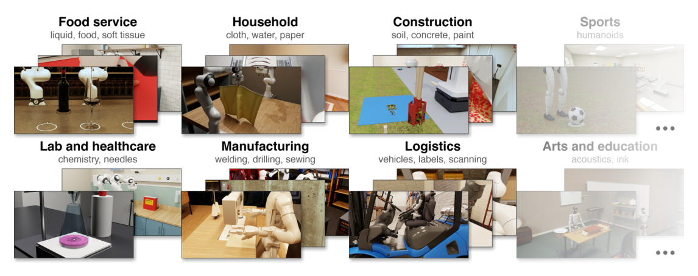
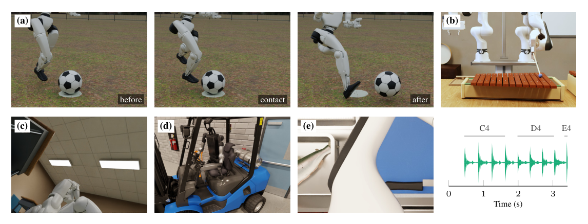

# GDP 데이터로 로봇 시뮬레이션을 자동 생산한다는 발상

이번 주 "Gym-Anything for Robotics"를 골랐습니다. 스코어는 0.33으로 수치상 높은 편은 아니지만, Imitation Learning과 RL을 수업에서 배운 뒤 VLA(Vision-Language-Action) 이후의 흐름을 처음 접하는 분들에게 "왜 요즘 로보틱스 연구가 시뮬레이션 생성 자체를 AI에게 맡기는가"를 보여주는 좋은 입구라고 판단했습니다. 특히 시뮬레이터의 특권 정보를 활용해 VLA를 학습시키는 구조는, 전통적인 Behavior Cloning이 왜 데이터 병목에 시달렸고 최근 연구들이 그 병목을 어떻게 우회하려 하는지를 한 편의 논문으로 압축해서 보여줍니다.

## 로봇 시뮬레이션은 왜 항상 손이 많이 가는 작업이었나

로봇을 실제 세계에서 학습시키는 건 비싸고 느리다. 로봇 팔 하나가 물건을 집었다 놓았다 하는 걸 수천 번 반복하려면 실제 시간이 그만큼 걸리고, 로봇이 망가지기도 하고, 사람이 옆에서 지켜봐야 한다. 그래서 RL(강화학습)이나 Imitation Learning(모방학습) 연구는 오래전부터 시뮬레이션을 대안으로 써왔다. 시뮬레이터 안에서는 로봇이 수백만 번 실패해도 비용이 거의 들지 않고, 속도도 실제 시간보다 훨씬 빠르게 돌릴 수 있다.

문제는 그 시뮬레이션 환경 자체를 만드는 일이 엄청난 수작업이라는 점이다. Meta-World, RLBench, ManiSkill 같은 기존 벤치마크들은 전문가들이 물리 엔진 파라미터를 하나하나 조정하고, 3D 모델을 배치하고, 보상 함수를 직접 코딩해서 만든 결과물이다. 그러다 보니 범위가 좁아진다. 물건을 집고 쌓는 식의 강체(rigid body) 조작은 많이 다루지만, 액체를 따르거나 천을 접거나 칼로 뭔가를 자르거나 접착제를 바르는 것처럼 물리적으로 훨씬 복잡한 현상은 거의 다뤄지지 않았다. 사람이 일일이 만들기엔 너무 품이 많이 들기 때문이다.

게다가 기존 벤치마크의 태스크 목록은 보통 연구자가 "이 정도면 흥미롭겠다" 싶어 임의로 고른 것들이다. 실제로 사람들이 돈을 받고 하는 노동이나 일상에서 반복하는 가사 활동과는 거리가 있다. 이 논문은 이 두 가지 한계, 즉 수작업의 한계와 현실 경제와의 괴리를 동시에 풀겠다고 나선다.

## 코딩 에이전트에게 시뮬레이션 제작을 통째로 맡긴다

이 논문의 핵심 아이디어는 단순하다. 시뮬레이션 환경과 태스크를 만드는 일을 "코딩 에이전트의 작업"으로 재정의하고, 그 과정을 네 단계로 쪼갠다.

첫 단계는 어떤 시뮬레이션을 만들지 고르는 작업이다. 미국 노동통계국(BLS)의 임금 데이터, O*NET 직업 데이터베이스, 생활시간조사(ATUS) 데이터를 LLM에게 먹여서 각 직업과 일상 활동을 "원자 단위 물리적 행동"으로 쪼갠다. 예컨대 "설거지"라는 활동은 "그릇 집기", "물 틀기", "문지르기" 같은 더 작은 물리 동작들로 분해된다. 이렇게 쪼갠 행동들에 경제적 가치(임금 총액이나 사람들이 그 활동에 쓰는 시간)로 가중치를 매기고, 가치가 높은 순으로 120개 행동 그룹을 뽑은 다음 그중 25개를 실제로 구현할 시뮬레이션으로 선정한다. 즉 "어떤 로봇 능력이 실제 경제에서 가장 자주, 가장 큰 가치로 쓰이는가"를 데이터로 정량화해서 우선순위를 매긴 것이다.

두 번째 단계가 가장 흥미로운 부분인데, 실제로 시뮬레이션 코드를 짜는 생성 에이전트와, 그 결과물을 검증하는 감사(audit) 에이전트들이 서로 싸운다. 생성 에이전트가 물리 솔버(유체, 천, 마찰, 화학 반응 등)를 포함한 3D 씬을 코딩하면, 현실성·동역학·실행속도·악용 가능성을 각각 담당하는 4개의 독립된 에이전트가 이를 검사한다. 특히 "악용 견고성"을 보는 에이전트는 일부러 로봇이 합법적인 동작만으로 시뮬레이터를 깨뜨릴 수 있는지 찾아낸다. 이건 기존 LLM 기반 시뮬레이션 생성 연구들이 갖고 있던 약점, 즉 벽을 통과하거나 물체가 순간이동하는 식의 물리 오류, 보상을 속이는 치팅을 사람이 뒤늦게 발견하던 문제를 자동화된 적대적 루프로 미리 잡아내려는 시도다.

세 번째 단계는 태스크와 보상 함수 설계다. 여기도 6개의 감사 에이전트가 붙어서 태스크가 실제로 풀 수 있는지, 보상이 제대로 설계됐는지, 난이도가 적절히 분산됐는지를 검증한다. 이 과정을 거쳐 최종적으로 25개 시뮬레이션에 걸쳐 200개의 RL 환경(RoboWorld)이 만들어진다.

## 시뮬레이터만의 특권을 어떻게 VLA에게 전달하는가

네 번째 단계가 이 논문에서 Imitation Learning을 배운 사람에게 가장 흥미로운 지점이다. 시뮬레이터 안에서는 실제 로봇이라면 절대 알 수 없는 정보, 이를테면 물체의 정확한 질량이나 마찰 계수, 액체 입자 하나하나의 위치 같은 "특권 상태(Privileged State)"에 완전히 접근할 수 있다. 이 논문은 이 특권 정보를 활용해 세 가지 방식으로 학습을 돕는다.

첫째는 인컨텍스트 학습이다. 같은 초기 상태로 반복 리셋하면서 LLM 에이전트가 이전 실패를 스스로 분석하고 점점 나아지게 한다. 둘째는 코칭 구조인데, 특권 상태를 보는 교사 에이전트가 제한된 시각 정보만 보는 학생에게 좌표나 수치 같은 구체적 명령이 아니라 "조금 더 왼쪽으로" 같은 정성적인 언어 힌트만 준다. 이건 수업에서 배운 DAgger와 문제의식이 닮아 있다. DAgger는 정책이 분포를 벗어났을 때 전문가가 다시 정답 행동을 라벨링해 학습 데이터를 보강하는 방식인데, 여기서는 전문가가 매 스텝 정답을 주는 대신 느슨한 언어 힌트만 준다는 점에서 더 약한 감독 신호로 비슷한 문제를 풀려는 변형이라 볼 수 있다.

셋째가 실제로 VLA를 학습시키는 방법이다. 특권 상태를 활용해 파이썬으로 "정답에 가까운" 제어 코드(코드 정책)를 작성하고, 이 코드를 수천 개의 환경 변형에서 자동 실행해서 궤적 데이터를 대량으로 뽑는다. 이렇게 모은 데이터로 카메라 영상과 관절 감각 정보만 보는 $$\pi_{0.5}$$ 모델을 파인튜닝한다. 이건 결국 Behavior Cloning이다. 다만 사람이 teleoperation으로 시연을 만드는 대신, 시뮬레이터의 치트키 같은 정보를 이용해 코드가 시연을 대량 생산한다는 점이 다르다. BC의 알고리즘 자체를 바꾼 게 아니라, BC가 늘 목말라했던 "질 좋은 시연 데이터"를 시뮬레이션 스케일링으로 해결하려는 시도인 셈이다.

결과는 꽤 인상적이다. 선물 상자를 조작하는 태스크에서 아무 훈련도 안 된 기본 $$\pi_{0.5}$$는 성공률 0%였지만, 코드 정책이 만든 1,000개의 시연으로 파인튜닝한 뒤에는 성공률이 53%까지 뛰었고, 처음 보는 씬 변형에서도 55%를 기록했다. 매 스텝 직접 제어하는 Claude Opus 5.5가 기록한 60%에 근접하면서도 속도는 14배 더 빨랐다. 시뮬레이션 안에서 교사의 힌트를 받은 학생 모델도 첫 시도부터 힌트 없이 혼자 하는 모델보다 훨씬 높은 보상(0.31 대 0.22)을 기록했다.

## 어디까지가 "자원으로 밀어붙이기"인가

이 논문의 전략을 한마디로 요약하면 "돈과 컴퓨트를 쏟아부어서 데이터 부족 문제를 정면으로 뚫는다"이다. GDP 통계부터 노동 데이터까지 끌어와서 경제적 가치를 계산하고, Claude Opus 5.5 같은 프론티어 LLM을 생성자와 감사자로 동시에 돌리는 건 결코 적은 비용이 아니다. 그리고 이 방식이 가능한 이유는 결국 시뮬레이터 안이기 때문에 특권 상태에 자유롭게 접근할 수 있다는 전제 위에 서 있다. 만약 재난 구조 로봇처럼 현실 자체를 시뮬레이터로 충실히 재현하기 어려운 영역이라면, 이 특권 상태라는 치트키 자체가 성립하지 않는다.

또 하나 짚을 점은, 이 논문이 로봇 하드웨어를 1축 암, 양팔 로봇, 휴머노이드까지 바꿔가며 지원하긴 하지만, embodiment(로봇의 물리적 형태)마다 특권 상태 기반 코드 정책을 따로 작성해야 한다는 점이다. 즉 하나의 embodiment에 종속되지 않는 표현을 학습해서 디코더만 바꿔 여러 로봇에 이식하는 방향과는 다르다. 오히려 각 embodiment별 비용 문제를 "그냥 자원을 더 투입해서" 해결하는 쪽에 가깝다.

## 용어 해설

- **Behavior Cloning**: 전문가의 시연 데이터(상태와 행동 쌍)를 지도학습으로 그대로 모방하도록 정책을 학습시키는 가장 기본적인 모방학습 방법.
- **DAgger (Dataset Aggregation)**: Behavior Cloning이 학습 데이터 분포를 벗어난 상황에서 실패하는 문제를 보완하기 위해, 학습된 정책이 직접 탐색하며 만난 상태에 전문가가 다시 정답 행동을 라벨링해 데이터셋을 반복적으로 보강하는 기법.
- **VLA (Vision-Language-Action model)**: 카메라 영상과 언어 지시를 입력으로 받아 로봇의 행동(관절 토크나 엔드이펙터 위치 등)을 직접 출력하도록 학습된 통합 모델.
- **고유감각 (Proprioception)**: 로봇이나 생물이 외부 센서(카메라 등) 없이 자신의 관절 각도, 속도 등 내부 상태를 스스로 감지하는 정보.

## 🤖 AI의 생각

이 논문은 데이터 생성 파이프라인 전체를 에이전트화했다는 점에서 인상적이지만, 동시에 "결국 비용을 많이 들이면 해결된다"는 방향성의 한계도 함께 보여준다고 생각한다.

적대적 감사 에이전트가 찾아내지 못하는 물리 오류는 여전히 남아있지 않을까

감사 에이전트도 결국 LLM이 설계한 검증 기준에 의존하므로, 애초에 LLM이 상상하지 못한 종류의 물리 현상(예: 특이한 재질 조합)에서는 오류를 걸러내지 못할 가능성이 있다.

특권 상태 기반 코드 정책으로 만든 시연 데이터가 실제 teleoperation 데이터와 비교했을 때 분포의 다양성이 떨어지지는 않을까

코드 정책은 결국 "가장 효율적인 경로"를 짜는 경향이 있어서, 사람이 시연할 때 생기는 자연스러운 비효율성이나 다양한 접근 방식이 줄어들어 VLA가 좁은 전략만 배울 위험이 있다고 본다.

taskcraft가 추구하는 embodiment-agnostic latent 방향과 이 논문의 embodiment별 코드 정책 방향을 절충할 방법은 없을까

여러 embodiment에서 생성된 코드 정책 시연 데이터를 공통 latent로 먼저 인코딩한 뒤 디코더만 embodiment별로 분리하는 식으로 두 전략을 결합해볼 수 있을 것 같다.

참고문헌

원문<a href="https://arxiv.org/abs/2610.40565v1" target="_blank" rel="noopener">Gym-Anything for Robotics: Scaling physical simulations with digital agents</a> · arxiv

