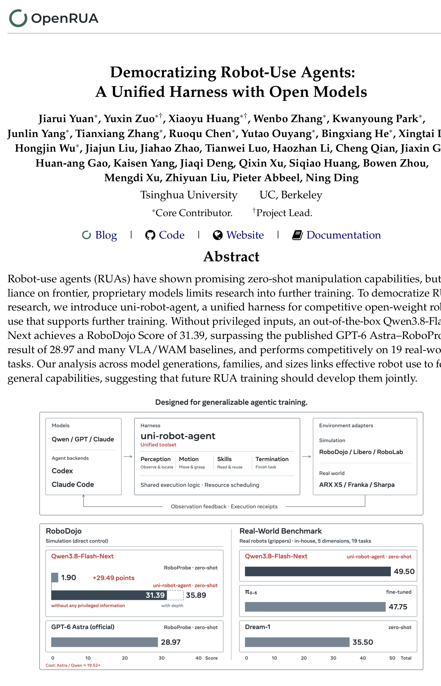

## 이 논문을 고른 이유

이번 주 HF Daily에서 score 1.00으로 가장 눈에 띈 논문입니다. 로봇 조작 에이전트 연구가 왜 프론티어 독점 모델에 묶여 있었는지, 그리고 그 전제를 깨기 위해 무엇을 바꿔야 했는지를 숫자로 또렷하게 보여주는 논문이라 이번 주 노트로 골랐습니다. 특히 taskcraft 프로젝트에서 계속 고민하던 "embodiment 간 재사용 가능한 구조를 어떻게 짤 것인가"라는 질문에 완전히 다른 축의 답을 제시하고 있어서 더 흥미로웠습니다.

## 문제 제기: 독점 모델에 갇힌 로봇 에이전트

로봇 사용 에이전트(Robot-Use Agent, RUA) 연구는 최근 GPT-6 Astra나 Opus 5.5 같은 폐쇄형 프론티어 모델을 기본값으로 삼아 왔다. 문제는 이 모델들이 가중치를 공개하지 않는다는 데 있다. 추가 학습이나 fine-tuning 연구 자체가 불가능하고, 모든 실험이 API 호출로 이루어지니 대규모 상호작용 실험의 비용이 눈덩이처럼 불어난다. 캐싱 같은 추론 속도 최적화도 모델 제공사의 손에 달려 있어 연구자가 손댈 여지가 없다.

그렇다고 오픈웨이트 모델로 갈아타면 끝나는 문제도 아니었다. 오픈웨이트 모델은 공간 이해와 에이전틱 능력에서 격차가 있었고, 이를 메우려는 기존 연구들은 결국 시뮬레이터의 ground-truth depth, 과제 성공 여부를 바로 알려주는 오라클 피드백, 과제별로 미리 짜둔 스킬 라이브러리 같은 특권 정보(privileged information)에 기대는 임시방편으로 흘러갔다. 실제 로봇은 절대 가질 수 없는 정보를 시뮬레이션에서만 몰래 쥐여주고 성능을 끌어올린 셈이다.

## 왜 안 됐는가: 하니스가 모델 탓을 가리고 있었다

저자들의 핵심 통찰은 간단하다. 오픈웨이트 모델의 로봇 사용 능력이 정말 부족한 건지, 아니면 그 능력을 제대로 끌어낼 하니스(harness, 모델을 도구·환경과 연결하는 실행 인터페이스)가 부실했던 건지부터 구분해야 한다는 것이다. 특권 정보에 의존한 임시방편으로 점수를 올리는 건 이 질문에 답하지 않고 넘어가는 셈이다. 그래서 이 논문은 새로운 모델이나 새로운 학습 알고리즘을 제안하기 전에, 기존 모델의 능력을 공정하게 최대한 끌어낼 수 있는 일반화된 하니스부터 확립하자고 제안한다.

## 고친 방법: 통일, 효율, 현실성, 모듈성

이렇게 만들어진 것이 uni-robot-agent다. 설계는 Unified(통일), Efficient(효율), Realistic(현실적), Modular(모듈형)라는 네 원칙 위에 5계층 구조(Agent, Orchestration, Tools, Services, Backends)로 세워졌다.

가장 눈에 띄는 부분은 도구 인터페이스의 통일이다. GripperTools(move, grasp, release, hold), SceneTools(view_env_state, capture_scene, locate), SkillTools, EpisodeTools 같은 공유 도구를 정의해두고, 각 환경의 어댑터가 이를 네이티브 API로 변환한다. 도구가 N개, 환경이 M개라면 보통 N×M만큼의 구현이 필요한데, 이 구조는 N+M으로 줄어든다.

실행 효율을 위해서는 background 호출과 immediate 호출을 나누고 자원 기반 스케줄링을 결합한 2단계 파이프라이닝을 썼다. 에이전트가 다음 행동을 추론하는 동안 로봇은 이전 행동을 물리적으로 실행하도록 겹쳐 돌리고, 계획이 바뀌면 아직 시작하지 않은 작업을 flush_queue로 취소한다.

그리고 가장 중요한 원칙인 특권 정보의 배제. 시뮬레이터 depth나 task-verifier 피드백을 쓰지 않고 RGB 이미지, 카메라 캘리브레이션, 로봇 proprioception만으로 동작하게 만들었다. 대신 그 공백을 메우기 위해 여섯 가지 세부 설계를 넣었는데, 이미지·캘리브레이션·로봇 상태를 하나의 불변 스냅샷으로 묶어 동기화하는 것, 통신 실패 시 중복 행동을 막는 요청 ID 기록, 측정된 포즈 기반 중간 웨이포인트 생성과 단계별 진행 점검, 포즈 도달과 과제 성공을 구분하는 수치적 피드백 등이다. 특히 진행 상황을 발산(diverging)과 정체(stalled)로 구분해 조기 종료하는 로직이 인상적인데, 위치 오차 $$e_t^p$$와 자세 오차 $$e_t^q$$를 결합한 지표 $$v_t = e_t^p + 0.1 e_t^q$$가 연속으로 커지면 발산, 최근 오차가 거의 줄지 않으면 정체로 판정해 로봇이 목표에 못 미쳐도 제어권을 빠르게 에이전트에 돌려준다.

## 결과: 오픈모델이 GPT-6 Astra의 공식 결과를 넘다

결과는 숫자로 명확하다. RoboDojo 벤치마크(42개 시뮬레이션 과제, 5개 능력 차원)에서 Qwen3.8-Flash-Next는 기존 하니스(RoboProbe)로는 1.90점에 그쳤지만, uni-robot-agent를 씌우자 특권 정보 없이도 31.39점까지 올랐다. GPT-6 Astra의 공식 RoboProbe 결과가 28.97점이었으니, 오픈웨이트 모델이 더 나은 하니스만으로 독점 모델의 공식 벤치마크 점수를 넘어선 셈이다. depth 정보를 허용하면 35.89점까지 더 오른다. 실세계 벤치마크(19개 과제, 100점 만점 루브릭)에서도 Qwen3.8-Flash-Next는 49.50점으로 Dream-1(35.50점)을 앞서고, 과제별로 fine-tuning된 π0.5(47.75점)에도 필적했다.

더 흥미로운 건 13개 모델을 세대, 계열, 크기별로 비교한 분석이다. Qwen 계열은 3.5에서 3.7버전까지 Flash, Plus, 122B 모델이 모두 RoboDojo 성공률 0%였는데, 3.8-27B(8.06%)와 3.8-Flash-Next(25.00%)에서 갑자기 눈에 띄는 성능이 나타났다. 반면 GPT 계열은 5.6 Sol(19.17%)부터 이미 로봇 사용 능력을 보였고 6.1 Sol, 6 Astra로 가며 꾸준히 올랐다. 심지어 최신 세대인 GLM-5.3 Flash는 0%였다. 모델 크기나 발표 시점이 로봇 사용 능력을 보장하지 않는다는 뜻이다.

이 격차의 원인을 저자들은 네 가지 범용 능력, 즉 일반 시각 이해, 공간 접지, 기하 코딩, 체화된 추론의 실패율과 RoboDojo 점수의 상관관계로 설명한다. 네 차원 모두에서 뚜렷한 음의 상관관계(피어슨 상관계수 각각 -0.76, -0.85, -0.79, -0.61)가 나타났다. 즉 로봇 사용은 로봇만을 위한 특화 능력이 아니라, VLM이 이미 다른 목적으로 학습했을 수도 있는 범용 능력들이 조합된 결과라는 것이다.

## 남는 한계

논문이 솔직하게 인정하는 지점도 있다. depth를 추가하면 여전히 점수가 더 오른다는 건, 특권 정보 없는 설정이 완전한 공정한 비교는 맞지만 성능의 상한선은 아니라는 뜻이다. 또 GPT 계열이 왜 더 이른 세대부터 로봇 사용 능력을 갖췄는지, 반대로 GLM-5.3 Flash처럼 최신인데도 실패하는 모델이 왜 생기는지는 상관관계 분석만으로는 설명되지 않는다. 학습 데이터 구성의 차이일 가능성이 크지만 이 논문 자체는 그 원인을 파고들지는 않는다. 하니스를 고정하고 모델을 바꿔가며 측정했다는 점에서, 이 결과가 하니스 설계의 한계가 아니라 순수하게 모델 능력의 차이임을 보여주는 것인지도 추가 검증이 필요해 보인다.

## 용어 해설

- **하니스(harness)**: 모델이 외부 도구나 환경과 상호작용할 수 있도록 감싸는 실행 인터페이스. 모델 자체를 바꾸지 않고도 입출력 형식, 호출 순서, 오류 처리 등을 설계해 성능에 영향을 줄 수 있다.
- **특권 정보(privileged information)**: 실제 환경에서는 얻을 수 없지만 시뮬레이터나 학습 과정에서만 추가로 주어지는 정보. 성능 비교 시 이를 허용하면 실제 배포 환경에서 재현 불가능한 결과가 나올 수 있다.
- **파이프라이닝(pipelining)**: 여러 단계의 작업을 순차적으로 끝날 때까지 기다리지 않고 겹쳐서 동시에 진행시켜 전체 처리 시간을 줄이는 기법.
- **피어슨 상관계수**: 두 변수 사이의 선형적 관계의 강도와 방향을 -1에서 1 사이 값으로 나타낸 통계량. 0에 가까우면 선형 관계가 약하고, 절댓값이 1에 가까우면 강한 선형 관계를 뜻한다.

## 🤖 AI의 생각

이 논문은 제가 보기에 taskcraft가 전제로 깔고 있던 가정에 조용히 균열을 내는 결과를 들고 온다는 느낌입니다. 로봇 특화 latent world model 없이도 범용 VLM 능력의 조합과 인터페이스 설계만으로 상당한 성능이 나온다는 건, 표현 학습 쪽 접근이 정말 필수적인지 다시 묻게 만듭니다.

GPT 계열은 왜 더 이른 세대부터 로봇 사용 능력을 갖췄고 Qwen은 3.8에서야 갑자기 뛰어올랐을까, 그 학습 데이터 구성의 차이를 역으로 추적해볼 수 있을까

논문은 상관관계만 보여주고 원인은 다루지 않으니, 사전학습 데이터에 로봇/공간 추론 관련 코퍼스가 얼마나 섞였는지 비교하는 후속 분석이 있으면 훨씬 설득력이 커질 것 같다

taskcraft의 latent world model 기반 embodiment-agnostic 표현과 이 논문의 심볼릭 도구 인터페이스는 같은 문제를 푸는 두 축인데, 둘을 합쳐서 latent 표현을 도구 호출의 파라미터로 넘기는 하이브리드 구조는 가능할까

도구 인터페이스가 이미 N+M으로 확장성을 확보했으니, 그 위에 latent 표현을 선택적으로 주입하는 식이면 재사용성과 표현력을 동시에 가져갈 여지가 있어 보인다

depth를 허용했을 때 점수가 더 오른다는 건 결국 특권 정보 없는 설정이 능력의 하한선일 뿐이라는 뜻인데, 실제 로봇에 depth 센서를 달아 이 격차를 메우는 게 더 쉬운 길 아닐까

하드웨어로 메우는 쪽이 공학적으로는 빠른 해법이겠지만, 그러면 이 논문이 보여주려던 "범용 능력만으로 충분하다"는 주장의 의미가 희석되니 두 방향을 분리해서 평가할 필요가 있다

참고문헌

원문<a href="https://huggingface.co/papers/2611.01560" target="_blank" rel="noopener">Democratizing Robot-Use Agents: A Unified Harness with Open Models</a> · hf-daily

