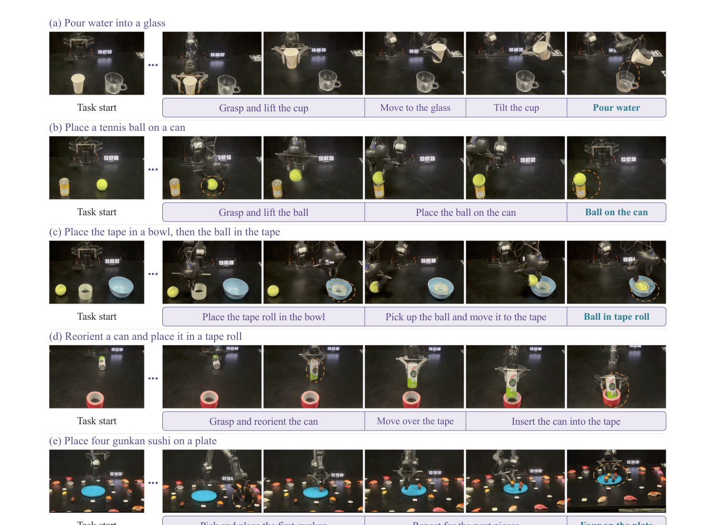
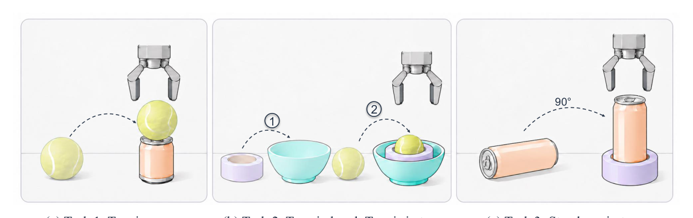

## 들어가며

이번 주는 "From Pixels to Actions: Towards Native Vision-Language-Action Policies"를 골랐습니다. 스코어링 기준으로는 0.33점(arXiv 출처)으로 그리 높은 점수는 아니었지만, 최근 VLA 연구들이 대부분 비전 인코더와 언어 백본을 분리한 구조를 당연하게 깔고 가는 와중에 이 논문은 그 전제 자체를 의심한다는 점에서 기초 개념을 짚기에 좋은 소재라고 판단했습니다. Imitation Learning이나 RL은 수업에서 배웠지만 VLA는 처음이라는 독자분들을 염두에 두고, 이 논문이 어떤 가정을 깨려고 했는지부터 차근히 풀어보겠습니다.

VLA(Vision-Language-Action)는 말 그대로 이미지를 보고 언어로 지시를 받아 로봇의 액션을 출력하는 모델이다. Imitation Learning 수업에서 다뤘던 Behavior Cloning의 연장선인데, 다른 점은 입력이 단순한 저차원 상태 벡터가 아니라 카메라 이미지와 자연어 지시문이라는 것, 그리고 그 둘을 다루는 백본이 대규모 사전학습된 Vision-Language Model(VLM)이라는 것이다. OpenVLA나 $$\pi_0$$ 같은 최근 모델들은 이미지를 직접 다루지 않고, 먼저 CLIP이나 SigLIP, DINOv2 같은 이미 학습된 비전 인코더에 통과시켜 압축된 벡터로 바꾼 다음 그 벡터만 언어 백본에 넣는다. 이렇게 하면 비전 인코더가 이미 인터넷 규모 데이터로 "사물이 뭔지" 배워놓은 지식을 그대로 재사용할 수 있어서 효율적이다.

## 비전 인코더는 왜 당연해 보였나

이 구조가 널리 쓰인 이유는 단순하다. 로봇 데이터는 인터넷에 떠도는 이미지 데이터에 비해 압도적으로 적다. 그러니 적은 로봇 데이터로 비전을 처음부터 다시 배우게 하는 것보다, 이미 수억 장의 이미지로 학습된 인코더를 가져다 쓰는 쪽이 합리적이다. 이 인코더는 이미지를 하나의 고정된 벡터(또는 벡터 시퀀스)로 압축해서 내보내고, 언어 백본은 그 압축된 결과만 받아서 언어 지시와 결합한 뒤 액션을 생성한다. 요약하면 "비전은 비전 전문가에게, 언어와 액션 결합은 언어 전문가에게" 맡기는 분업 구조다.

## 그런데 왜 문제가 되는가: 고정된 시각 엔드포인트

문제는 조작(manipulation) 작업이 요구하는 시각 정보의 성격이다. 물체가 "컵이다"라는 의미론적 인식은 중요하지만, 그 컵을 집기 위해서는 컵 손잡이의 정확한 위치, 테이블과의 거리, 그리퍼가 닿는 각도 같은 저수준의 공간 정보가 더 결정적이다. 그런데 CLIP류 인코더는 애초에 "이 이미지가 어떤 개념에 해당하는가"를 맞추도록 학습된 모델이라, 최종 출력 벡터로 갈수록 의미는 보존되지만 정밀한 공간 좌표나 경계 정보는 깎여나간다. 더 큰 문제는 구조적인 것인데, 언어 백본은 인코더가 내보낸 "최종 결과물" 딱 하나만 받아볼 수 있을 뿐, 인코더 내부에서 이미지가 저수준 특징에서 고수준 의미로 변환되어가는 중간 과정에는 전혀 접근할 수 없다. 저자들은 이걸 고정된 시각 엔드포인트(fixed visual endpoint)라고 부른다. 정책이 볼 수 있는 시야가 애초에 인코더의 마지막 레이어로 제한되어 있다는 뜻이다.

## 고친 방법: 인코더를 없애고 백본이 직접 보게 하라

이 논문의 해법은 꽤 과감하다. 별도의 비전 인코더를 아예 없애버린다. 대신 2단계의 합성곱 패치 임베더(stride 32짜리 간단한 레이어)로 원본 픽셀을 바로 잘게 쪼개서, 40개 레이어 2B 파라미터 규모의 단일 비전 언어 백본 안으로 밀어 넣는다. 이렇게 되면 시각 토큰과 언어 토큰이 처음부터 같은 공간 안에서 함께 어텐션을 주고받으며 진화한다. 이때 위치 정보를 다루기 위해 3D RoPE(시간, 높이, 너비 세 축에 대한 회전 위치 인코딩)를 쓰고, 시각 토큰끼리는 양방향 어텐션을 허용한다.

아래 표는 이 논문이 비교하는 세 가지 구조를 정리한 것이다.

| 구조 | 비전 처리 | 액션 출력 방식 |
|---|---|---|
| RT-2 스타일 | 사전학습 비전 인코더 | 이산 토큰 |
| $$\pi_0$$ 스타일 | 사전학습 비전 인코더 | 연속 Flow Matching |
| 이 논문(NEO-VLA) | 인코더 없이 픽셀 직접 투영 | 연속 Flow Matching, 멀티레이어 참조 |

핵심은 두 번째 열이다. 액션 생성 방식 자체는 $$\pi_0$$와 크게 다르지 않은 Flow Matching을 그대로 쓴다. Flow Matching은 Diffusion 계열 모델처럼 노이즈에서 출발해서 점진적으로 타깃 분포(여기서는 실제 로봇 액션)로 변환해가는 연속적인 경로를 학습하는 방식이다. 구체적으로는 실제 액션 $$a$$와 가우시안 노이즈 $$\epsilon$$을 $$a_{\tau} = (1-\tau)\epsilon + \tau a$$ 식으로 선형 보간하고, 모델은 이 경로를 따라가는 속도장을 예측하도록 학습된다. 이 논문이 다르게 가져가는 부분은 이 속도장을 예측할 때 "무엇을 보고" 예측하느냐다.

## 액션 전문가는 어느 깊이를 봐야 하는가

기존 모델은 액션 헤드가 백본의 마지막 레이어 출력 하나만 참조한다. 이 논문은 대신 별도의 경량 액션 전문가를 붙여서, 백본의 여러 레이어에서 캐시된 Key와 Value를 동시에 교차 참조하도록 설계했다. 어느 레이어를 참조하게 할지는 설정 가능한 레이어 맵으로 정한다.

그렇다면 실제로 어느 깊이의 정보가 조작에 중요할까. 저자들은 개입(intervention) 실험으로 이를 검증했다.

특정 레이어의 Key, Value를 다른 관측 데이터의 것으로 바꿔치기(swap)하고 액션 예측이 얼마나 틀어지는지 측정했는데, 0번부터 10번 사이의 초기 레이어를 바꿨을 때 병진 이동 오차가 가장 크게 튀었다. 반면 똑같은 크기의 무작위 노이즈를 주입했을 때는 오차가 거의 변하지 않았다. 이건 단순히 "레이어를 건드리면 다 망가진다"는 민감도 문제가 아니라, 초기 레이어에 조작에 꼭 필요한 저수준 공간 정보가 실제로 몰려 있다는 뜻이다. 인코더를 쓰는 기존 구조에서는 이 초기 단계의 정보에 애초에 접근할 방법이 없었다는 걸 생각하면, 왜 인코더를 없애는 선택을 했는지가 납득이 간다.

## 부작용: VLM이 바보가 된다

여기까지만 보면 깔끔한 개선처럼 보이지만, 저자들은 이 구조를 로봇 액션 데이터로만 전면 미세조정했을 때 생긴 부작용도 솔직하게 보고한다. 원래 범용 VLM이 가지고 있던 시각 언어 추론 능력이 액션 전용 데이터로 학습을 계속하면서 붕괴된 것이다. 그 결과 도메인을 무작위화한 평가 환경(RoboTwin C2R)에서 성공률이 10.7%까지 떨어졌다. 로봇 데이터만 계속 보여주다 보니 일반적인 이미지 이해 능력을 잊어버리는, 전형적인 망각 문제가 일어난 셈이다.

해법은 비교적 단순하다. 범용 멀티모달 이해 데이터를 액션 데이터와 번갈아가며 공동 학습(co-training)시키고, 이해 데이터 쪽 손실에는 0.1이라는 작은 가중치를 줬다. 이렇게 하자 성공률이 69.4%까지 회복됐다. 구조를 바꾼 것 자체보다, 그 구조를 유지하면서 범용 능력을 잃지 않게 하는 이 처방이 실제로는 더 공들인 부분처럼 보인다.

## 결과와 한계

정리하면 이 논문은 비전 인코더를 없애고 픽셀을 직접 백본에 넣는 구조적 변화, 그리고 액션 전문가가 백본의 여러 깊이를 동시에 참조하게 하는 변화, 이 두 가지를 통해 조작에 필요한 저수준 공간 정보를 복원했다. 다만 이 접근은 처음부터 비전과 언어를 통합 학습할 수 있는 대규모 백본(2B 파라미터)이 전제되어야 하고, 사전학습된 인코더가 주는 지식 재사용의 이점을 포기하는 대가로 더 많은 멀티모달 공동 학습 데이터와 계산 자원을 요구한다. 또한 이 논문이 검증한 환경은 특정 로봇 팔 하나에 국한되어 있어서, 레이어별 정보 분포가 다른 embodiment에서도 똑같이 성립하는지는 이 논문만으로는 알 수 없다.

## taskcraft와의 접점

이 논문은 하나의 로봇 팔이라는 단일 embodiment 안에서 픽셀, 언어, 액션을 더 밀접하게 통합하려는 연구라서, 서로 다른 embodiment 사이에 표현을 이식하는 문제를 다루는 taskcraft의 핵심 질문과 직접 맞닿아 있지는 않다. 다만 흥미로운 접점이 하나 있다. 백본의 초기 레이어(0~10번)에는 저수준 기하·공간 정보가, 더 깊은 레이어에는 추상화된 task 관련 정보가 분포한다는 걸 개입 실험으로 보여줬다는 점이다. 이는 taskcraft가 가정하는 "latent world model 안에서 embodiment에 덜 종속적인 표현과 embodiment에 종속적인 저수준 제어 표현이 깊이별로 분리되어 존재할 수 있다"는 직관에 간접적인 근거가 될 수 있다. 이 논문이 쓴 레이어별 swap 개입 실험 방법론 자체는, taskcraft가 latent world model에서 embodiment-agnostic한 부분을 식별하려 할 때 참고할 만한 실험 설계 아이디어다.

## 용어 해설

- **RoPE(Rotary Positional Embedding)**: Transformer가 토큰의 순서나 공간적 위치를 인식하도록, 벡터를 회전시키는 방식으로 위치 정보를 주입하는 기법이다. 이 논문처럼 시간, 높이, 너비 같은 여러 축이 있을 때는 이를 3차원으로 확장해 쓴다.
- **Key, Value 캐시(KV 캐시)**: Transformer의 어텐션 연산에서 각 레이어가 만들어내는 Key와 Value 벡터를 저장해둔 것으로, 다른 모듈이 이를 다시 계산하지 않고 재사용해 참조할 수 있게 해준다.
- **Catastrophic Forgetting(파국적 망각)**: 모델이 새로운 데이터나 task로 추가 학습을 하는 과정에서, 이전에 학습했던 지식이나 능력을 잃어버리는 현상을 말한다.
- **Co-training(공동 학습)**: 서로 다른 목적의 데이터셋(여기서는 로봇 액션 데이터와 범용 멀티모달 이해 데이터)을 하나의 모델에 번갈아 또는 동시에 학습시켜, 한쪽 능력을 키우면서 다른 쪽 능력이 퇴화하지 않게 하는 학습 전략이다.

## 🤖 AI의 생각

개인적인 의견을 덧붙이자면, 이 논문이 흥미로운 지점은 구조 변경 자체보다 그 구조 변경이 드러낸 부작용과 그걸 고친 방식에 있다고 생각한다. 비전 인코더를 없앤다는 아이디어는 직관적이지만, 그 대가로 생기는 망각 문제를 작은 가중치의 co-training으로 해결했다는 처방이 오히려 더 실용적인 기여처럼 보인다.

레이어별로 저수준 공간 정보와 고수준 의미 정보가 나뉘어 있다는 결과가 다른 embodiment나 다른 백본 크기에서도 재현될까

이 논문은 단일 로봇 팔, 단일 백본 크기로만 검증했기 때문에 레이어 깊이와 정보 종류의 대응 관계가 백본 크기나 embodiment에 따라 달라질 가능성은 열려 있다.

co-training 가중치 0.1이라는 값은 어떻게 정해졌을까, 더 체계적인 스케줄링으로 망각 문제를 아예 막을 수 있을까

논문에서 이 값이 하이퍼파라미터 탐색의 결과인지 경험적 선택인지 명확히 드러나지 않아서, 망각과 성능 사이의 트레이드오프 곡선을 더 촘촘히 그려보면 흥미로운 분석이 될 것 같다.

taskcraft에서 latent world model의 어느 깊이가 embodiment-agnostic한지 식별할 때 이 논문의 레이어 swap 개입 실험을 그대로 적용할 수 있을까

이 논문은 같은 embodiment 내에서 레이어를 바꿔치기했지만 taskcraft는 서로 다른 embodiment 사이의 비교가 필요하므로, 비교 대상을 다른 로봇의 같은 깊이 표현으로 바꿔 swap하는 식의 변형 실험을 설계해볼 수 있다.

참고문헌

원문<a href="https://arxiv.org/abs/2611.06918v1" target="_blank" rel="noopener">From Pixels to Actions - Towards Native Vision-Language-Action Policies</a> · arxiv

