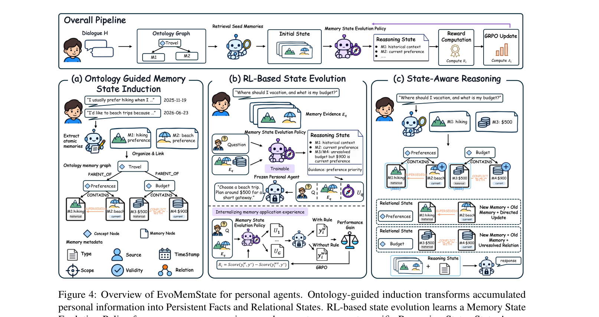
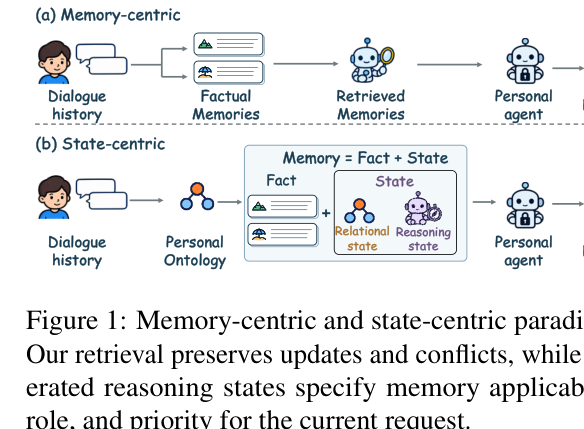

이번 주는 개인화 AI 에이전트의 장기 기억 설계를 다루는 EvoMemState를 골랐습니다. HF Daily 소스에서 스코어 0.83으로 상위권에 올라온 논문인데, 단순히 "기억을 더 잘 검색하자"는 엔지니어링 논문이 아니라 "기억이라는 표현 자체를 어떻게 구조화해야 하는가"라는 근본적인 질문을 던지고 있어서 이번 주 노트로 선택했습니다.

개인화 에이전트가 오래 대화를 나누다 보면 사용자에 대한 정보가 계속 쌓인다. 지난달엔 하이킹을 좋아한다고 했다가 이번 달엔 해변이 더 좋다고 말하는 식으로, 같은 사람에 대한 사실이 시간이 지나며 바뀌거나 서로 충돌하는 일이 흔하다. 기존 장기 기억 시스템들(MemoryBank, Mem0, A-MEM, LightMem, Supermemory 등)은 이런 상황에서 각 발화를 독립된 사실 레코드로 추출해서 저장하고, 필요할 때 유사도 검색으로 꺼내 쓰는 fact-centric 방식을 쓴다. 문제는 "하이킹을 좋아한다"와 "해변이 더 좋다"를 각각 별도 레코드로만 저장하면, 둘 중 뭐가 최신 선호인지, 혹은 둘이 충돌하는 건지 보완하는 건지에 대한 정보가 통째로 사라진다는 점이다.

저자들은 이 문제를 추측이 아니라 직접 측정했다. 다섯 개 기존 시스템에 대해 "이 질문에 답하는 데 필요한 모든 증거를 검색해냈는가"를 체크해봤더니 MemoryBank, LightMem, Supermemory 모두 절반 이상의 질문에서 관련 기억을 빠뜨렸고, 완전하게 검색된 경우와 그렇지 않은 경우의 정답률 차이가 최대 33.3%p까지 벌어졌다. 검색이 불완전하면 당연히 답도 틀린다는 건 예상 가능한 결과다.

진짜 흥미로운 건 그다음 실험이다. 완전한 증거를 다 모아준 상태에서 self-reflection 같은 흔한 기법을 적용해봤더니, 오히려 평균 정확도가 50.5%에서 48.9%로 떨어졌다. 증거를 다 갖고 있어도 그걸 현재 질문에 맞게 적용하는 판단(이 정보가 지금도 유효한가, 어느 쪽을 우선해야 하는가)이 따로 필요하다는 뜻이다. 즉 메모리 시스템의 실패는 "검색 실패"와 "활용 실패"라는 서로 다른 두 종류로 나뉘는데, 기존 연구들은 대체로 전자에만 집중해왔다.

아래 그림이 이 두 가지 한계를 수치로 보여준다.

EvoMemState는 이 두 문제를 각각 다른 레이어로 분리해서 푼다. 먼저 사실 하나하나에 대해 Relational State라는 걸 따로 유지한다. 새 사실이 들어올 때마다 온톨로지(개념 노드와 사실 노드로 이루어진 그래프)를 순차적으로 갱신하면서, 어떤 사실이 다른 사실을 대체하는지(SUPERSEDES)와 서로 풀리지 않은 채 충돌하는지(CONFLICTS_WITH)를 명시적인 관계로 기록한다. 중요한 건 원본 사실을 덮어쓰지 않고 관계만 추가한다는 점이다. 하이킹 선호가 사라지는 게 아니라 "해변 선호로 대체됨"이라는 꼬리표가 붙는 식이다.

그 다음이 더 핵심인데, 요청마다 이 사실들과 관계를 어떻게 조합해서 쓸지를 정하는 Reasoning State를 강화학습으로 학습시킨다. 후보 Reasoning State를 만들어서 고정된 개인 에이전트에게 줬을 때 답변이 얼마나 좋아지는지를 보상으로 삼고, GRPO로 정책을 업데이트한다. 후보가 증거를 왜곡하거나 약화시키면 보상이 음수가 되어 패널티를 받는 구조다. self-reflection을 규칙 기반으로 고정해두는 대신, 어떤 기억을 어떤 역할로 얼마나 우선시할지를 경험으로부터 배우게 만든 것이다.

추론 시점에는 의미 유사도로 몇 개의 시드 사실을 검색한 뒤, 저장해둔 관계를 양방향으로 따라가며 관련된 갱신·충돌·제약 사실까지 함께 끌어온다. 하이킹 얘기만 검색됐어도 거기 연결된 "해변으로 대체됨" 관계를 타고 가서 최신 사실까지 자동으로 포함시키는 식이다. 이렇게 모은 증거로 학습된 정책이 Reasoning State를 생성하고, 이걸 원본 증거와 함께 에이전트에 넘겨 최종 응답을 만든다.

전체 흐름은 아래 그림에서 여행 계획 예시로 잘 드러난다. 예산이 $500에서 $900으로 바뀌고 선호가 하이킹에서 해변으로 바뀐 상황에서, 관계 기반으로 모은 증거와 학습된 추론 상태가 결합되어 "예산 $900선에서 짧은 해변 여행"처럼 과거 정보를 참고하되 최신 선호를 우선하는 응답이 나온다.

결과적으로 EvoMemState는 완전 검색률(Complete Retrieval Rate) 85.6%라는 높은 검색 완전성과 동시에, 완전 검색 상태에서의 정확도(Acc@complete)에서도 LoCoMo-Refined 70.8%, MemSyco 68.5%로 가장 높은 수치를 기록했다. 이 두 지표를 나눠서 측정한 게 이 논문의 영리한 점인데, 덕분에 "증거를 더 많이 모아서 좋아진 건지" 아니면 "모은 증거를 더 잘 쓴 건지"를 구분해서 보여줄 수 있었다. 저자들의 결론은 후자 쪽, 즉 학습된 Reasoning State의 기여가 더 크다는 쪽이다.

다만 이 논문이 완전히 다 해결한 건 아니다. 온톨로지를 사실 단위로 순차 갱신하는 방식은 대화가 길어질수록 그래프가 계속 커지고 갱신 비용도 늘어날 텐데, 이 비용에 대한 분석은 깊게 다뤄지지 않는다. 또 GRPO 보상이 고정된 개인 에이전트의 답변 품질 개선분으로 정의되는데, 그 에이전트 자체의 성능 상한에 따라 학습 가능한 정책의 품질도 간접적으로 제약될 수밖에 없다는 점은 짚고 넘어갈 만하다.

## 용어 해설

- **온톨로지(Ontology)**: 어떤 도메인에 속한 개념들과 그 개념들 사이의 관계를 구조적으로 정의한 체계로, 여기서는 사실 노드와 개념 노드, 그리고 둘 사이의 계층·관계 엣지로 이루어진 그래프를 가리킨다.
- **GRPO(Group Relative Policy Optimization)**: 여러 후보 출력을 한 그룹으로 샘플링해 그룹 내 상대적인 보상 순위로 정책을 업데이트하는 강화학습 알고리즘으로, 별도의 가치 함수 없이도 안정적인 학습이 가능하다는 장점이 있다.
- **KL Divergence(쿨백 라이블러 발산)**: 두 확률분포가 얼마나 다른지를 수치로 나타내는 척도로, 강화학습에서는 학습 중인 정책이 기준이 되는 참조 정책에서 너무 멀어지지 않도록 제약하는 데 흔히 쓰인다.

## 🤖 AI의 생각
이 논문은 로봇이나 embodiment 문제와는 거리가 멀어 보이지만, 곰곰이 보면 taskcraft가 고민하는 것과 구조적으로 닮은 지점이 하나 있다고 생각한다. "사실(fact)을 독립된 레코드로 저장하면 그 사실이 다른 사실과 맺는 관계, 즉 갱신되었는지 충돌하는지가 사라진다"는 이 논문의 문제의식은, taskcraft가 "행동을 신체에 직접 연결하면 그 행동이 세계 상태를 어떻게 바꿨는지에 대한 관계적 의미가 사라진다"고 말하는 것과 거의 같은 형태의 논증이다. 둘 다 원자적 표현(fact 하나, action 하나)만 저장하는 방식이 맥락을 날려버린다고 지적하고, 그 맥락을 별도의 관계 레이어(Relational State vs latent world model)로 명시적으로 떼어내려 한다는 점에서 구조가 비슷하다.

더 흥미로운 건 Reasoning State라는 개념이다. 이 논문은 "증거가 완전히 검색되어도 그걸 현재 요청에 맞게 어떻게 쓸지"는 별도로 학습되어야 한다는 걸 실험으로 보여주는데(Figure 3, self-reflection이 오히려 정확도를 낮춤), 이건 taskcraft 맥락으로 옮기면 "latent world model이 task representation을 완벽하게 뽑아내도, 그걸 특정 embodiment의 디코더(정책)가 어떻게 활용할지는 별도로 학습되어야 한다"는 가설과 평행하게 읽힌다. 즉 표현을 잘 뽑는 것과 그 표현을 상황별로 적절히 적용하는 것은 분리된 문제이고, 후자를 과소평가하면 안 된다는 교훈을 이 논문이 다른 도메인에서 꽤 설득력 있게 보여준 셈이다. taskcraft의 디코더 설계 단계에서 "latent가 좋아도 디코더가 그걸 상황에 맞게 쓰는 법을 따로 배워야 한다"는 가능성을 염두에 두게 만드는 참고 사례로 느껴진다. 다만 메모리와 로봇 제어는 평가 방식도 보상 구조도 완전히 달라서, 이 유사성이 방법론적으로 얼마나 실제 전이 가능한 통찰인지는 의문이 남는다.

참고문헌

원문<a href="https://huggingface.co/papers/2611.03743" target="_blank" rel="noopener">EvoMemState: Evolving Memory State for Personal Agents</a> · hf-daily

