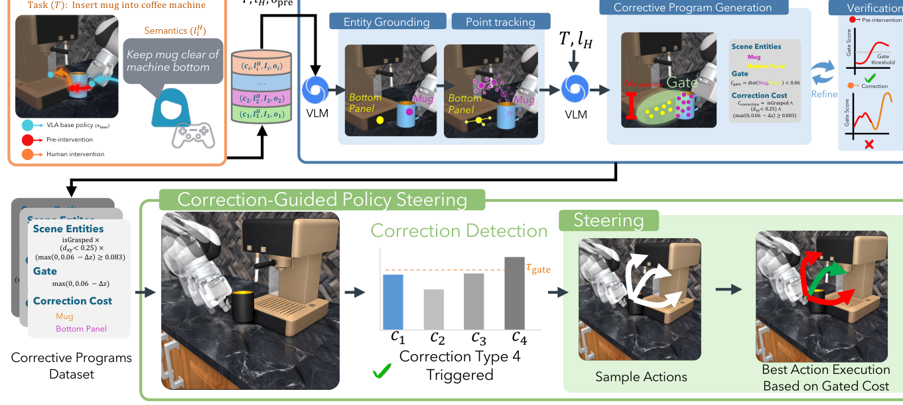
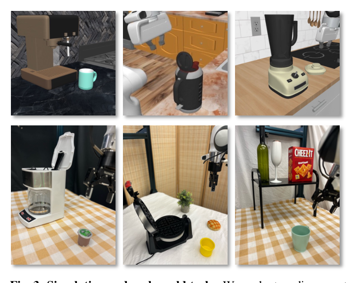

이번 주에 고른 논문은 OopsieRecover입니다. 자동 스코어링 점수로는 0.33으로 특별히 높은 편은 아닙니다만, 이 주제를 고른 이유는 따로 있습니다. VLA(Vision-Language-Action) 모델이 로봇 분야의 기본값이 되어가는 지금, 많은 분들이 수업에서 배운 Imitation Learning이나 DAgger 같은 고전 기법과 이후 흐름 사이에 공백을 느끼실 거라 생각합니다. 이 논문은 그 공백을 "실패를 어떻게 고치는가"라는 아주 실용적인 질문으로 메워주고, 동시에 제가 진행 중인 taskcraft 프로젝트의 핵심 고민인 "저수준 행동 대신 의미를 전이시키자"는 문제의식과도 맞닿아 있어서 이번 주 노트로 선택했습니다.

## VLA는 실전에서 왜 자꾸 틀리는가

VLA는 카메라 영상과 언어 지시를 입력받아 로봇의 저수준 행동(관절 각도나 엔드이펙터 포즈)을 직접 출력하는 모델이다. 대규모 로봇 시연 데이터로 behavior cloning 방식으로 학습되는데, 문제는 학습 데이터에 없던 상황, 예를 들어 물체 위치가 조금 다르거나 처음 보는 배경이 등장하면 정책이 충돌하거나 물건을 떨어뜨리는 등 체계적인 실패를 반복한다는 점이다. 이건 behavior cloning의 고질적인 한계다. 정책이 학습 데이터의 상태 분포 바깥으로 나가는 순간 행동의 질이 급격히 나빠진다.

이 문제를 교과서적으로 풀던 방법이 DAgger였다. 정책을 굴려보고, 정책이 틀릴 것 같은 순간 전문가(사람)가 개입해서 올바른 행동을 보여주고, 그 상태-행동 쌍을 다시 데이터셋에 추가해 정책을 재학습한다. 분포 이탈 문제를 줄이는 정석적인 해법이지만, VLA 시대에는 두 가지 이유로 비싸진다.

첫째는 데이터 비효율이다. VLA는 파라미터 수가 크기 때문에 몇 번의 개입만으로 파인튜닝해봤자 효과가 미미하고, 제대로 고치려면 수십에서 수백 번의 개입 데이터가 필요하다. 둘째는 일반화 부재다. 어렵게 모은 개입 데이터로 재학습해도, 그 데이터는 특정 물체 위치와 특정 장면에서 수집된 궤적이다. 물체가 10센티미터만 옆으로 가도 보정 효과가 사라진다. 반면 사람은 "커피 머신 바닥에 부딪히지 않게 머그잔을 들고 가라"는 피드백 한 번이면 그 원리를 다른 장면에도 알아서 적용한다. 기존 방법은 이 "원리"를 뽑아내지 못하고 궤적만 베낀다는 게 저자들의 핵심 문제의식이다.

## 궤적을 베끼지 말고 원리를 뽑아내자

OOPSIERECOVER의 아이디어는 간단히 말하면 이렇다. 사람의 개입을 상태-행동 쌍으로 다시 학습시키지 말고, 그 개입에 담긴 의미를 추론해서 재사용 가능한 비용 함수(cost function) 코드로 바꿔놓자는 것이다. VLA 가중치는 건드리지 않는다. 대신 테스트 타임에 이 비용 함수를 이용해 VLA가 제안하는 여러 후보 행동 중 더 나은 것을 골라주는 방식으로 정책을 조향(steering)한다.

그림에서 보듯 사람이 "뚜껑 중심에 더 가깝게 움직여라"라고 피드백하면, 시스템은 이걸 "그리퍼와 뚜껑 중심 사이의 거리"라는 기하학적 양으로 번역한다. 이 거리 기반 비용은 물체의 위치나 배경이 달라져도 똑같이 계산할 수 있는 양이라서, 단 한 번의 개입만으로 새로운 포즈와 완전히 다른 주방에서도 그대로 재사용된다. 핵심은 개입을 "궤적"이 아니라 "엔티티 간 기하 관계에 대한 제약"으로 추상화했다는 점이다.

## 수집, 합성, 조향의 세 단계

전체 파이프라인은 세 단계로 나뉜다.

| 단계 | 하는 일 | 핵심 산출물 |
| --- | --- | --- |
| 개입 수집 | VLA 실행 중 사람이 개입, 보정 궤적과 자연어 설명을 함께 기록 | 개입 직전 구간, 인간 조작 구간 |
| 프로그램 합성 | VLM이 엔티티를 찾아 3D 포인트로 추적하고, 게이트 조건과 비용 코드를 생성 및 검증 | 게이트 보정 비용 코드 |
| 테스트 타임 조향 | 새 장면에서 같은 엔티티를 다시 찾고, 후보 행동들을 평가해 최적 행동 선택 | 실제로 실행되는 액션 청크 |

이 중 재밌는 부분은 두 번째 단계다. VLM(Vision-Language Model)이 자연어 설명에 등장하는 엔티티, 예를 들면 머그잔이나 커피머신 바닥면을 영상에서 찾아내고, 세그멘테이션과 깊이 정보를 결합해 3D 포인트 집합으로 추적한다. 이렇게 시공간에 걸친 엔티티의 움직임을 요약한 다음, VLM에게 "언제 이 비용을 켤지"를 정하는 게이트 조건과 "어떻게 행동을 바꿀지"를 정하는 보정 비용을 코드로 생성하게 시킨다.

생성된 코드가 바로 쓸만한지는 아무도 보장 못 한다. 그래서 검증 루프를 둔다. 인간이 직접 보정한 구간이 개입 직전 구간보다 비용 점수가 더 낮게 나오는지(순위 검증), 개입 직전 구간에서는 게이트가 실제로 켜지는지(트리거 검증)를 확인하고, 둘 중 하나라도 통과 못 하면 VLM이 코드를 다시 고쳐 쓴다. 이 생성 후 테스트(generate-and-test) 방식은 LLM 코드 생성의 신뢰성 문제를 다루는 익숙한 패턴인데, 로봇 보정이라는 안전이 중요한 영역에 끌고 온 점이 눈에 띈다.

게이트 임계값도 사람이 직접 튜닝하지 않는다. 과거 개입 직전 구간에서 게이트가 켜졌던 시점들의 최소 점수를 임계값으로 잡는다. 즉 과거에 실제로 사람이 개입했던 모든 상황에서는 최소한 감지가 되도록 역산해서 기준을 맞추는 셈이다.

마지막 조향 단계에서는 VLA가 후보 행동 청크를 여러 개 샘플링하면, 포인트 기반 다이내믹스 모델이 각 후보를 미래로 굴려봐서 엔티티들의 위치가 어떻게 바뀔지 예측하고, 누적 비용이 가장 낮은 청크를 골라 실제로 실행한다. 이때 초반 시점의 위반에 더 큰 페널티를 주는 할인율을 곱해서, 초기에 위험한 행동을 하는 후보는 아예 배제되게 만든다.

## 어디까지 되고, 어디서 걸릴 것 같은가

이 접근의 설득력은 "궤적 대신 기하학적 제약을 뽑자"는 추상화 수준의 선택에서 나온다. 다만 이 선택은 동시에 한계의 원인이기도 하다. VLM이 엔티티를 못 찾거나 잘못 접지하면 게이트 조건 자체가 작동하지 않고, 포인트 트래킹이 흔들리면 비용 계산이 noisy해질 수밖에 없다. 또한 지금 설명된 일반화는 같은 로봇, 같은 작업 범주 안에서 물체 포즈와 배경이 바뀌는 수준이다. 로봇 팔 자체가 바뀌거나 작업 구조가 완전히 다른 경우에도 이 추상화가 버텨줄지는 논문만으로는 확신하기 어렵다.

## 용어 해설

- **VLM (Vision-Language Model)**: 이미지와 텍스트를 함께 입력받아 이해하고, 텍스트로 답하거나 이미지 속 영역을 지목할 수 있는 모델. 이 논문에서는 엔티티를 찾아내고 비용 함수 코드를 생성하는 역할을 맡는다.
- **SAM (Segment Anything Model)**: 이미지에서 지정된 영역이나 물체의 정확한 경계를 픽셀 단위로 분리해주는 세그멘테이션 모델. 물체의 윤곽을 자동으로 뽑아낼 때 널리 쓰인다.
- **Dynamics Model (다이내믹스 모델)**: 현재 상태와 어떤 행동을 했을 때 다음 상태가 어떻게 바뀔지 예측하는 모델. 로봇 제어에서는 실제로 행동을 실행해보지 않고도 결과를 미리 시뮬레이션하는 데 쓰인다.
- **제로샷 일반화 (Zero-shot Generalization)**: 추가 학습이나 파라미터 업데이트 없이, 한 번도 본 적 없는 새로운 상황에 기존 지식을 그대로 적용해 작동하는 능력.

## 🤖 AI의 생각

여기부터는 제 의견입니다. VLA 가중치를 건드리지 않고 테스트 타임 비용 함수로만 보정한다는 설계는 "적은 데이터로 큰 효과"라는 측면에서 매력적이지만, 결국 VLM의 grounding 품질에 전체 시스템의 상한선이 걸려 있다는 인상을 받았습니다.

VLM이 엔티티를 잘못 찾거나 애매하게 접지했을 때 게이트가 조용히 실패하는 경우, 이를 어떻게 탐지하고 사람에게 알릴 수 있을까

논문의 검증 루프는 합성 시점의 실패만 잡아내므로, 배포 중 실시간으로 grounding 신뢰도를 체크하는 별도 모니터가 필요해 보인다

이 방식이 물체 포즈와 배경 변화를 넘어 완전히 다른 로봇 embodiment로도 확장될 수 있을까

3D 포인트셋과 기하 제약이라는 표현 자체는 embodiment에 무관해 보이지만 액션 청크 샘플링과 다이내믹스 모델은 특정 로봇에 종속적이라 그대로는 어렵다

taskcraft의 latent world model이 이 논문의 포인트 다이내믹스 모델보다 나은 지점이 있다면 무엇일까

포인트 기반 표현은 사람이 해석하고 검증하기 쉽다는 장점이 있지만, latent 표현은 사람이 미처 명시하지 못한 제약까지 암묵적으로 포착할 여지가 있다는 점에서 상호 보완적일 것 같다

참고문헌

원문<a href="https://arxiv.org/abs/2611.08462v1" target="_blank" rel="noopener">OopsieRecover: Learning Transferable VLA Corrections from Semantic Interventions</a> · arxiv

