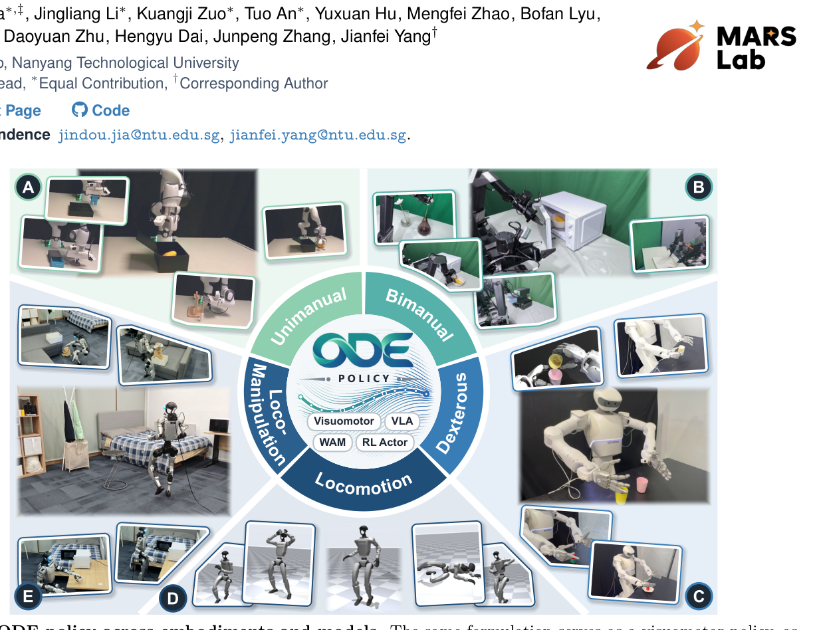
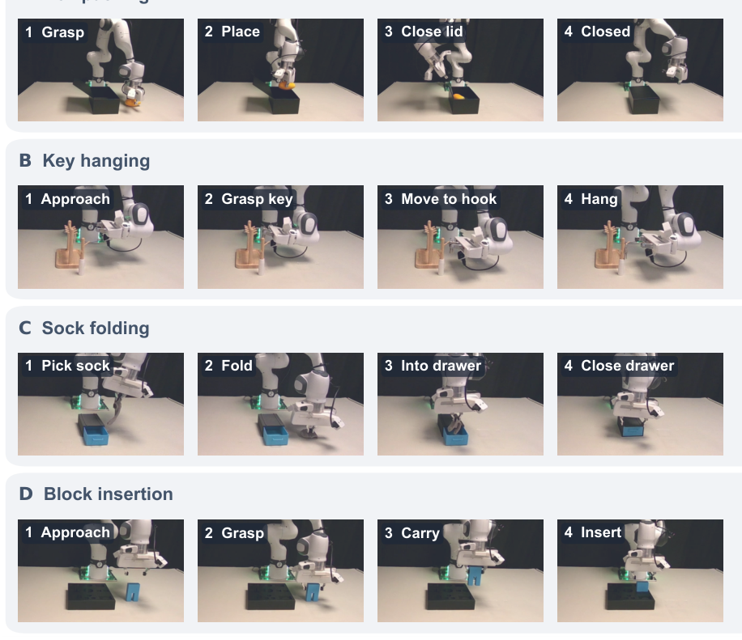

이번 주에 고른 논문은 ODE Policy입니다. HuggingFace Daily Papers 기준 스코어 0.53으로 올라온 글인데, 숫자 자체가 압도적인 화제성을 뜻하는 건 아니지만 로봇 정책이 매 제어 스텝마다 액션값을 직접 출력한다는, 거의 당연한 전제처럼 받아들여지던 설계를 정면으로 건드린다는 점에서 이번 주 노트로 택했습니다. Diffusion Policy나 Flow Matching 계열 정책들이 공통으로 겪는 느린 추론과 청크 경계 점프 문제를, 네트워크 구조를 바꾸지 않고 "무엇을 학습 대상으로 삼을 것인가"라는 공식화 자체를 바꿔서 풀었다는 주장이라 검증해볼 가치가 있었다.

## 왜 액션값을 직접 찍는 게 문제였나

로봇은 본질적으로 연속적인 물리 시스템이다. 그런데 지금까지의 모방학습(IL)이든 강화학습(RL)이든 정책은 관측을 입력받아 이산적인 제어 스텝마다 액션 값을 직접 매핑하는 방식을 썼다. 문제는 이 연속성을 네트워크가 데이터로부터 암묵적으로 학습해야 한다는 점이다. 액션을 여러 스텝 묶음(청크)으로 미리 생성하는 방식에서는 청크와 청크의 경계에서 이 암묵적 연속성이 깨지고, 그 결과 커맨드가 순간적으로 점프한다. 게다가 diffusion이나 flow matching 기반 생성형 정책은 청크 하나를 만드는 데 여러 번의 denoising 스텝(네트워크 평가)이 필요해서 실시간 실행이 느려지고, 청크가 완성되기 전까지는 새로운 관측에 반응하지도 못한다. RL 쪽도 사정은 비슷해서, 많은 상호작용 샘플이 필요하고 명시적인 정규화 없이는 액션이 고주파로 흔들려 실제 액추에이터를 마모시키는 문제가 있었다.

사실 "액션의 동역학을 학습하자"는 아이디어 자체는 새롭지 않다. DMP(Dynamic Movement Primitive)나 stable dynamical system 계열 연구들이 이미 벡터장 기반 접근을 시도했었다. 하지만 이들은 벡터장의 형태를 특정 함수 형식으로 고정하거나 하나의 attractor로 반드시 수렴하도록 제약을 걸어서, 소수의 단일 task 모션에나 쓸 수 있을 뿐 다양한 task, 다중 모달 행동, 스케일 가능한 신경망 학습에는 맞지 않았다. 즉 "동역학을 배우자"는 방향은 맞았지만 신경망 기반으로 유연하게 확장하는 데는 실패했던 셈이다.

## 벡터장을 배우고 적분해서 행동을 만든다

ODE Policy가 고친 지점은 간단히 말하면 "정책이 액션값을 출력하는 함수가 아니라, 액션이 어떻게 변해야 하는지를 출력하는 함수"로 바뀐 것이다. 신경망 $$f_\theta$$는 현재 액션 상태, 고유수용감각, 이미지·언어로부터 인코딩된 조건을 받아 액션의 시간 미분(속도)을 출력한다. 청크를 만들 때는 이 조건을 한 번만 계산해 고정한 뒤, 직전 청크의 마지막 액션에서 시작해 RK4 같은 수치 solver로 적분해서 다음 액션들을 연속적으로 뽑아낸다. 각 액션이 바로 이전 액션에서 유도되기 때문에 연속성이 "데이터로부터 학습되어야 하는 성질"이 아니라 "구조에 내장된 성질"이 된다.

학습은 겉보기엔 평범한 모방학습처럼 보인다. 적분으로 얻은 경로와 시연 액션을 MSE로 맞추는 경로 손실(path loss)을 쓰는데, 속도 자체의 라벨이 없어도 되는 게 장점이다. 시연 데이터의 노이즈를 미분해서 속도 라벨로 쓰면 노이즈가 증폭되는데, 경로 손실은 적분된 결과만 비교하므로 이 문제를 피해간다.

그런데 여기서 바로 추론 단계의 숨은 위험이 드러난다. 학습 때는 정답 경로를 따라 적분하지만, 추론 때는 자기 자신이 만든 액션을 다시 입력으로 받아 적분을 이어가야 한다. 이때 오차가 조금씩 누적되면(drift) 정책이 시연 분포에서 점점 벗어날 수 있다. 저자들은 이걸 막기 위해 수축 섭동(contractive perturbation)이라는 보조 손실을 추가했다. 청크 시작점에 일부러 작은 섭동을 주고, 그 편차가 스텝이 지날수록 기하급수적으로 줄어들도록 학습시킨다. 쉽게 말하면 "살짝 궤도를 벗어나도 다시 정답 경로로 끌려 돌아오는 성질"을 손실 함수 안에 명시적으로 집어넣은 것이다.

다중 모달 행동 문제(같은 상황에서도 사람이 서로 다른 방식으로 task를 수행하는 시연들)도 그냥 두면 결정론적 벡터장이 여러 모드를 평균내버리는 부작용이 생긴다. 이를 막기 위해 청크 시작 시 혼합 가우시안에서 하나의 오프셋을 샘플링해 속도에 더하는 다양성 헤드를 따로 붙였는데, 이 헤드의 손실은 stop-gradient로 처리해서 메인 벡터장 학습에는 영향을 주지 않도록 분리했다. RL로 확장할 때는 청크 길이를 1로 줄이고 매 스텝 한 번의 Euler step만 수행하는 형태로 actor를 바꿔 끼웠는데, 기존 world model이나 critic은 그대로 두고 actor만 교체했다는 점이 눈에 띈다.

## 결과: 빠르면서 매끄럽다

LIBERO 벤치마크에서 ODE Policy는 1 에폭만에 85% 성공률 기준선에 도달해서, flow matching 기반 정책이 도달하는 데 걸리는 30 에폭, DDPM 기반이 걸리는 50에서 60 에폭에 비해 15배에서 60배 빠르게 학습이 수렴했다.

시연 개수를 5개에서 50개까지 바꿔가며 측정했을 때는 데이터가 적을수록 ODE Policy의 이득이 커졌고, 파라미터 수를 1.5M에서 48M까지 바꿔도 이 이득이 거의 변하지 않았다. 저자들은 이를 두고 성능 향상이 모델 용량 때문이 아니라 "연속성을 구조로 내장했다"는 공식화 자체에서 온다고 해석하는데, 이 해석은 상당히 설득력이 있다고 본다. 실제 로봇 실험에서도 단일팔, 양팔, dexterous hand, 휴머노이드를 포함한 14개 과제 전부에서 최고 성공률을 기록했고, 청크당 추론 시간은 diffusion이나 flow matching 대비 3.5배에서 27배 빨랐다. 더 흥미로운 건 추론이 빨라졌는데도 청크 경계에서의 가속도와 저크(jerk)가 시연 데이터 수준이거나 그보다 낮았다는 점이다. 보통 추론 속도와 동작 매끄러움은 트레이드오프 관계로 여겨지는데, 이전 액션에서 연속적으로 이어지는 적분 구조 덕분에 둘 다 동시에 달성된 셈이다.

한편으로 솔직히 짚어야 할 한계도 있다. 수축 섭동의 decay rate나 섭동 크기, 다양성 헤드의 혼합 성분 개수 같은 하이퍼파라미터가 여전히 수작업 튜닝에 의존하는 구조로 보이고, 이게 과제마다 얼마나 민감한지는 논문만으로는 충분히 드러나지 않는다. 또한 solver 안정성(특히 액션 차원이 크거나 행동이 급격히 바뀌는 과제에서 적분 스텝 크기를 어떻게 선택할지)에 대한 논의가 상대적으로 적어서, 실제 배포 환경에서 solver 설정을 바꿀 때 어떤 실패 모드가 생기는지는 더 들여다볼 여지가 있다.

## 용어 해설

- **Neural ODE**: 신경망으로 어떤 양의 시간 미분(변화율)을 정의하고, 그 미분을 수치적으로 적분해 시간에 따른 값을 만들어내는 모델링 방식. 값 자체를 직접 예측하는 대신 "값이 어떻게 변하는지"를 학습한다는 점이 핵심이다.
- **수축(contraction) 동역학계**: 서로 다른 초기 조건에서 출발한 궤적들이 시간이 지날수록 서로 가까워지는 성질을 가진 동역학계. 작은 오차나 섭동이 있어도 시간이 지나면 정상 궤도로 다시 끌려오기 때문에 외란에 강건한 제어기 설계에서 자주 쓰이는 개념이다.
- **저크(jerk)**: 가속도의 시간 미분, 즉 가속도가 얼마나 급격히 변하는지를 나타내는 값. 저크가 크면 동작이 뚝뚝 끊기듯 거칠어지고 액추에이터에 부담이 커지기 때문에 로봇 궤적의 매끄러움을 평가하는 지표로 쓰인다.
- **stop-gradient**: 순전파 때는 어떤 값을 그대로 사용하지만, 역전파 때는 그 값에 대한 gradient가 흘러가지 않도록 끊는 연산. 특정 보조 손실이 메인 네트워크의 학습 방향에 영향을 주지 않게 분리하고 싶을 때 쓴다.

## 🤖 AI의 생각

이 요약과 분석은 논문 내용을 정리한 것이고, 아래는 개인적인 의견에 가깝다. "액션값이 아니라 액션의 동역학을 배운다"는 전환이 단순한 트릭이 아니라 연속성이라는 귀납적 편향을 손실 함수 구조 자체에 집어넣은 것이라는 점에서, 모델을 키우지 않고도 데이터 효율을 올린 사례로 상당히 인상적이었다.

수축 섭동의 decay rate \(\rho\)를 과제별로 자동으로 고르거나 학습 가능한 파라미터로 만들 수는 없을까?

현재는 고정 하이퍼파라미터로 보이는데, 과제의 동작 속도나 액션 차원에 따라 적정 $$\rho$$가 꽤 달라질 것 같아서 메타러닝이나 과제별 캘리브레이션으로 자동화하면 범용성이 더 늘어날 수 있을 것 같다.

taskcraft가 다루는 "행동이 세계 상태를 어떻게 바꾸는가"라는 질문과 이 논문의 벡터장 공식화는 어떻게 연결될까?

ODE Policy는 액션 공간 안에서의 동역학만 모델링하는데, 이걸 액션이 세계 상태에 미치는 동역학까지 확장하면 world model과 정책이 같은 ODE 틀 안에서 통합될 여지가 있어 보인다.

다중 모달 행동을 다루는 다양성 헤드가 stop-gradient로 메인 벡터장과 분리되어 있는데, 이게 오히려 벡터장이 모드 구분 신호를 전혀 학습하지 못하게 막는 건 아닐까?

분리 덕분에 벡터장 학습이 안정적이긴 하겠지만, 장기적으로는 벡터장 자체가 조건부 모드 정보를 더 잘 반영하도록 약한 gradient 연결을 실험해볼 가치가 있다고 본다.

참고문헌

원문<a href="https://huggingface.co/papers/2611.01729" target="_blank" rel="noopener">ODE Policy: Robot Learning via Action Dynamics, Not Actions</a> · hf-daily

