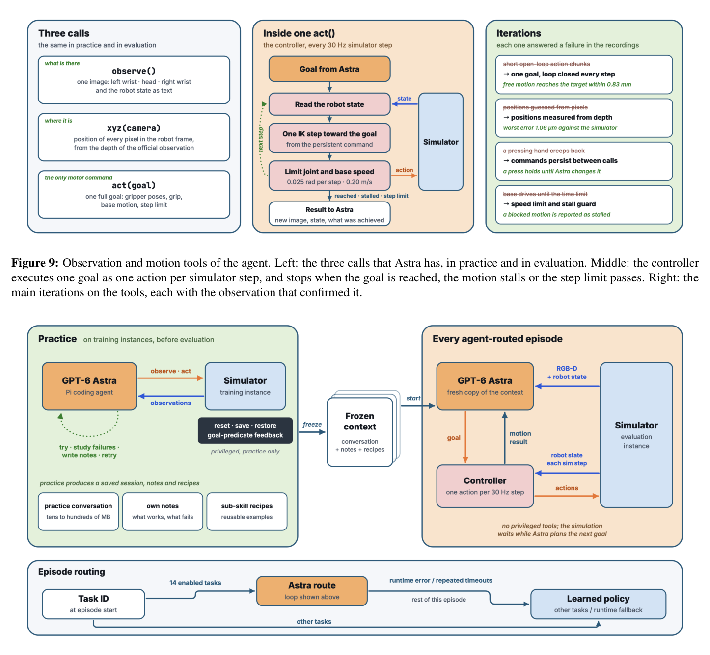
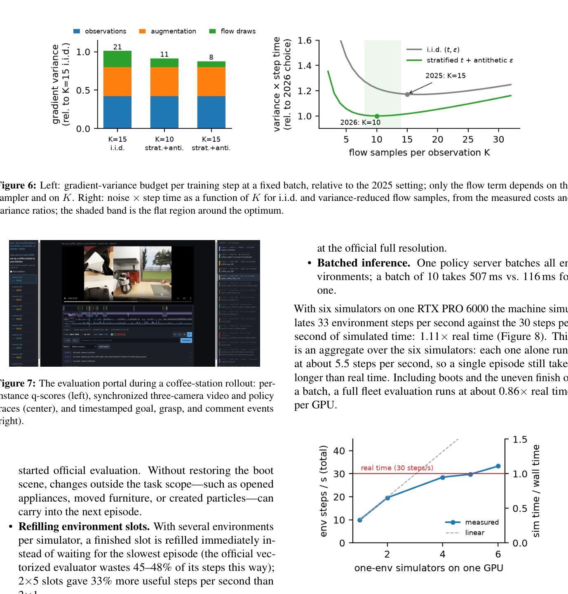

이번 주는 로봇이 집안일을 배우는 방식에 관한 논문을 골랐습니다. 스코어링 점수 자체는 0.50으로 아주 높지는 않지만, Imitation Learning과 RL의 고전적인 틀을 수업에서 배운 분만 VLA(Vision-Language-Action) 이후의 흐름을 따라가기에 아주 좋은 입문 사례라고 판단했습니다. 하나의 정책이 100개의 서로 다른 집안일을 수행해야 하는 상황에서 무엇이 무너지고, 그걸 어떻게 고쳤는지가 단계별로 아주 선명하게 드러나는 논문이라 이번 주 학습용으로 선정했습니다.

## 문제 제기: 과제가 두 배로 늘면 생기는 일

BEHAVIOR Challenge는 OmniGibson이라는 시뮬레이터 안에서 Galaxea R1Pro 로봇이 장기 가정용 활동을 수행하는 벤치마크다. 설거지, 식탁 차리기, 물건 정리 같은 과제를 사람이 텔레오퍼레이션으로 시연한 데이터를 모아 학습시키고, 평가 시에는 로봇이 혼자 그 과제들을 재현해야 한다. 2025년판은 과제가 50개였고 저자들은 이를 4개의 체크포인트로 나눠 처리해 1위를 했다. 그런데 2026년판은 과제가 100개로 늘었고 시연 데이터도 과제당 200개, 전체 211M 프레임에 달한다. 여기서 제약이 하나 걸린다. 체크포인트를 쪼개는 방식을 포기하고 단일 체크포인트로 100개를 다 커버해야 한다는 것이다.

왜 단일 체크포인트가 어려운가부터 짚어야 한다. 이 논문이 쓰는 모델은 π0.5라는 VLA 모델이다. VLA는 이미지와 언어 지시를 입력받아 로봇의 다음 행동(관절 각도, 그리퍼 개폐 등)을 직접 출력하는 모델로, 보통 비전-언어 모델(VLM) 위에 행동을 생성하는 작은 전문가 네트워크(action expert)를 붙인 구조다. 행동을 생성하는 방식으로 이 논문은 Flow Matching을 쓰는데, 간단히 말하면 순수한 노이즈에서 시작해 정답 행동으로 점점 다가가는 방향(velocity)을 예측하도록 학습시키는 방식이다. Diffusion 모델과 비슷한 발상이라고 보면 된다.

문제는 과제 수가 늘어날수록 하나의 네트워크가 외워야 할 행동 패턴의 다양성이 커지고, 그만큼 학습이 수렴하는 데 더 많은 스텝이 필요하다는 것이다. 2025년 솔루션은 사실 이 지점에서 이미 undertrained, 즉 학습이 덜 끝난 상태로 제출됐다. 2026년에는 과제가 두 배가 됐으니 같은 학습 예산으로는 어림도 없다. 그래서 저자들의 전략은 두 갈래로 나뉜다. 하나는 학습을 더 오래, 더 효율적으로 돌리는 것이고, 다른 하나는 아무리 오래 돌려도 정책이 못 하는 과제는 아예 다른 방법으로 우회하는 것이다.

## 왜 안 됐는지: 과제 이식, attention의 함정, 그래디언트 노이즈

과제를 50개에서 100개로 늘리는 가장 단순한 방법은 새 과제를 처음부터 학습시키는 것이다. 하지만 이러면 2025년에 이미 학습된 지식을 버리는 셈이라 비효율적이다. 저자들은 대신 기존 체크포인트에서 워밍스타트(warm start)하는 길을 택했는데, 여기서 첫 번째 함정이 나온다. 기존 모델은 각 과제를 시간 순서로 균등하게 쪼갠 stage 단위로 학습돼 있었는데, 이 시간 기반 분할은 새로운 과제의 stage와 대응시키기가 애매했다. 그래서 시연 데이터에 달린 skill annotation(어떤 동작을 하고 있는지 라벨)을 기준으로 정렬한 semantic stage를 새로 정의하고, 새 과제의 임베딩은 의미적으로 비슷한 기존 과제 임베딩들의 가중 평균으로 초기화했다. 행동공간도 32차원에서 실제 텔레오퍼레이션 제어 방식에 맞춘 21차원으로 줄였다.

두 번째 함정은 더 흥미롭다. 저자들이 디버깅 과정에서 attention map을 들여다보니, 비전 인코더(SigLIP)의 특정 셀 하나가 어떤 프레임을 넣든 거의 항상 모든 attention을 독점하고 있었다. 에피소드 전체에서 이 패턴의 상관계수가 0.97에 달했다니, 사실상 모델이 이미지 내용을 보는 게 아니라 고정된 자리 하나만 쳐다보고 있었던 셈이다. 이는 SigLIP의 position embedding 중 norm이 유독 큰 셀이 "attention 주차장" 역할을 하는, 비전 트랜스포머에서 보고된 적 있는 현상이다. 모델이 물체를 실제로 보지 않고 있다면 아무리 학습을 오래 돌려도 성능이 한계에 부딪히는 건 당연하다.

세 번째 함정은 학습 효율 자체에 있다. Flow Matching 손실은 보통 관측 하나당 노이즈와 flow 시간 하나만 뽑아서 계산하는데, VLA 구조에서는 VLM 쪽(prefix) 연산이 action expert 연산보다 훨씬 비싸다. 그러니 같은 prefix를 재사용하면서 action expert만 여러 번 돌리는 게 거의 공짜에 가까운데, 이걸 안 하고 있었다는 뜻이다. 그런데 단순히 샘플 수만 늘린다고 그래디언트 노이즈가 다 사라지는 것도 아니다. 그래디언트 분산은 관측을 어떤 걸 뽑았는지, 증강을 어떻게 했는지, flow 샘플을 어떻게 뽑았는지 세 가지 원천이 섞여 있는데, 샘플 수를 늘려서 줄일 수 있는 건 flow 샘플링에서 오는 분산뿐이다.

## 고친 방법

첫 번째 함정, 즉 attention sink 문제에는 register token이라는 처방을 썼다. SigLIP에 register token을 추가하고, VLM과 action expert에도 scratch token을 추가하고, 모든 레이어에 학습 가능한 attention sink를 하나씩 달았다. 그리고 이미 학습이 상당히 진행된 체크포인트에 대해서는 "parameter surgery"라는 표현을 쓸 만큼 직접적인 수술을 했다. 문제를 일으키던 그 hot cell의 position embedding 값을 통째로 새로 만든 register 자리로 옮겨 심은 것이다. 아래 그림은 이 수술 전후의 attention map을 비교한 것이다.

수술 전에는 세 카메라 모두에서 같은 셀 하나로 attention이 쏠려 있었고, 수술 후에는 로봇이 다가가는 물체(논문 예시로는 팝콘 봉지)를 따라 attention이 실제로 움직이는 것으로 바뀌었다. 정량적인 점수 향상을 ablation으로 따로 떼어 보여주지는 않았지만, 모델이 적어도 "보고 있어야 할 것을 보기 시작했다"는 건 해석 가능성 측면에서 꽤 중요한 확인이다.

두 번째로 학습 효율 문제에는 분산 감소 기법 두 가지를 조합했다. 하나는 flow 시간을 독립적으로 무작위 추출하는 대신 분포를 여러 구간으로 나눠 각 구간에서 고르게 뽑는 stratified sampling, 다른 하나는 노이즈를 뽑을 때 $$\epsilon$$과 $$-\epsilon$$을 쌍으로 같이 써서 서로 상쇄시키는 antithetic sampling이다. 실험적으로 stratification만으로 flow 분산이 절반으로 줄었고, antithetic pairing이 추가로 17%를 더 줄였다. 그리고 "샘플 수 $$K$$를 몇으로 할까"라는 질문에도 비용(prefix 1회 비용과 샘플당 비용의 비율)과 분산 감소분을 같이 고려해 최적값을 구하는 간단한 식을 유도했는데, 실측값을 대입하면 $$K^* \approx 10$$이 나온다. 비싼 ablation 실험을 여러 번 돌리지 않고도 적정한 샘플 수를 고를 수 있다는 점에서 실용적인 기여다.

세 번째, 학습 자체는 2025 체크포인트에서 출발해 처음엔 1×B300(batch 480), 이후 8×H200 FSDP(batch 2048)로 옮겨가며 총 200k 스텝, 전체 데이터 기준 1 epoch(211M 프레임)에 해당하는 분량을 돌렸다. 평가 인프라도 손봤는데, 9,000개 에피소드를 평가해야 하는 규모에서 시뮬레이터를 계속 재사용하고 끝난 슬롯을 즉시 새 에피소드로 채우는 식으로 GPU 1장당 6개 시뮬레이터가 실시간보다 빠르게 돌아가게 만들었다.

마지막으로 가장 인상적인 설계는, 아무리 학습을 길게 해도 구조적으로 잘 안 풀리는 과제가 있다는 걸 인정하고 LLM 에이전트에게 넘긴 부분이다. GPT-6 Astra라는 코딩 에이전트가 학습용 인스턴스에서 관측하고(observe), 좌표를 찍고(xyz), 행동하는(act) 세 가지 도구로 미리 연습을 한다. 이때는 리셋, 상태 저장과 복원, 목표 달성 피드백 같은 특권적인 도구까지 써가며 연습 세션을 쌓고, 이 세션을 "동결"시킨 뒤 평가 시에는 그 동결된 세션을 포크해서 실제 에피소드를 제어한다. 이런 식으로 정밀 조작이나 grasp 실패 복구처럼 학습된 정책이 유독 약한 14개 과제의 전체 에피소드를 Astra가 담당했다.

## 결과와 한계

최종적으로 이 솔루션은 2026 BEHAVIOR Challenge에서 독립 참가 팀 중 1위, 전체 순위로는 9위를 기록했다. 과제별 점수 분포를 보면 100개 과제 중 13개는 점수 0.75 이상을 받을 만큼 잘 풀었지만 8개는 0점에 머물렀다. Astra가 투입된 14개 과제에서는 개선 폭이 아주 컸는데, 예를 들어 연기감지기 설치 과제는 정책 단독으로는 0.10점이었던 것이 1.0점까지 올라갔다고 보고한다.

다만 한계도 뚜렷하다. attention sink 수술이 정말로 점수를 얼마나 끌어올렸는지는 별도로 측정되지 않았고, 8개 과제는 여전히 0점으로 남아 있다. 또한 Astra 라우팅은 어떤 과제가 정책에 맡기기 적합한지, 어떤 과제가 에이전트에 맡길 만한지를 사람이 사전에 판단해 나눠야 하는 구조라서, 100개보다 더 많은 과제로 확장될 경우 이 분류 작업 자체가 병목이 될 가능성이 있다. 학습된 하나의 정책으로 모든 걸 풀겠다는 애초의 목표에는 아직 완전히 도달하지 못한 셈이다.

## 용어 해설

- **Attention Sink**: 트랜스포머의 attention 메커니즘에서 내용과 무관하게 특정 토큰이나 위치가 거의 항상 큰 attention 가중치를 받는 현상. 원래는 모델이 "딱히 볼 게 없을 때 버리는 자리"로 활용하려는 부작용으로 알려져 있다.
- **Register Token**: 비전 트랜스포머에 입력 패치와 별개로 추가하는, 특정 이미지 내용과 대응되지 않는 여분의 토큰. attention이 엉뚱한 곳으로 쏠리는 걸 이 토큰이 대신 흡수하게 해서 나머지 토큰들의 attention을 정상화하는 데 쓰인다.
- **Antithetic Sampling**: 확률적 추정의 분산을 줄이기 위해 무작위 샘플을 독립적으로 뽑는 대신, 서로 반대 부호를 가진 쌍(예: $$\epsilon$$과 $$-\epsilon$$)으로 묶어 뽑는 기법. 두 샘플의 오차가 서로 상쇄되는 효과를 노린다.
- **FSDP(Fully Sharded Data Parallel)**: 아주 큰 신경망을 여러 GPU에 나눠 학습시킬 때, 모델 파라미터와 옵티마이저 상태 자체를 GPU들에 쪼개 저장하고 필요할 때만 모아 쓰는 분산 학습 기법. 모델이 GPU 하나에 다 안 들어갈 만큼 클 때 주로 쓴다.

## 🤖 AI의 생각

이 논문에서 가장 눈에 띄는 건 "정책이 못 하는 건 LLM 에이전트가 메운다"는 타협을 숨기지 않고 그대로 보고했다는 점이다. 사실 요약과는 별개로, 개인적으로는 이게 깔끔한 해법이라기보다 현재 VLA 단일 정책의 한계를 솔직하게 인정한 결과물이라는 인상을 받았다.

attention sink 수술이 점수에 실제로 얼마나 기여했는지 별도 ablation이 없는데, 만약 측정했다면 효과가 생각보다 작게 나왔을 가능성은 없을까.

attention map이 바뀐 것과 정책 성능이 비례한다는 보장은 없어서, 해석 가능성 개선과 실제 성능 개선을 분리해서 봐야 할 여지가 있다.

8개 과제가 끝내 0점으로 남았는데, 이 과제들이 Astra로도 못 풀렸던 건지 아니면 애초에 라우팅 대상에서 빠졌던 건지가 궁금하다.

논문 설명상 Astra는 14개 과제만 맡았으므로 0점 과제들이 라우팅 후보에서 제외된 것인지, 포함됐는데도 실패한 것인지는 본문만으로는 구분이 안 된다.

taskcraft는 영상 시연에서 embodiment와 무관한 표현을 뽑아 다른 로봇으로 옮기는 걸 목표로 하는데, 이 논문의 과제 임베딩 워밍스타트(비슷한 기존 과제 임베딩의 가중 평균)가 그런 전이 가능한 표현 설계에 참고가 될까.

이 논문은 embodiment를 Galaxea R1Pro 하나로 고정한 채 과제만 늘린 것이라 방향이 다르지만, "과제 표현을 구조적으로 재사용한다"는 발상 자체는 taskcraft의 task representation 설계에 느슨한 참고가 될 수 있다.

참고문헌

원문<a href="https://arxiv.org/abs/2611.14432v1" target="_blank" rel="noopener">One Policy for 100 Household Tasks: Our Solution for the 2026 BEHAVIOR Challenge</a> · arxiv

