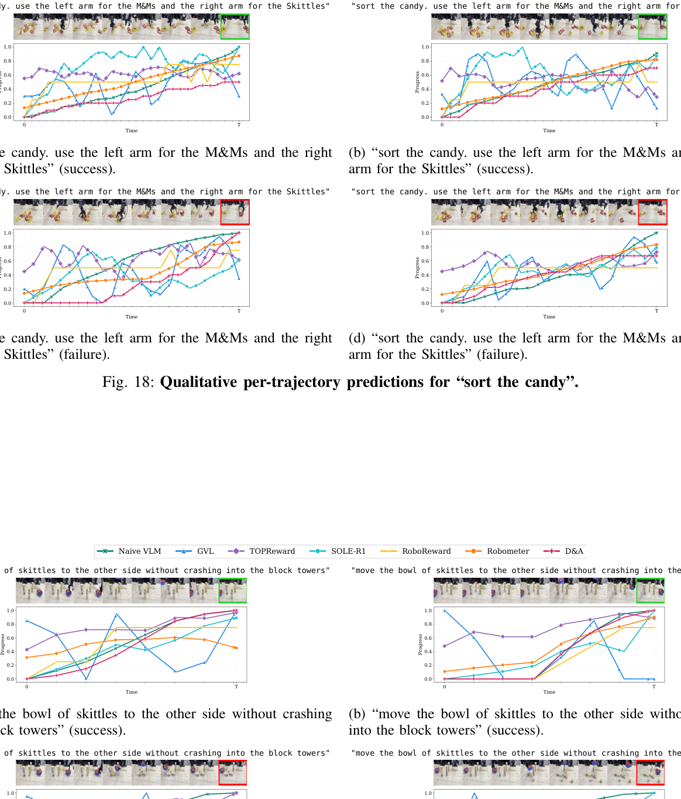
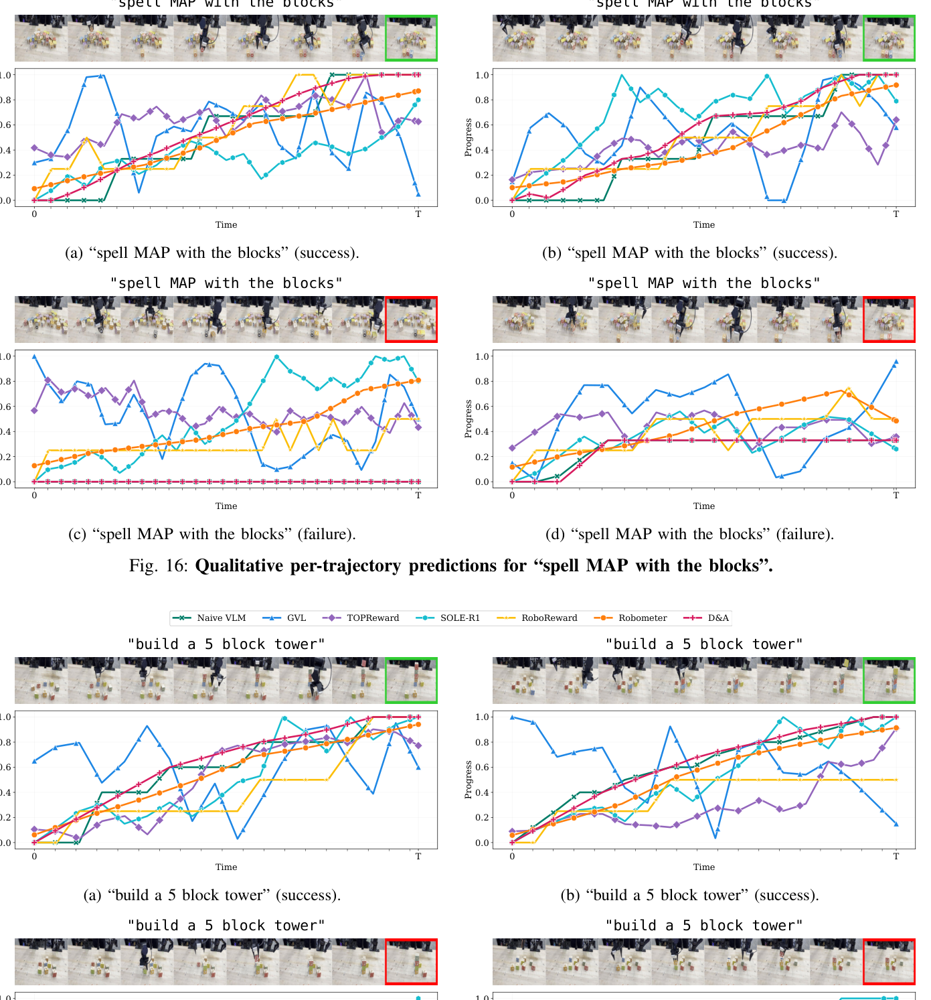

## 이번 주의 선택

이번 주 논문 노트는 semantic-scholar의 추천 경로를 통해 올라왔고, 스코어링 점수는 0.85입니다. 로봇 학습에서 reward를 어떻게 설계할지는 늘 골치 아픈 문제인데, 이 논문은 "VLM에게 로봇 데이터를 전혀 학습시키지 않고도 제로샷으로 쓸 만한 reward model을 만들 수 있는가"라는 질문에 꽤 설득력 있는 답을 내놓아서 골랐습니다. 특히 방법 자체가 복잡한 모델 구조가 아니라 프롬프트를 두 단계로 나누는 것뿐이라는 점이 흥미로웠습니다.

## 문제: VLM은 왜 실패를 성공으로 본다

로봇 비디오와 언어 지시를 VLM에게 같이 주고 "이 trajectory가 지시문을 향해 얼마나 진행됐는가"를 직접 물어보면, 생각보다 자주 틀린 답이 나온다. 원인은 인간 피드백으로 미세조정된 VLM이 갖고 있는 일종의 확증 편향이다. 모델은 주어진 지시문이 실제로 수행되고 있다는 전제를 깔고 영상을 해석하는 경향이 있어서, 실패한 trajectory에서도 과제가 잘 진행 중이라고 과대평가해버린다.

논문이 든 예시가 인상적이다. "셔츠를 펼쳐라(unfold the shirt)"라는 지시를 주고 실제로는 정반대로 "셔츠를 접는(folding)" 영상을 보여주면, naive 프롬프팅은 지시문 자체를 의심하지 않고 단순히 프레임 간 픽셀 차이를 보상으로 쓰는 식의 엉뚱한 해석을 내놓는다.

이 문제는 제로샷 방법에만 국한되지 않는다. 프레임을 섞어 순위를 매기는 GVL이나 토큰 로짓을 뽑아 쓰는 TOPReward도 같은 성공 편향을 겪는다. 그렇다고 로봇 데이터로 미세조정한 reward model(RoboReward, Robometer, SOLE-R1 등)이 완전한 해법도 아니다. 비싸고 다양성이 부족한 실제 로봇 데이터가 필요하고, 오픈소스 백본에 묶이며, 더 강력한 기반 VLM이 나올 때마다 다시 학습해야 한다. 결국 이 부정확한 reward 신호는 그 위에서 강화학습이나 모방학습을 돌리는 다운스트림 정책 학습에 그대로 노이즈로 전달된다.

## 왜 안 됐는지: 질문이 너무 모호했다

이 논문의 분석에서 재미있는 포인트는, 문제의 근원을 모델 능력 부족이 아니라 질문 설계의 모호함으로 짚는다는 점이다. "l을 향한 진행도를 추정하라"는 질문 자체가 VLM 입장에서는 답하기 애매하다. 지시문이 맞다는 전제를 깔 수밖에 없는 구조라서, 모델은 관찰과 지시 사이의 틈을 메우려고 무리한 가정을 한다. 그 결과 전부 0점으로 몰리거나, 아예 이진 성공/실패 판정으로 단순화되는 실패 모드가 반복된다.

## 고친 방법: 설명과 평가를 나누다

D&A(Describe & Assess)는 reward 함수 $$R(o_{1:T}, l)$$를 Describer $$D$$와 Assessor $$A$$ 두 단계로 쪼갠다.

Describer는 과제 지시문 $$l$$을 아예 모르는 상태(task-blind)로 비디오 전체를 한 번에 보고 로봇이 실제로 무엇을 했는지 객관적으로 서술한다. 지시문을 숨기면 "의도된 과제가 수행 중"이라는 전제 자체가 애초에 성립하지 않으니, 확증 편향이 구조적으로 차단된다. 다만 지시문을 완전히 가리면 "어떤 책인지" 같은 중요한 세부사항이 빠질 위험이 있어서, Entity Extractor가 먼저 비디오와 지시문에서 과제 관련/무관 엔티티를 모두 뽑고 Grounded Describer가 이 엔티티에 근거해 서술하게 만든다. 수식으로 쓰면 $$d_{1:T} = D^{desc}(o_{1:T}, E(o_{1:T}, l))$$이다. $$D^{desc}$$ 자체는 어떤 엔티티가 과제에 중요한지는 모르기 때문에, 전체 Describer는 여전히 지시문에 대해 눈먼 상태를 유지한다.

Assessor는 이 서술 $$d_{1:T}$$와 지시문 $$l$$을 받아, 먼저 "과제가 완전히 끝났을 때 세상이 어떤 관찰 가능한 상태가 되는지"에 대한 자연어 성공 기준 $$c$$를 스스로 생성한다. 그다음 각 타임스텝의 서술을 이 기준과 비교해 점수를 매긴다: $$r_{1:T} = A^{score}(d_{1:T}, C(l, d_{1:T}))$$. 포인트는 "진행도를 추정하라"는 모호한 질문을 "d가 c를 얼마나 만족하는가"라는 훨씬 구체적인 질문으로 바꿔치기했다는 데 있다. 여기에 Feedback generator $$F(l, d_{1:T})$$를 더하면 점수뿐 아니라 실패 원인과 교정 지침까지 텍스트로 뽑아, Code-as-Policies 같은 반복 개선 루프에도 바로 쓸 수 있다.

이렇게 얻은 reward는 두 갈래로 쓰인다. 온라인 RL(DSRL)에서는 D&A 점수를 그대로 dense reward로 써서 latent noise를 steering하고, 오프라인 RL에서는 이를 potential function으로 삼아 advantage $$A_t = r_{\min(t+C, T)} - r_t$$를 계산한 뒤 CFGRL/RECAP 스타일로 정책을 조건화한다. 부록에는 potential-based reward $$\tilde r_t = r_t - r_{t-1}$$를 할인된 몬테카를로 리턴 $$G_t = \sum_{k=t}^{T}\gamma^{k-t}\tilde r_k$$로 누적하고, 데이터셋 전체 평균을 기준선 $$V$$로 삼아 중심화된 advantage $$A(s_t,a_t) = G_t - V$$를 만드는 유도가 전체로 실려 있다.

## 결과: 곡선이 갈라진다

가장 압축적인 증거는 Fig. 1의 teaser 그림이다. naive VLM 프롬프팅은 성공 trajectory와 실패 trajectory의 진행도 곡선이 뒤섞여 올라가는 noisy separation을 보이는 반면, D&A는 성공과 실패를 명확히 가르는 깔끔한 곡선을 만든다.

보충 실험도 이 주장을 뒷받침한다. "hit the enter key" 과제에서 다른 키를 눌렀지만 화면상 변화는 거의 안 보이는, 성공과 시각적으로 매우 비슷한 실패 케이스를 D&A만이 정확히 구분한다($$r_T \to 1$$ vs $$r_T \to 0$$). 반면 Robometer는 둘을 거의 동일하게, RoboReward와 SOLE-R1은 오히려 반대로 평가했다. 비디오와 언어 지시문을 서로 섞어 매칭 여부를 확인하는 혼동 행렬 실험에서도, D&A는 맞는 쌍에는 높은 보상(대각선 평균 0.81, 0.83)을, 안 맞는 쌍에는 0에 가까운 보상을 일관되게 부여했다.

## 남는 한계

이 방법이 reward 설계 비용을 VLM 프롬프팅으로 옮겼다는 점은 분명한 장점이지만, 그만큼 Describer와 Assessor 두 번의 VLM 호출이 추론 비용으로 그대로 쌓인다는 점, 그리고 Describer의 서술 품질 자체가 여전히 기반 VLM의 비디오 이해 한계에 종속된다는 점은 논문이 완전히 해소하지 못한 지점으로 보인다. 엔티티 추출이 실패하면 결국 grounding이 깨지는 구조라, "지시문을 숨기되 중요한 디테일은 남긴다"는 균형이 생각보다 섬세한 트레이드오프일 수 있다.

## 용어 해설

- **제로샷(Zero-shot)**: 해당 작업에 맞춘 추가 학습이나 fine-tuning 없이, 사전학습된 모델을 그대로 새로운 과제에 적용하는 방식을 말한다.
- **잠재 노이즈(Latent noise)**: Diffusion 기반 생성 모델이 최종 출력을 만들기 전에 다루는, 눈에 보이지 않는 내부 노이즈 변수. 이 값을 조작하면 최종 출력(여기서는 로봇 action)을 간접적으로 바꿀 수 있다.
- **Advantage(어드밴티지)**: 강화학습에서 특정 상태-행동 쌍이 평균적인 기준선보다 얼마나 더 좋은 결과를 낳는지를 나타내는 값으로, 정책 학습에서 어떤 행동을 더 강하게 강화할지 결정하는 데 쓰인다.
- **Potential-based reward**: 상태의 "포텐셜" 값 차이로 reward를 재정의하는 기법으로, 최적 정책을 바꾸지 않으면서 학습 신호를 더 조밀하고 안정적으로 만들어주는 reward shaping 방식이다.

## 🤖 AI의 생각

사실 요약과 별개로 제 의견을 덧붙이면, 이 논문의 핵심은 새로운 모델이 아니라 "질문을 더 잘 던지는 법"이라는 점이 가장 인상 깊었습니다. 모델 구조를 바꾸지 않고 프롬프트의 역할 분리만으로 확증 편향을 구조적으로 막았다는 점에서, reward 설계 문제를 데이터가 아니라 인터페이스 설계 문제로 재정의한 셈입니다.

Describer가 지시문을 모른 채 서술하다가 정작 과제의 핵심 디테일(어떤 색의 컵인지 등)을 놓치면 Entity Extractor가 이를 얼마나 안정적으로 보완해줄 수 있을까?

엔티티 추출 자체가 틀리면 grounding이 통째로 무너지는 구조라, 이 단계의 실패율을 정량적으로 따로 보고하지 않은 점이 아쉬운 지점이다.

Code-as-Policies 같은 반복 개선 파이프라인에서 "설명자와 평가자를 분리한다"는 설계를 그대로 가져올 수 있을까?

Code-as-Policies의 코드 생성 단계도 언어 모델이 "이 코드가 의도대로 작동할 것이다"는 확증 편향에 노출될 수 있어서, 실행 결과를 객관적으로 기술하고 따로 평가하는 중간 단계를 넣어보는 실험이 의미 있을 것 같다.

온라인 RL에서 D&A 점수를 dense reward로 바로 쓰는 설계가, reward hacking에는 얼마나 취약할까?

VLM이 만든 성공 기준 자체를 정책이 흉내 내는 방향으로만 최적화될 위험이 있어서, 실제 환경 성공률과의 장기적인 괴리를 추적하는 실험이 더 필요해 보인다.

참고문헌

원문<a href="https://www.semanticscholar.org/paper/d0d93bd4dd9bee4aa7c37d176fa31e4faee107e6" target="_blank" rel="noopener">D&A: Decoupling Description and Assessment Enables VLMs as Zero-Shot Robotic Reward Models</a> · semantic-scholar-rec

