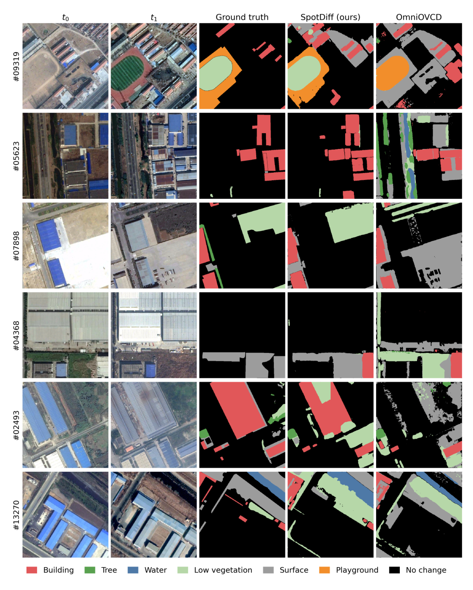
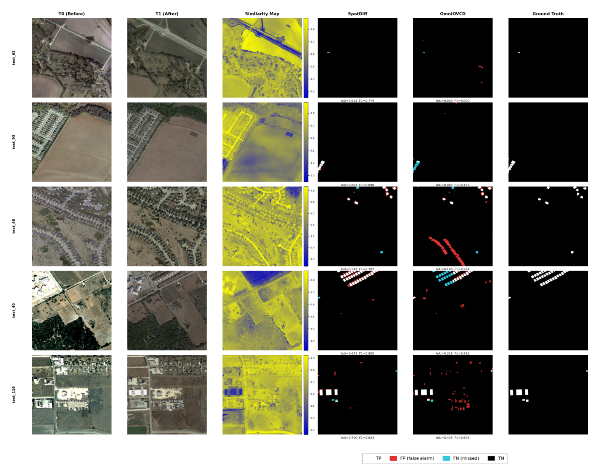

이번 주 논문 선정 기준을 먼저 말씀드리겠습니다. 이 글에서 다루는 SpotDiff는 arXiv 단일 소스에서 스코어 0.17로 상대적으로 낮게 평가된 논문입니다. 화제성이 큰 논문은 아니라는 뜻입니다. 하지만 "파운데이션 모델을 학습 없이 조합만 해서 특정 downstream 문제를 푼다"는 접근 방식 자체는, VLA 이후 로봇/에이전트 분야에서도 계속 반복되는 패턴이라 학습 목적으로 뜯어볼 가치가 있다고 판단했습니다. 특히 IL/RL 수업에서는 "모델을 처음부터 끝까지 학습시킨다"는 전제가 당연했는데, 요즘 흐름은 이미 잘 학습된 거대 모델들을 레고처럼 조립해서 새 문제를 푸는 쪽으로 많이 옮겨갔습니다. 이 감각을 익히기에 적당한 사례라 골랐습니다.

## 변화 탐지라는 문제, 그리고 왜 라벨이 발목을 잡는가

변화 탐지(change detection)는 같은 지역을 서로 다른 시점에 찍은 두 장의 위성/항공 영상을 비교해서 "여기가 바뀌었다"를 픽셀 단위로 표시하는 과제다. 신축 건물, 삼림 벌채, 재해 피해 지역 파악 같은 데 쓰인다. 전통적인 방법은 FC-Siam, STANet, BIT, ChangeFormer처럼 지도학습 기반인데, 문제는 학습 데이터다. 변화 탐지 라벨은 두 시점 영상이 정확히 정렬돼 있어야 하고, 사람이 픽셀 단위로 "여기가 변했다"를 칠해야 한다. 이게 지역마다, 센서마다, 응용 분야마다(건물 변화인지 식생 변화인지) 다 다시 만들어야 하니 비용이 크고, 한 데이터셋으로 학습한 모델이 다른 지역에서는 잘 안 맞는다.

그래서 최근에는 DINOv3 같은 자기지도학습(self-supervised learning) 비전 트랜스포머나 SAM 계열 분할 모델처럼, 라벨 없이 범용적으로 학습된 "비전 파운데이션 모델"을 가져다 쓰려는 시도가 나온다. 그런데 이 모델들은 애초에 변화 탐지용으로 만들어진 게 아니라서 그대로 쓰면 세 가지 벽에 부딪힌다.

첫째, ViT(Vision Transformer) 구조 특성상 특징이 16×16 픽셀짜리 패치 하나당 벡터 하나로 나온다. 원본 해상도보다 16배 거칠다는 뜻이라, 작은 건물 하나를 구분하기엔 너무 뭉개져 있다. 둘째, 두 시점 영상의 의미적 유사도만 단순 비교하면 조명이나 계절, 촬영 각도 차이 같은 노이즈가 전부 "변화"로 잡혀서 결과가 지저분해진다. 셋째, 파운데이션 모델 자체에는 "나는 건물 변화만 보고 싶다" 같은 사용자 의도를 반영할 방법이 없다. 이 세 벽을 어떻게 넘을지가 이 논문의 질문이다. 과제별 학습 없이, 최신 파운데이션 모델만 조합해서 정확한 제로샷(zero-shot, 학습 데이터 없이 바로 적용) 변화 탐지가 가능한가.

## 세 모듈로 나눠서 각자의 벽을 넘는다

SpotDiff의 전략은 "무엇이 변했는가"와 "어디를 볼 것인가"를 아예 분리하는 것이다. 세 모듈 모두 가중치를 고정(frozen)한 기존 모델이거나 파라미터가 없는 단순 연산이라, 학습 과정이 전혀 없다.

먼저 유사도 모듈. 두 시점 영상을 DINOv3 인코더에 통과시켜 패치 단위 특징을 뽑는다. 여기서 앞서 말한 "해상도가 16분의 1로 거칠다"는 문제가 나오는데, 이걸 AnyUp이라는 범용 업샘플러로 해결한다. AnyUp은 원본 영상을 가이드로 써서 거친 패치 특징을 원본 해상도 픽셀 단위로 복원해주는 모델이다. 복원된 두 시점 특징을 픽셀별로 코사인 유사도(두 벡터가 같은 방향을 가리키는 정도)로 비교하면, 값이 1에 가까우면 "변화 없음", 낮을수록 "변화 의심"인 유사도 맵이 만들어진다. 픽셀값 자체를 빼는 게 아니라 의미 특징 공간에서 비교하기 때문에 조명이나 색감 차이에는 덜 흔들리면서 실제 내용 변화에는 반응한다.

다음은 관심영역 제안 모듈이다. 여기서 사용자가 "roof(지붕)" 같은 텍스트 프롬프트를 입력하면 SAM 3이 각 시점 영상에서 해당 범주의 객체들을 인스턴스 단위로 분할(segmentation)해준다. 그런데 위성 영상 속 작은 주거 건물들은 SAM 3도 한 번에 놓치는 경우가 많았다고 한다. 그래서 저자들은 SWIMS(Sliding-Window Inference with Multiple Scales)라는 트릭을 쓴다. 영상을 2배로 확대한 뒤 슬라이딩 윈도우로 SAM 3를 돌리고 결과를 다시 축소해서, 원래 배율(1배)의 결과와 합친다. 재밌는 건 4배까지 확대해서 추가해봤더니 오히려 성능이 떨어졌다는 점이다. 너무 확대하면 균일한 지면이 객체처럼 오탐되기 때문이다. 이렇게 두 시점에서 얻은 인스턴스들을 IoU(Intersection over Union, 두 영역이 겹치는 비율) 0.5 이상으로 겹치는 쌍은 "그대로 있는 객체"로 보고 제거하고, 등장하거나 사라지거나 모양이 바뀐 것만 후보로 남긴다.

마지막 변화 판정 모듈은 단순하다. 남은 각 후보 인스턴스 안의 픽셀들에 대해 유사도 맵 값을 평균 내고, 이 평균값이 임계값 $$\tau$$보다 낮으면 "변화"로 확정한다. 개별 픽셀 단위로 판단하지 않고 인스턴스 단위로 평균을 내기 때문에 고립된 노이즈 픽셀 하나가 전체를 흔들지 못하고, 동시에 "의미적 불일치가 실제 객체 제안으로 뒷받침될 때만" 변화로 인정하므로, 예를 들어 건물 탐지 모드에서는 계절에 따라 나무 색이 변해도 무시된다. 프롬프트를 아예 주지 않는 클래스 비의존(class-agnostic) 모드도 있는데, 이때는 RoI 제안 없이 픽셀별 유사도만으로 바로 판정한다.

이 그림을 보면 구조가 명확하다. 위쪽 경로에서 두 시점 영상이 각각 DINOv3와 AnyUp을 거쳐 픽셀 단위 임베딩이 되고, 유사도 연산으로 컬러 맵이 만들어진다. 아래쪽 경로에서는 SWIMS로 얻은 인스턴스 마스크들을 시간적으로 비교해서 "지속 객체는 빼고 변화 후보만 남긴" 최종 마스크를 만든다. 두 출력을 변화 판정 모듈이 받아서 최종 이진 마스크를 뽑는다. 이 구조의 핵심은 세 모듈이 서로 독립적이라 교체가 자유롭다는 점이다. 실제로 저자들은 DINOv3 백본을 ViT-L에서 ViT-7B로 바꿀 때 체크포인트 교체 말고는 아무것도 손대지 않았다고 밝히고 있다.

## 수식으로 보면

전체 파이프라인은 다음처럼 세 함수의 합성으로 쓸 수 있다.

$$Y = C\big(S(I_0, I_1),\, R(I_0, I_1, p)\big)$$

$$I_0, I_1$$은 두 시점 영상, $$p$$는 텍스트 프롬프트, $$Y$$는 최종 이진 변화 마스크다. 유사도 모듈 $$S$$는 다음 순서로 작동한다.

$$Z_t = f_\theta(I_t) \in \mathbb{R}^{C \times \frac{H}{16} \times \frac{W}{16}}$$

고정된 DINOv3 인코더 $$f_\theta$$로 패치 특징을 뽑는다. 다음으로 AnyUp $$g_\phi$$가 원본 영상을 가이드 삼아 해상도를 복원한다.

$$E_t = g_\phi(Z_t, I_t) \in \mathbb{R}^{C \times H \times W}$$

이렇게 복원된 두 시점 특징을 픽셀별 코사인 유사도로 비교한다.

$$S(i,j) = \frac{E_0(i,j)^\top E_1(i,j)}{\lVert E_0(i,j) \rVert \,\lVert E_1(i,j) \rVert}$$

RoI 제안 쪽은 SWIMS 연산 하나로 요약된다.

$$M_t = \bigcup_{s \in K} \mathrm{Down}_{1/s}\big(h(\mathrm{Up}_s(I_t), p)\big)$$

배율 $$s$$로 영상을 키운 뒤 SAM 3($$h$$)로 마스크를 얻고 다시 축소해서, 스케일 집합 $$K=\{1,2\}$$의 결과를 합친다. 마지막으로 각 후보 인스턴스 $$m$$에 대한 평균 유사도를 구해 임계값과 비교한다.

$$s_m = \frac{1}{\lvert m \rvert}\sum_{(i,j)\in m} S(i,j)$$

$$Y = \bigvee_{m \in M:\, s_m < \tau} m$$

프롬프트 없이 쓰는 단순화 버전은 이렇게 쓸 수 있다.

$$Y = \mathbf{1}[S < \tau]$$

논문에서는 모든 데이터셋에 걸쳐 $$\tau = 0.6$$ 하나를 고정해서 썼다고 밝히고 있다.

## 결과와 한계

LEVIR-CD 데이터셋에서 SpotDiff는 82.46 F1을 기록해 기존 training-free 기법들을 넘어섰다고 한다. 정성적 비교 그림을 보면 왜 그런지 감이 온다.

경쟁 기법인 OmniOVCD는 도로나 맨땅을 따라 거짓 양성을 많이 만들고 정작 작은 건물은 놓치는 반면, SpotDiff는 실제로 바뀐 건물에 예측이 집중돼 있다. 유사도 맵을 보면 변하지 않은 지붕이나 도로는 두 시점 간 유사도가 높게 유지되고, 신축 건물만 작고 또렷한 저유사도 영역으로 튀어나온다. 이게 가능한 이유는 픽셀 해상도까지 복원한 특징으로 비교하기 때문이라는 게 논문의 설명이다. SWIMS의 효과도 따로 확인했는데, 멀티스케일을 쓰지 않고 1배 해상도만으로 SAM 3를 돌리면 작은 주거 건물들을 다수 놓치지만, 1배와 2배를 합치면 이 건물들이 복원되면서 ablation 실험에서 F1이 최대 21.4점까지 올라갔다.

다만 한계도 명확하다. 임계값 $$\tau=0.6$$을 모든 데이터셋에 고정했다는 건 편리하지만, 센서나 지역이 크게 달라지는 실제 배포 환경에서도 이 값이 그대로 유지될지는 검증되지 않았다. 또 지금까지의 실험은 "건물" 같은 단일 카테고리 프롬프트 위주라서, 여러 범주를 동시에 모니터링하는 실전 시나리오에서는 어떻게 동작할지 추가 검증이 필요해 보인다.

## 용어 해설
- **자기지도학습(Self-Supervised Learning)**: 사람이 만든 라벨 없이, 데이터 자체에서 정답에 해당하는 신호를 스스로 만들어 학습하는 방식. DINOv3 같은 모델이 이 방식으로 사전학습된다.
- **코사인 유사도(Cosine Similarity)**: 두 벡터가 이루는 각도를 기반으로 방향이 얼마나 비슷한지 측정하는 값. 1에 가까울수록 두 벡터가 같은 방향, 즉 의미적으로 비슷하다는 뜻이다.
- **IoU(Intersection over Union)**: 두 영역(또는 박스)이 얼마나 겹치는지를 "겹치는 부분 면적 나누기 합쳐진 전체 면적"으로 계산한 비율. 분할이나 탐지 결과를 비교할 때 널리 쓰인다.
- **제로샷(Zero-Shot)**: 해당 과제에 대한 전용 학습 데이터나 파인튜닝 없이, 이미 학습된 모델을 그대로 적용해 문제를 푸는 방식.

## 🤖 AI의 생각

개인적인 감상을 먼저 밝히면, 이 논문은 "새 모델을 학습시키지 않고 기존 파운데이션 모델들을 영리하게 조합하는 것만으로 충분하다"는 주장을 비교적 설득력 있게 증명한 사례로 보인다. 다만 이건 사실 요약이 아니라 제 의견이다.

임계값 \(\tau=0.6\)을 모든 데이터셋에 고정했다는 설계가 다른 센서나 해상도의 위성 영상에서도 그대로 유지될까.

코사인 유사도의 절대 스케일은 인코더와 도메인에 따라 달라질 수 있어서, 센서가 바뀌면 재보정이 필요할 가능성이 있어 보인다.

SAM 3 대신 더 가벼운 오픈 보캐뷸러리 분할기로 RoI 제안 모듈을 바꿔도 성능이 유지될까.

플러그앤플레이 구조상 교체는 쉬워 보이지만, SWIMS로 얻는 소형 객체 복원 효과가 다른 분할기에서도 똑같이 나올지는 별도 검증이 필요하다.

taskcraft가 지향하는 embodiment 공유 latent 구조와 이 논문의 "고정 백본 위에 모듈 교체" 설계는 얼마나 닮아 있을까.

둘 다 과제별 재학습 없이 하나의 고정된 표현 위에서 다운스트림을 갈아 끼운다는 발상은 비슷하지만, taskcraft는 서로 다른 embodiment 간 전이를 다루는 반면 SpotDiff는 입력 modality가 동일한 영상 대 영상 비교라서 직접적인 기술 이전보다는 설계 철학 차원의 참고 정도로 보는 게 맞을 것 같다.

참고문헌

원문<a href="https://arxiv.org/abs/2611.17172v1" target="_blank" rel="noopener">SpotDiff: A Plug-and-Play Framework for Zero-Shot Change Detection in Remote Sensing Imagery</a> · arxiv

