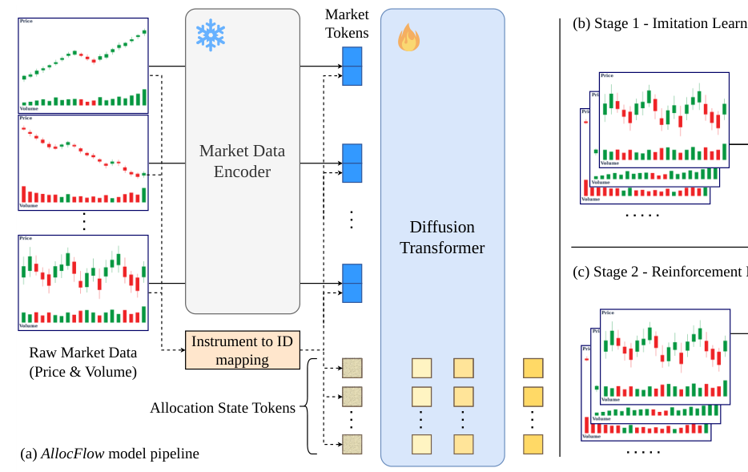

이번 주는 hf-daily 소스에서 score 1.00을 받은 논문을 골랐습니다. 포트폴리오 트레이딩이라는, 평소 블로그에서 잘 다루지 않는 도메인이지만 Flow Matching과 DiT, GRPO라는 익숙한 기법들이 완전히 다른 문제(자본 배분)에 재조립되는 방식이 흥미로워서 이번 주 논문 노트로 선택했습니다.

## 신호와 포지션을 나누면 생기는 간극

전통적인 퀀트 파이프라인은 보통 두 단계로 나뉜다. 먼저 각 자산의 미래 수익률이나 알파 점수를 예측하고, 그 다음 그 점수를 최적화기에 넣어 실제 매매 포지션을 뽑아낸다. 이 구조는 깔끔해 보이지만 문제는 두 단계가 서로 다른 목표로 학습된다는 데 있다. 예측 모델은 "얼마나 정확히 맞혔는가"로 평가되고, 최적화기는 그 예측을 받아 자본 제약과 리스크 한도 안에서 기계적으로 포지션을 짜낸다. 좋은 예측이 반드시 좋은 트레이드로 이어지지 않는 이유가 여기 있다. 포지션이 과도하게 커지거나, 다른 자산의 노출과 중복되거나, 포지션을 바꾸는 데 드는 비용이 수익보다 커지는 경우를 최적화기가 사후적으로밖에 다루지 못하기 때문이다. 결국 "이 자산을 얼마나 사야 하는가"는 다른 모든 자산의 포지션과 함께, 공유된 자본 제약 아래에서 결정되어야 하는 문제인데 기존 파이프라인은 이 결합적 의사결정을 명시적으로 학습하지 않는다.

그렇다고 처음부터 강화학습으로 연속적인 배분 정책을 학습시키는 것도 답이 되지 못한다. 자산이 20개만 되어도 행동 공간은 20차원 연속 벡터가 되고, 보상 신호는 수익률이라는 극도로 노이즈가 많은 값이다. 게다가 거래 비용이 들어가면 정책은 "아무것도 하지 않는 것"이 가장 안전한 국소 최적해라고 금방 배워버린다. 탐색이 제대로 안 되는 것이다. AllocFlow는 이 두 가지 문제, 즉 신호와 포지션의 분리, 그리고 처음부터 RL로 배우는 비효율성을 하나의 생성 모델과 2단계 학습 절차로 동시에 풀려고 한다.

## 왜 생성 모델로 접근했는가

AllocFlow의 핵심 아이디어는 포트폴리오 전체를 하나의 연속 벡터로 보고, 이를 Flow Matching으로 생성하는 것이다. 먼저 동결된 금융 파운데이션 모델 Kronos가 각 자산의 OHLCV 히스토리를 market token으로 압축한다. 이 토큰들이 DiT 스타일의 플로우 트랜스포머에 조건으로 들어가고, 노이즈에서 출발해 N개 자산의 포지션 가중치를 담은 "포트폴리오 북"을 한 번에 생성한다. 이미지 생성에서 DiT가 패치 시퀀스를 노이즈에서 이미지로 복원하듯, 여기서는 allocation-state 토큰 시퀀스를 노이즈에서 달러 중립 포지션 벡터로 복원하는 셈이다. 최종 출력은 $$w_t = \frac{1}{c} P_t z_1$$ 형태의 투영을 거쳐 전체 평균 성분을 제거함으로써 롱숏 합이 0이 되도록 강제된다.

학습은 두 단계로 나뉜다. 1단계는 사실상 모방학습이다. AgenticAlpha라는 teacher 전략(알파 마이닝 결과를 결합한 기존 룰 기반 전략)의 과거 배분을 데모로 삼아, 무작위 초기화된 플로우 헤드가 $$\mathcal{L}_{\text{FM}} = \mathbb{E}\left[\frac{1}{N_t}\\vert{}v_\theta(z_\tau, \tau; X_t) - (a_t - \epsilon)\\vert{}_2^2\right]$$ 로 속도장을 배운다. 여기에 score, weight, rank, gross 네 가지 보조 손실을 더해 teacher의 방향과 크기 정보를 조금 더 안정적으로 전달한다. 순수 모방학습의 고질적 문제, 즉 teacher의 실수까지 그대로 복제한다는 한계는 이 단계에서 해결되지 않는다. 대신 2단계인 Flow-GRPO가 이를 맡는다.

2단계에서는 같은 시장 상황에 대해 old policy가 G=8개의 후보 포트폴리오 북을 샘플링하고, 각각을 동일한 gross exposure(0.85)로 정규화한 뒤 24시간 보유시켜 연율화 Sharpe를 보상으로 계산한다. 레버리지 크기가 아니라 "구성의 질"만 비교하기 위한 설계다. 업데이트는 PPO 스타일의 클리핑된 대리 손실을 쓰되, 동결된 1단계 IL 정책을 레퍼런스로 삼아 너무 멀리 벗어나지 않도록 KL 유사 항으로 묶어둔다. 즉 teacher를 완전히 떠나는 대신, teacher가 제시한 분포 안에서 더 나은 조합을 찾도록 탐색을 앵커링하는 방식이다.

## 결과와 구체적 사례

평가는 시간당 리밸런싱되는 암호화폐 무기한 선물 20종에 5bps 수수료를 적용해 14개월 out-of-sample 구간과 추가 6개월 구간에서 이뤄졌다.

누적 PnL 곡선은 in-sample과 out-of-sample 경계를 넘어서도 끊기지 않고 상승하고, 롤링 Sharpe도 대부분 양의 영역에 머문다. 단순 과적합이 아니라는 신호다. 더 흥미로운 건 논문의 사례 분석(Figure 3)인데, AUCTION과 1000PEPE 두 자산에서 RL이 teacher/IL과 반대 방향으로 포지션을 바꾼 경우를 보여준다. 가격 반전 11시간 전에 방향을 틀어 자산별 PnL이 각각 -1.78%에서 +0.76%, -0.07%에서 +1.29%로 개선됐다. 집계 지표만 보면 드러나지 않는, Flow-GRPO가 실제로 teacher의 실수를 어느 지점에서 교정하는지를 보여주는 구체적 증거다.

다만 한계도 분명하다. 달러 중립 투영은 롱숏 합을 0으로 만들 뿐 베타 중립이나 명시적 리스크 제한을 보장하지 않는다고 저자들 스스로 밝히고 있다(Appendix A.2). 또한 teacher 전략 하나(AgenticAlpha)에 의존해 1단계를 구성했기 때문에, 그 teacher가 애초에 포착하지 못하는 유형의 기회는 2단계 RL로도 발굴되기 어렵다. RL은 teacher가 제시한 후보 분포 안에서 더 나은 조합을 고르는 것이지, 완전히 새로운 전략을 처음부터 발견하는 것은 아니기 때문이다.

## 용어 해설

- **Sharpe 비율**: 투자 전략의 평균 수익을 수익의 변동성(표준편차)으로 나눈 값으로, 단순히 수익이 큰지가 아니라 위험 대비 수익이 얼마나 효율적인지를 재는 지표다.
- **달러 중립(dollar-neutral)**: 롱 포지션의 총액과 숏 포지션의 총액을 같게 맞춰 포트폴리오 전체의 시장 방향성 노출을 0으로 만드는 구성 방식이다.
- **그룹 상대적 강화학습(GRPO)**: 같은 상태에서 여러 후보 행동을 동시에 샘플링한 뒤, 절대적인 보상값이 아니라 그룹 내 상대적 순위로 어드밴티지를 계산해 정책을 업데이트하는 강화학습 기법이다.

## 🤖 AI의 생각

이건 논문 내용 요약과는 별개로 제 의견인데, 알파 예측과 포트폴리오 최적화를 한 생성 모델로 합치는 발상 자체보다도 "teacher를 떠나지 않으면서 교정한다"는 2단계 설계가 더 인상적이었다. RL을 처음부터 쓰지 않고 IL로 구조화된 분포를 먼저 만든 뒤 그 위에서 탐색을 제한하는 패턴은 트레이딩뿐 아니라 다른 도메인에도 옮겨 적용할 수 있을 것 같다.

teacher 전략(AgenticAlpha) 자체의 질이 바뀌면 AllocFlow의 상한도 그만큼 달라질 텐데, teacher를 교체하거나 여러 teacher를 앙상블했을 때 2단계 RL의 교정 폭이 얼마나 달라지는지가 궁금하다.

논문에는 단일 teacher 결과만 있어서, 이 부분은 저자들의 후속 실험이나 재현 연구를 기다려야 확인할 수 있을 듯하다.
Q: taskcraft 프로젝트에서 에이전트가 여러 하위 작업을 순서 없이 동시에 처리해야 할 때도, AllocFlow처럼 "먼저 IL로 그럴듯한 조합 분포를 만들고 그 다음 RL로 상대적 순위를 교정"하는 2단계 구조를 가져올 수 있을지 궁금하다.
A: taskcraft의 작업들은 포트폴리오처럼 합이 고정된 제약은 없지만, 여러 후보 계획을 그룹으로 샘플링해 상대 비교하는 GRPO 스타일 보상 설계는 그대로 적용해볼 만해 보인다.
Q: 달러 중립 투영이 베타 중립을 보장하지 않는다는 한계를 저자들도 인정했는데, 이를 보완하려면 투영 행렬 자체에 리스크 팩터 제약을 추가로 넣는 게 자연스러운 다음 단계가 아닐까.
A: 다만 그러면 플로우 매칭의 단순한 선형 투영 구조가 깨지므로, 생성 과정 자체에 제약을 넣는 쪽(예: constrained flow)으로 설계가 복잡해질 수 있다.

참고문헌

원문<a href="https://huggingface.co/papers/2611.19937" target="_blank" rel="noopener">AllocFlow: End-to-End Portfolio Trading Action Generation from Raw Market Data</a> · hf-daily

