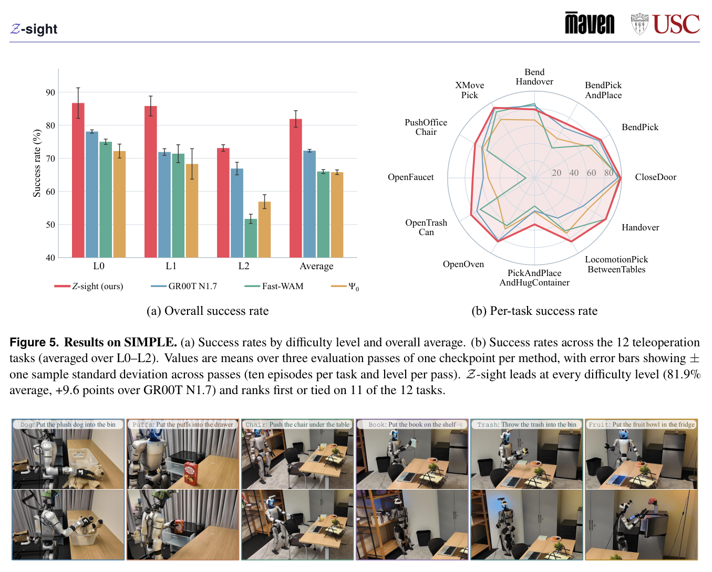
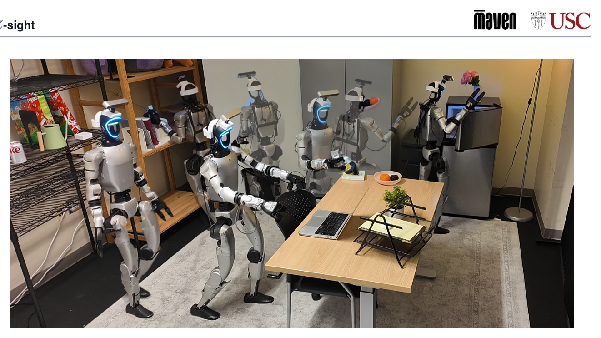

## 이번 주 왜 이 논문인가

이번 주 서베이에서는 로봇 정책 학습 쪽에서 눈에 띄는 흐름 하나를 집중적으로 뜯어보려 합니다. Vision-Language-Action(VLA) 모델과 World Model을 하나로 합치려는 시도들이 최근 arXiv에 꾸준히 올라오고 있는데, 그중 Z-sight는 "미래를 어떤 공간에서 예측할 것인가"라는 질문에 비교적 깔끔한 답을 내놓은 논문이라 골랐습니다(score=0.50, arxiv). 수업에서 Imitation Learning과 RL 고전 알고리즘을 배운 독자라면 VLA라는 단어 자체가 낯설 수 있는데, 이번 글에서는 VLA가 뭔지부터 시작해서 Z-sight가 어떤 문제를 풀었는지 차근차근 짚어보겠습니다.

## VLA 모델이 뭘 하는 놈인가

Imitation Learning 수업에서 배운 Behavior Cloning은 보통 이미지나 저차원 상태를 입력으로 받아 행동을 바로 출력하는 작은 네트워크였다. VLA는 여기서 입력단을 크게 키운 버전이다. 카메라 영상(Vision)과 자연어 지시문(Language)을 함께 입력받아서, 그 지시를 수행할 로봇 행동(Action)의 시퀀스를 출력한다. 핵심은 Vision-Language Model, 즉 이미지와 텍스트를 함께 이해하도록 대규모로 사전학습된 VLM을 백본으로 그대로 가져다 쓴다는 점이다. $\pi_0$나 GR00T 같은 최근 VLA들은 이 VLM에 "action expert"라는 작은 모듈을 붙여서, VLM이 뽑아낸 특징을 받아 연속적인 행동 값을 생성한다. 로봇 팔이나 휴머노이드처럼 자유도가 높은 시스템에서 이런 구조가 잘 작동한다는 게 최근 2~3년의 성과다.

## 그런데 뭐가 문제였나

문제는 지도 신호다. VLA는 결국 (영상, 지시문) 쌍에 대해 정답 행동 라벨만으로 학습된다. 그런데 행동 라벨은 본질적으로 희소하다. 물체를 집는다는 하나의 목표를 달성하는 궤적은 무수히 많고, 라벨은 그중 하나의 샘플일 뿐이다. 모델이 "이 물체를 집으면 세상이 어떻게 바뀌는지"를 이해하지 못한 채 행동 패턴만 흉내 내면, 조금만 환경이 바뀌어도 쉽게 무너진다. RL 수업에서 배운 모델 기반 강화학습이 샘플 효율을 높이려고 환경의 동역학을 따로 학습하는 것과 같은 동기다. 로봇도 "다음에 뭐가 보일지" 예측할 수 있어야 더 robust한 행동을 고를 수 있다.

이 동기에서 나온 게 World Action Model(WAM) 계열이다. 비디오 디퓨전 모델을 백본으로 써서 미래 영상 프레임을 픽셀 단위로 통째로 생성하고, 그 생성된 미래를 보면서 행동을 예측한다. 그럴듯한 아이디어지만 비디오 디퓨전 모델 자체가 워낙 무겁다. 픽셀 하나하나를 복원하는 과정에서 연산 비용이 action expert 하나 돌리는 것과는 비교가 안 될 만큼 커지고, 실시간 로봇 제어에 올리기 어려워진다.

그래서 다음으로 나온 아이디어가 "픽셀 말고 잠재 공간(latent space)에서 미래를 예측하자"는 latent world model 계열이다. FLARE 같은 모델은 정책 내부 특징을 압축된 임베딩에 맞추도록 유도하지만, 명시적으로 "이게 미래 프레임이다"라고 생성하는 스트림이 없다. DreamVLA나 VLA-JEPA 같은 모델은 한 걸음 더 나가서 미래 특징을 명시적으로 예측하긴 하는데, 그 타깃을 DINOv2나 V-JEPA2 같은 고정된(frozen) 외부 인코더에서 가져온다. 즉 정책이 실제로 "보는" 특징 공간과, 미래를 예측하는 특징 공간이 서로 다른 모델에서 나온, 분리된(decoupled) 공간이라는 뜻이다. 정책이 현재를 지각하는 눈과 미래를 상상하는 눈이 다른 셈이니, 둘 사이에 괴리가 생길 수밖에 없다.

## Z-sight의 해법: 같은 눈으로 현재도 보고 미래도 본다

Z-sight의 제안은 단순하게 들리지만 효과는 분명하다. VLM이 현재 관측을 지각할 때 쓰는 바로 그 시각 토큰 공간에서, 똑같은 비전 인코더로 미래 토큰도 예측하자는 것이다. 비디오를 픽셀로 생성하지도 않고, 외부의 고정된 인코더도 쓰지 않는다. 대신 VLM의 비전 인코더를 파라미터 없이 확장한 인과적(causal) 비디오 인코더를 만들어, 현재까지의 관측 이력과 미래 클립을 같은 방식으로 인코딩한다.

여기서 재미있는 설계가 하나 들어간다. 미래 타깃을 만들 때 그냥 같은 인코더를 쓰면 모델이 모든 입력을 똑같은 값으로 뭉개버리는 표현 붕괴(representation collapse)가 생길 수 있다. 이를 막기 위해 EMA(지수이동평균) 방식으로 서서히 따라오는 교사(teacher) 인코더를 별도로 두고, 그 교사가 만든 미래 특징에는 stop-gradient를 걸어서 역전파가 흘러가지 않게 한다. 자기 자신을 복사한 교사를 보고 베끼되, 교사 쪽은 건드리지 않는 방식이라고 보면 된다.

## 구조를 뜯어보면

전체 구조는 mixture-of-transformers(MoT) 형태로, 하나의 VLM 스트림에 두 개의 전문가(expert)가 붙는다.

| 구성 요소 | 역할 | 학습 방식 |
|---|---|---|
| VLM 스트림 | 영상, 언어, 상태를 지각하고 이산 행동 토큰(FAST) 예측 | autoregressive 음의 로그우도 |
| foresight expert | 미래 시각 토큰을 flow matching으로 디노이징 | EMA 교사 타깃과의 x-prediction 손실 |
| action expert | 연속 행동 청크를 flow matching으로 생성 | conditional flow matching 손실 |

여기서 핵심은 action expert가 foresight 스트림에 직접 attention한다는 점이다. 어텐션 패턴을 보면 VLM 토큰은 인과적(causal) 어텐션을 쓰고, foresight 스트림은 VLM prefix와 자기 자신에 양방향으로 어텐션하며, action 스트림은 VLM prefix에 더해 foresight 스트림과 자기 자신에도 어텐션한다. 즉 행동을 만드는 동안 "지금 형성되고 있는 미래 예측"을 실시간으로 참조할 수 있다.

추론 시에는 두 스트림이 완전히 동시에 돌아간다. 하나의 Euler step 안에서 행동 청크와 미래 토큰이 같이 디노이징되는데, 이걸 논문에서는 joint denoising이라 부른다. 순서를 정해서 미래를 먼저 다 그리고 행동을 나중에 뽑는 sequential 방식과 비교했을 때, 이 joint 방식이 더 빠르면서 성능도 더 좋았다고 보고한다. 두 과정을 분리하지 않고 한 forward pass 안에 묶은 설계가 단순히 효율만이 아니라 품질에도 도움이 된다는 뜻이라 흥미로운 결과다.

## 학습은 어떻게 시키나

학습은 세 단계로 나뉜다. 첫 단계는 사람이 1인칭 시점으로 찍은 EgoDex, EgoVerse 같은 에고센트릭 비디오로 VLM만 FAST 토큰 손실로 사전학습한다. 로봇 데이터보다 사람 비디오가 압도적으로 많고 다양하기 때문에, 여기서 "세상이 어떻게 움직이는지"에 대한 기초 지식을 먼저 쌓는다. 두 번째 단계에서 AgiBot World, Humanoid Everyday 같은 실제 로봇 데이터에 사람 데이터를 20% 비율로 섞어 리플레이하면서 전체 모델(VLM, foresight expert, action expert)을 함께 학습한다. 이때 "knowledge insulation"이라는 기법으로 VLM이 사전학습에서 얻은 지식을 급격히 잃지 않도록 보호한다. 마지막 단계에서 Unitree G1 같은 실제 타깃 로봇에서 사후학습(post-training)을 거쳐 구체적인 작업에 맞춘다.

## 결과와 한계

결과 측면에서는 휴머노이드의 로코-매니퓰레이션(이동하면서 조작하는) 작업들에서 기존 VLA와 latent world model 계열을 넘어서는 성능을 보였다고 보고된다. 특히 joint denoising이 sequential denoising보다 빠르면서도 더 나은 성능을 낸다는 ablation 결과는, 이 논문이 단순히 "예측을 추가했다"가 아니라 "예측과 제어를 같은 생성 과정으로 묶었다"는 설계가 실제로 유효함을 보여준다.

다만 한계도 명확하다. 비전 인코더를 비디오 인코더로 확장하고 foresight expert를 추가로 붙인 만큼, 표준 VLA보다 파라미터와 연산량이 늘어난다. 실시간 제어에서 이 추가 비용이 어느 정도의 지연(latency)으로 나타나는지는 더 따져볼 부분이다. 또한 EMA 교사의 감쇠율이나 stop-gradient 설계가 표현 붕괴를 막는 데 민감하게 작용할 수 있는데, 이런 하이퍼파라미터가 다른 로봇 임베디먼트나 다른 데이터 분포로 옮겨갔을 때도 안정적으로 작동할지는 논문만으로는 확신하기 어렵다. 그리고 사람 비디오 리플레이 비율을 20%로 고정한 선택이 어떤 기준으로 정해졌는지, 더 많거나 적었을 때 어떤 trade-off가 생기는지도 추가로 탐구할 여지가 있다.

## 용어 해설

- **World Model**: 에이전트가 자신의 행동이 환경에 어떤 변화를 일으킬지 예측하기 위해 학습하는, 환경의 동역학을 모사하는 내부 모델을 말한다.
- **EMA (지수이동평균)**: 현재 값과 과거 값을 지수적으로 감쇠하는 가중치로 평균 내는 방법으로, 딥러닝에서는 빠르게 변하는 온라인 네트워크를 천천히 따라가는 안정적인 "교사" 네트워크를 만들 때 자주 쓰인다.
- **Flow Matching**: 노이즈로부터 목표 데이터 분포로 이어지는 연속적인 변환 경로(속도장)를 직접 학습하는 생성 모델 기법으로, Diffusion Model과 비슷한 역할을 하지만 학습과 샘플링이 더 간단한 경우가 많다.
- **Mixture-of-Transformers (MoT)**: 하나의 Transformer 안에 여러 개의 독립적인 파라미터 집합(전문가)을 두고, 토큰 종류나 역할에 따라 서로 다른 전문가가 처리하면서도 어텐션으로 정보를 공유하게 만드는 구조다.

## 🤖 AI의 생각

이 정리는 논문 내용을 요약한 것이고, 아래는 그걸 보고 든 제 개인적인 의견입니다. 지각과 예측을 같은 표현 공간에 묶는다는 아이디어 자체는 직관적이고 설득력 있지만, 그 대가로 늘어난 구조적 복잡도를 실전 로봇에서 얼마나 감당할 수 있을지는 별개의 질문으로 남아 있다고 느꼈습니다.

더 생각해볼 것

EMA 교사와 stop-gradient로 표현 붕괴를 막는 설계가, 로봇 데이터처럼 다양성이 사람 비디오보다 훨씬 작은 분포에서도 똑같이 안정적으로 작동할까

논문은 사람 비디오 사전학습 단계에서 이 메커니즘을 검증했지만, 로봇 전용 데이터만으로 처음부터 학습했을 때도 붕괴 없이 버틸지는 별도 실험이 필요해 보인다

joint denoising이 sequential보다 빠르고 좋다는 결과가, foresight expert가 짧은 호라이즌의 미래만 예측하기 때문에 가능한 것은 아닐까

예측 호라이즌을 늘렸을 때도 이 우위가 유지되는지는 ablation으로 더 확인해볼 가치가 있는 지점이다

taskcraft처럼 작업을 세분화해서 데이터를 자동 생성하는 프로젝트 입장에서는, Z-sight의 foresight expert가 만드는 미래 토큰을 작업 성공/실패를 미리 판별하는 필터로 활용할 수 있지 않을까

실제 행동을 실행하기 전에 잠재 공간에서의 예측만으로 저품질 궤적을 걸러낼 수 있다면 데이터 생성 파이프라인의 비용을 줄이는 데 도움이 될 것 같다

참고문헌

원문<a href="https://arxiv.org/abs/2611.24940v1" target="_blank" rel="noopener">$Z$-sight: Unifying Vision-Language-Action and Latent World Modeling</a> · arxiv

