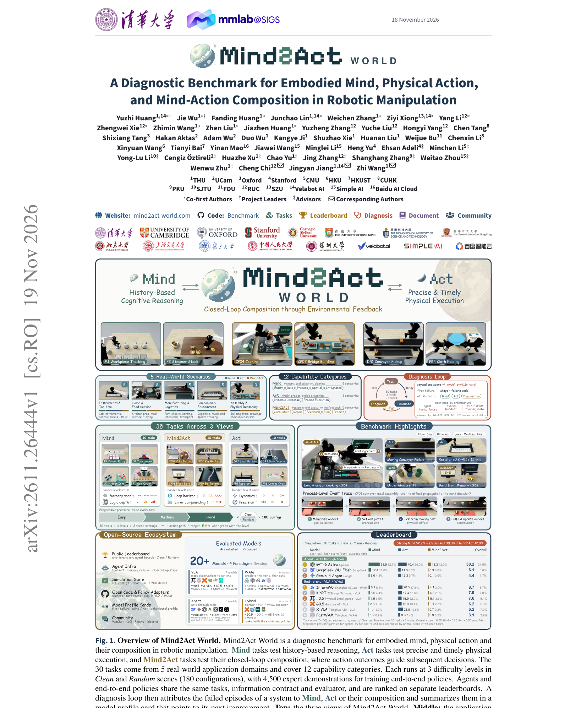
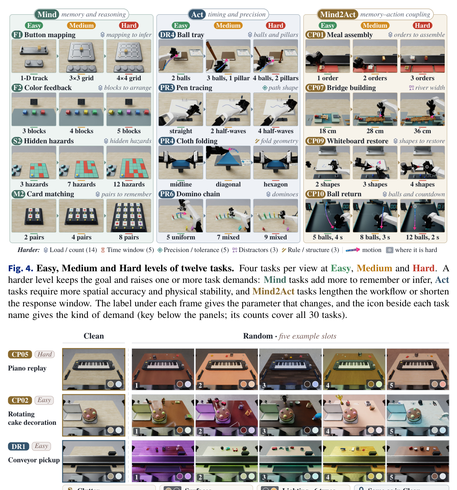

이번 주 HF Daily에서 스코어 1.00으로 가장 눈에 띈 논문입니다. 로봇 조작 벤치마크는 많지만 "왜 실패했는가"를 체계적으로 쪼개서 보여주는 시도는 드물었는데, 이 논문은 실패 원인을 21개 코드로 분류하고 모델별 프로필 카드까지 뽑아내는 진단 체계를 갖췄다는 점에서 이번 주 1순위로 골랐습니다. 특히 taskcraft가 상정하는 latent world model 가설과 직접 충돌하는 실증 결과를 담고 있어 더 눈여겨볼 만했습니다.

## 문제 제기: 성공률 하나로는 아무것도 알 수 없다

로봇 조작 벤치마크의 오래된 관행은 에피소드 끝에 성공했는지 실패했는지만 기록하는 것이다. 그런데 조작 작업은 보통 두 가지 능력이 섞여 있다. 하나는 과거 관측을 기억하고 다음에 뭘 해야 할지 추론하는 인지(Mind) 능력이고, 다른 하나는 그 판단을 실제 모터 제어로 정밀하게 실행하는 물리(Act) 능력이다. 최종 성공 여부만 보면 로봇이 물건을 놓친 게 손이 서툴러서인지 애초에 뭘 들어야 하는지 착각해서인지 구분할 수 없다.

더 큰 문제는 인지와 실행을 따로 떼어 각각 벤치마크를 만들어도 해결되지 않는다는 점이다. 실제 작업에서는 로봇이 한 번 움직인 결과가 다음 판단에 피드백되는 폐루프 상호작용이 끊임없이 일어난다. 문을 밀었는데 안 열렸다면 그 관측을 바탕으로 당기는 전략으로 바꿔야 한다. 이런 "행동 결과를 다시 인지에 반영하는" 결합 능력은 Mind 벤치마크에도 Act 벤치마크에도 없다.

## 왜 안 됐는가: 공정한 비교 기준조차 없었다

여기에 또 다른 걸림돌이 있다. 최근 로봇 조작 모델은 크게 두 계열로 나뉜다. 하나는 멀티모달 LLM이 모션 툴을 호출하는 에이전트 방식이고, 다른 하나는 영상과 언어를 받아 바로 행동을 출력하는 VLA(Vision-Language-Action) 혹은 WAM(World-Action Model) 계열의 end-to-end 정책이다. 이 둘은 추론 속도도 다르고 출력 형태도 다르다. 에이전트는 추론에 시간이 걸리는데, 시뮬레이션 시계가 계속 흐른다면 단지 생각하는 데 오래 걸린다는 이유로 불리해진다. 이런 구조적 차이 때문에 두 계열을 같은 리더보드에 올려놓고 비교하는 것 자체가 불공정했다.

## 고친 방법: 3개의 뷰와 3단계 진단 퍼널

이 논문은 벤치마크를 Mind, Act, Mind2Act 세 개의 뷰로 나눠 각각 10개씩 총 30개 작업을 설계했다. Mind는 과거 관측에 의존하는 추론 작업, Act는 시공간 제약 속 정밀 제어 작업, Mind2Act는 둘이 환경 피드백으로 맞물리는 폐루프 작업이다. 가정, 제조, 도구 사용, 조립, 교육이라는 5개 응용 도메인과 12개 역량 카테고리를 교차시키고, 난이도 3단계와 조명·텍스처·잡동사니를 추가한 Random 씬까지 조합해 총 180개 구성을 만들었다. 듀얼암 ARX X5 로봇으로 4,500개(75.8시간) 분량의 전문가 시연 데이터도 함께 공개했다.

공정성 문제는 간단하지만 효과적인 방식으로 풀었다. 모델이 추론하는 동안 Isaac Sim의 시뮬레이션 클록을 아예 멈춰서, 에이전트든 VLA든 생각하는 데 걸리는 시간이 성능에 불이익을 주지 않게 했다.

진단 쪽은 3단계 퍼널로 구성했다. 먼저 규칙 기반 채점기와 시뮬레이터 이벤트로 1차 필터링을 하고, 애매한 케이스는 비디오와 액션 로그를 본 LLM 판정관에게 넘기고, 그래도 불확실하면 사람이 최종 검수한다. 이 과정에서 모델이 첫 번째로 저지른 비가역적 오류를 21개 실패 코드(Mind 6종, Act 6종, Composition 4종, 에피소드 레벨 3종)로 분류하고, 이를 모아 모델별 프로필 카드를 자동 생성한다. 종합 점수는 단순 평균이 아니라 Mind와 Act에 각각 0.25, Mind2Act에 0.50을 주는 가중합으로 설계했는데, 이는 단일 능력만 잘하고 결합을 못하는 모델이 점수를 높게 받지 못하도록 막기 위한 장치다.

$$ \text{Overall Score} = 0.25 \times \text{Mind} + 0.25 \times \text{Act} + 0.50 \times \text{Mind2Act} $$

## 결과: 둘 다 잘해도 합치면 무너진다

결과는 예상보다 극단적이었다. 가장 강력한 멀티모달 에이전트인 GPT-6 Astra조차 Mind에서 52.7%, Act에서 39.0%를 기록했는데, 둘이 결합된 Mind2Act에서는 12.0%로 급감했다. X-VLA는 더 심해서 Act 19.6%에서 Mind2Act 0.2%로 사실상 작업을 전혀 수행하지 못했다.

Random 씬에서의 결과는 또 다른 약점을 보여준다. 조명이나 테이블 텍스처, 잡동사니를 추가했을 때 VLA 모델들의 Act 성공률은 86에서 94%로 거의 그대로 유지됐지만, Mind 성공률은 28에서 41% 수준으로 급락했다. KinRT는 97건에서 35건으로, $$\pi_{0.5}$$는 82건에서 23건으로 떨어졌다. 모터 제어는 외형 변화에 강건한데 추론은 그렇지 않다는 건, 이 모델들이 작업에 필요한 상태 기억을 추상화하기보다 학습 시점에 본 시각적 외형을 암기하는 쪽으로 학습됐다는 뜻이다.

## 용어 해설

- **VLA (Vision-Language-Action model)**: 카메라 영상과 언어 지시를 입력으로 받아 로봇의 관절 동작을 직접 출력하는 end-to-end 신경망 모델.
- **WAM (World-Action Model)**: 환경의 내부 상태를 예측하는 latent world model을 매개로 행동을 결정하는 모델 계열.
- **폐루프(closed-loop) 제어**: 시스템이 자신의 행동이 만든 결과를 다시 관측해 다음 판단이나 동작에 반영하는 제어 방식.
- **Wilson 신뢰구간**: 적은 표본에서도 비율(성공률) 추정치의 불확실성을 안정적으로 나타내는 통계적 구간 추정 방법.

## 🤖 AI의 생각

사실 요약과는 별개로, 이 논문이 흥미로운 건 벤치마크 자체보다 "결합 능력이 가장 취약한 지점"이라는 걸 숫자로 못박았다는 점이다.

Mind와 Act를 각각 재는 것과 Mind2Act를 재는 것의 차이가 왜 이렇게 큰가, 단순히 작업이 더 어려워서는 아닐까

논문은 난이도를 통제했다고 주장하지만 Mind2Act 작업이 Mind와 Act 작업보다 스텝 수나 상태 공간이 본질적으로 더 큰지 별도로 검증할 필요가 있어 보인다.

WAM 계열이 결합에서 특히 취약하다면, latent world model을 쓰는 것 자체가 결합 능력에 도움이 안 된다는 뜻인가

이 논문만으로는 latent 표현이 나빠서인지 학습 데이터가 결합 시나리오를 충분히 담지 못해서인지 분리할 수 없어서, taskcraft 입장에서는 이 둘을 가르는 실험이 먼저 필요하다.

taskcraft가 embodiment를 넘나드는 task representation을 만들려 한다면, 이 논문의 결과를 어떻게 선행 조건으로 삼을 수 있나

embodiment 이식을 시도하기 전에 같은 embodiment 안에서 행동 결과가 인지에 제대로 반영되는지부터 Mind2Act류 진단으로 먼저 확인하는 게 순서상 맞아 보인다.

참고문헌

원문<a href="https://huggingface.co/papers/2611.26444" target="_blank" rel="noopener">Mind2Act World: A Diagnostic Benchmark for Embodied Mind, Physical Action, and Mind-Action Composition in Robotic Manipulation</a> · hf-daily

