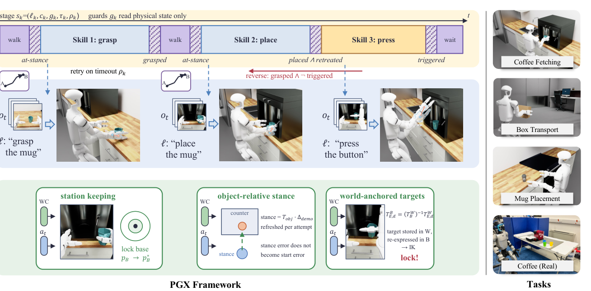
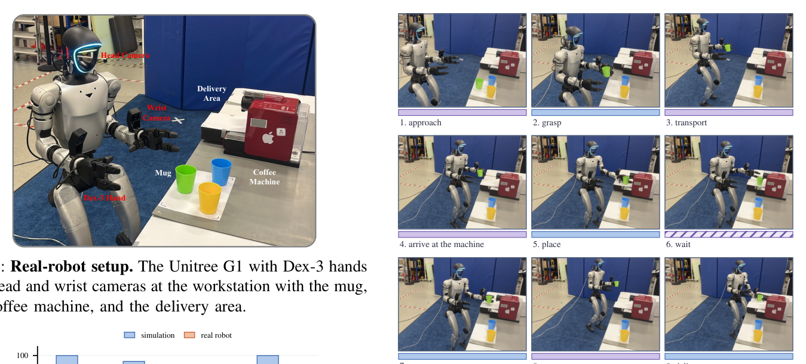

이번 주 논문은 PGX, Physically Grounded Execution for Long-Horizon Humanoid Loco-Manipulation입니다. 스코어링 점수 자체는 0.50으로 아주 높은 편은 아니지만, 요즘 학부 수업에서 배우는 Behavior Cloning이나 RL 고전 기법이 왜 휴머노이드의 "걷다가 조작하다가 다시 걷는" 긴 과제 앞에서 무너지는지, 그리고 그 해법이 반드시 더 큰 모델이나 더 많은 데이터가 아닐 수도 있다는 점을 선명하게 보여주는 사례라 이번 주 학습용 논문으로 골랐습니다. VLA라는 단어를 이번에 처음 접하는 독자라면 이 글이 좋은 입구가 될 것입니다.

## VLA가 뭐고 왜 긴 과제에서 무너지는가

VLA는 Vision-Language-Action 모델의 줄임말이다. 카메라 이미지와 언어 지시문을 입력으로 받아 로봇의 행동(관절 명령이나 엔드이펙터 자세)을 직접 출력하는 신경망이라고 생각하면 된다. 구조적으로는 수업에서 배운 Behavior Cloning의 연장선에 있다. 전문가 시연 데이터로 지도학습을 하되, 입력이 이미지와 텍스트까지 확장된 버전이다.

문제는 이 VLA 하나로 "커피 머신까지 걸어가서 컵을 집고 옮기고 버튼을 누르고 기다렸다가 다시 컵을 집어 배달한다" 같은 장기간(long-horizon) 과제 전체를 통째로 학습시키려 할 때 생긴다. 이런 과제는 단일 정책 안에 세 가지 서로 다른 책임이 뒤섞여 있다. 지금 몇 번째 단계인지 아는 것(타이밍), 접촉이 많은 조작을 실제로 해내는 것(스킬), 몸이 흔들리는 와중에도 손끝이 정확한 지점을 겨냥하는 것(정밀도)이다. 전통적인 TAMP(Task and Motion Planning)나 행동 트리 방식은 타이밍과 정밀도는 잘 다루지만 객체와 장면이 바뀔 때마다 사람이 다시 설계해야 하고, 접촉이 많은 스킬 자체는 모델 기반 제어로 깨지기 쉽다. 반대로 VLA 하나로 전부 학습시키면 세 가지 문제가 동시에 터진다.

첫째, 시각적으로 비슷해 보이는 서로 다른 단계의 장면을 구분하지 못해 엉뚱한 스킬을 실행한다. 둘째, 로봇 골반처럼 계속 움직이는 좌표계를 기준으로 행동을 표현하다 보니 정밀한 조작이 흔들린다. 셋째, 전체 시연 데이터 중 보행이나 거의 멈춰 있는 구간이 압도적으로 많아서, 모방학습이 안전하게 "일단 멈춰 있자"는 보수적인 행동으로 수렴해버린다. 이건 Behavior Cloning이 데이터 분포에 그대로 종속된다는, 수업에서 배운 그 한계가 장기간 과제에서 극단적으로 드러나는 모습이다.

위 그림이 이 문제를 압축해서 보여준다. 똑같은 VLA 백본을 썼는데도, 전체 과제를 하나의 지시문으로 통째로 학습한 flat 모델은 커피 머신에 도달하기도 전에 엉뚱한 스킬을 실행해 실패한다. 반면 PGX는 각 단계마다 적합한 실행기를 명시적으로 배정해 8단계 과제를 끝까지 완수한다. 저자들이 던지는 질문은 결국 이것이다. VLA 가중치를 전혀 건드리지 않고도 이 문제를 고칠 수 있을까.

## 왜 모델을 더 키우는 대신 실행 구조를 바꿨는가

PGX의 답은 "VLA는 조작을 잘하는 하나의 모듈로만 쓰고, 언제 그 모듈을 부를지, 어디를 기준으로 좌표를 잡을지는 네트워크 바깥에서 관리하자"는 것이다. 이 분리가 가능한 이유는, 장기간 과제의 타이밍 문제는 사실 물리적으로 검증 가능한 저차원 상태 판정으로 충분히 풀 수 있기 때문이다. 컵을 잡았는지, 물체를 내려놨는지, 버튼이 눌렸는지는 손 상태, 손목과 물체 사이 거리, 물체가 들린 높이 같은 몇 가지 숫자만 보면 판정할 수 있다. 굳이 신경망이 그 판단까지 학습할 필요가 없다는 것이다.

이 판정 함수를 논문은 술어(predicate)라고 부른다. 예를 들어 잡기 성공 여부는 다음과 같이 정의된다.

$$grasped \Leftrightarrow closed \land \lVert p_W - p_O \rVert < d_g \land z_O - z_{rest} > h_g$$

손이 닫혀 있고(closed), 손목 위치 $$p_W$$와 물체 위치 $$p_O$$ 사이 거리가 임계값 $$d_g$$보다 작고, 물체 높이 $$z_O$$가 정지 높이보다 $$h_g$$ 이상 올라왔을 때만 "잡음"으로 인정한다. 세 조건을 동시에 요구하는 이유는 간단하다. 빈손을 쥐는 동작만으로는 성공을 오판하지 않도록 하려는 것이다.

이런 술어들을 노드로 삼아 과제를 스테이지 그래프로 표현하고, 각 스테이지에 지시문, 실행기, 완료 술어, 시간 예산, 실패 시 복구 정책을 묶어 넣은 것이 PGX의 핵심인 predicate-gated stage machine이다. 재미있는 점은 이 술어가 세 역할을 동시에 겸한다는 것이다. 시연 데이터를 단계별로 자동 분할하는 기준이 되고, 실제 실행 중 전환 게이트가 되며, 평가할 때 단계별 진행도를 기록하는 잣대도 된다. 세 역할에 동일한 물리적 기준을 쓰기 때문에 학습, 실행, 평가가 서로 어긋나지 않는다.

그리고 VLA는 이 스테이지 머신이 "지금은 조작 단계다"라고 신호를 줄 때만 호출된다. 호출되기 전에 실행기가 기저부를 멈추고 팔 자세를 스킬이 학습된 초기 조건과 비슷하게 맞춰주기 때문에, VLA는 자신이 학습 때 본 것과 크게 다르지 않은 상황에서만 동작하면 된다. 게다가 전체 시연이 아니라 술어로 잘라낸 조작 구간만 모아 따로 학습한 stage 모델을 쓸 수도 있어서, 보행과 저동작 구간이 학습 데이터를 지배하는 문제도 자연스럽게 줄어든다.

마지막으로 정밀도 문제는 world-coordinate locking, 줄여서 WCL이라는 레이어로 해결한다. 기저부가 계속 움직이는 상황에서 팔이 겨냥하는 목표가 흔들리지 않게 하려고 세 가지 장치를 쓴다. 매 시도마다 객체 위치 기준으로 내비게이션 목표를 다시 잡는 객체 상대 스탠스, 조작 중에는 하나의 월드 기준 자세를 유지하다가 오차가 임계값을 넘을 때만 보정하는 기저부 스테이션 키핑, 그리고 버튼처럼 허용 오차가 아주 작은 접촉의 경우 목표 자세 자체를 월드 좌표계에 저장해두고 매 제어 주기마다 기저부 기준으로 재표현하는 월드 고정 접촉 타겟이다. 마지막 장치는 다음 식으로 표현된다.

$$T_{E,d}^B(t) = \left(T_B^W(t)\right)^{-1} T_{E,d}^W(t)$$

월드 프레임에 저장해둔 목표 자세 $$T_{E,d}^W(t)$$를, 현재 기저부 자세 $$T_B^W(t)$$의 역행렬과 곱해서 기저부 기준으로 다시 표현한 값이 $$T_{E,d}^B(t)$$다. 이렇게 매 순간 재계산한 목표를 역기구학(IK)으로 관절 명령으로 바꾸면, 몸통이 흔들려도 팔은 계속 월드 상의 같은 한 점을 겨냥하게 된다.

## 결과와 구조가 말해주는 것

위 아키텍처 그림이 PGX의 설계 철학을 그대로 보여준다. 상단의 스테이지 머신은 술어로 게이팅되는 단계 전환과 재시도, 그리고 혼동 시 되돌아가는 역전환까지 다루고, 중단의 VLA는 그 안에서 조작 자체만 책임지며, 하단의 WCL은 몸이 흔들려도 좌표가 안정적으로 유지되도록 받쳐준다. 세 레이어가 각자 자기 책임만 지고 서로의 영역을 침범하지 않는 구조다. 저자들은 Coffee Fetching, Box Transport, Mug Placement 같은 시뮬레이션 과제와 실제 로봇의 커피 과제에서 이 구조를 검증했고, 동일한 VLA 가중치를 쓰고도 flat 정책 대비 과제 완수율이 크게 개선됨을 보였다.

다만 이 구조가 공짜는 아니다. 술어와 월드좌표 고정은 특정 로봇의 손 형태, 기저부, IK 체인에 강하게 묶여 있어서, 다른 휴머노이드나 다른 과제로 옮기려면 술어 정의와 임계값을 다시 손봐야 한다. 결국 PGX는 "VLA를 더 똑똑하게 만드는 법"이 아니라 "VLA가 똑똑해질 필요가 없는 상황만 만들어주는 법"에 가깝다. 그 대가로 사람이 설계해야 하는 부분이 완전히 사라지지는 않았다는 점은 솔직하게 짚어둘 만하다.

## 용어 해설
- **술어(predicate)**: 참 또는 거짓으로 판정되는 조건식을 가리키는 논리학 용어로, 여기서는 "잡았다", "눌렀다" 같은 물리적 상태를 몇 개의 측정값으로 참/거짓 판정하는 함수를 뜻한다.
- **유한상태기계(Finite State Machine, FSM)**: 시스템이 가질 수 있는 상태들과 상태 사이의 전환 규칙을 정의한 모델로, 특정 조건이 만족될 때만 다음 상태로 넘어간다.
- **역기구학(Inverse Kinematics, IK)**: 로봇 팔 끝이 원하는 위치와 방향에 도달하도록, 각 관절이 얼마나 움직여야 하는지를 거꾸로 계산하는 문제다.
- **히스테리시스(hysteresis)**: 어떤 상태 전환이 한 번의 임계값이 아니라 들어갈 때와 나올 때 서로 다른 두 임계값으로 일어나게 해서, 경계 근처에서 전환이 자꾸 진동하는 것을 막는 설계 기법이다.

## 🤖 AI의 생각

사실 요약과는 별개로 느낀 점을 말하면, 이 논문이 흥미로운 건 "학습을 더 잘 시키자"가 아니라 "학습된 모델을 건드리지 않고 그 주변 구조를 바꾸자"는 입장을 끝까지 밀어붙였다는 점이다.

술어 기반 완료 판정이 정말로 모든 조작 동작에 대해 깨지지 않고 일반화될 수 있을까

논문이 다룬 과제들은 잡기, 놓기, 누르기처럼 완료 조건이 비교적 뚜렷한데 천 접기나 액체를 붓는 동작처럼 경계가 모호한 조작에서도 저차원 술어만으로 충분할지는 의문이 남는다.

stage 모델처럼 조작 구간만 잘라 학습하면 보행과 조작 사이의 전이 동작 자체는 누가 배우는가

논문에서는 전환을 실행기가 스킬 시작 조건을 재확립하는 과정으로 처리하는데 이 재확립 로직 자체가 또 하나의 수작업 설계 지점이라는 점이 눈에 띈다.

taskcraft가 추구하는 embodiment-agnostic latent 표현에 PGX의 술어 같은 장치를 끼워 넣으면 어떨까

latent만으로 접촉이나 타이밍을 완전히 잡아내기 어렵다면 grasped 같은 물리적으로 검증 가능한 저차원 신호를 보조 레이블이나 검증 장치로 함께 쓰는 쪽이 디버깅에 더 유리할 수 있다.

참고문헌

원문<a href="https://arxiv.org/abs/2611.26596v1" target="_blank" rel="noopener">PGX: Physically Grounded Execution for Long-Horizon Humanoid Loco-Manipulation</a> · arxiv

