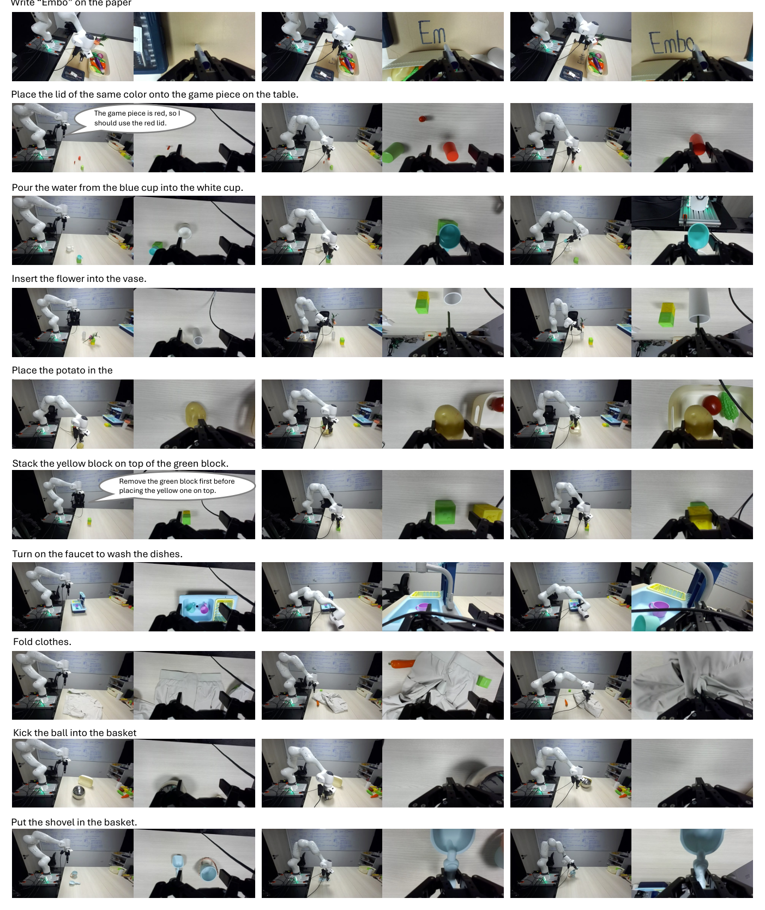
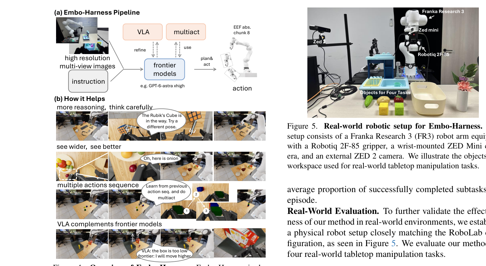

## 들어가며

이번 주는 Hugging Face Daily Papers에서 score 1.00으로 가장 눈에 띈 논문을 골랐습니다. GPT-6-Astra 같은 프런티어 멀티모달 모델을 로봇 제어 루프 안에 그대로 집어넣어 "정책(policy)"으로 쓰는 시도가 최근 부쩍 많아졌는데, 다들 결과만 자랑할 뿐 왜 되는지는 아무도 설명하지 않고 있었습니다. 그 공백을 정면으로 파고든 논문이라 이번 주 1순위로 뽑았습니다.

## 문제 제기: 왜 되는지 아무도 모른다

SenseNova-RoboRSI나 GPT-as-Policy 같은 최근 시스템들은 로봇 조작 전용으로 학습된 VLA(Vision-Language-Action)나 WAM(World Action Model)보다 오히려 범용 목적으로 학습된 프런티어 모델을 폐루프(closed-loop) 하니스에 직접 끼워 넣었을 때 더 나은 성공률을 보여줬다. 이상한 일이다. 저 모델들은 로봇 데이터를 거의 본 적이 없는데, 로봇 팔 전용으로 수만 번의 시연 데이터를 학습한 전문 정책보다 낫다는 게 말이 되나.

문제는 기존 연구들이 전부 "우리 시스템이 이만큼 잘합니다"를 보여주는 데서 끝났다는 점이다. 하니스를 구성하는 요소(프롬프트, 플래닝, 액션 실행 방식, 툴 사용)가 수십 개인데, 그중 뭐가 진짜 성능을 끌어올리는지, 그리고 애초에 프런티어 모델의 어떤 능력이 작동하는 건지 아무도 통제된 실험으로 분리하지 않았다. 그냥 "잘 되네" 수준에 머물러 있었던 것이다.

## 왜 기존 접근으로는 답이 안 나왔나

하니스 설계는 변수가 너무 많다. action space를 joint로 할지 end-effector(EEF)로 할지, 절대좌표로 할지 상대좌표로 할지, 액션 청크를 몇 프레임으로 끊을지, 추론 노력(reasoning effort)을 어느 수준으로 줄지, 명시적 플래닝을 시킬지 말지. 이걸 한꺼번에 바꿔서 비교하면 어느 변수가 효과를 냈는지 알 수 없다. 그래서 다들 "우리 설정이 최선"이라고만 말하고 각 요소의 기여도는 블랙박스로 남겨뒀다.

## 고친 방법: 한 번에 하나씩 바꿔보기

이 논문은 π0.5 설정을 베이스라인으로 고정하고, 매 단계마다 딱 하나의 설계 요소만 바꿔서 효과를 측정한 뒤, 그 결과가 좋으면 다음 단계에 누적 반영하는 방식으로 레시피를 쌓아갔다. 위 그림의 (a)가 그 과정을 그대로 보여준다. 베이스라인 성공률 43.3%에서 시작해, action space를 EEF 절대좌표로 바꾸니 58.3%, 액션 청크를 8로 줄이니 65.0%, 추론 노력을 xhigh로 올리니 83.3%, 해상도를 640으로 키우니 90.0%, 마지막으로 짧은 다중 액션 시퀀스 툴과 VLA refinement를 더하니 96.7%까지 올라갔다.

흥미로운 건 안 통한 것들이다. 명시적 플래닝을 시키거나 실패 사례에서 뽑은 "주의 사항(notice reminder)"을 프롬프트에 넣는 건 효과가 없었고, 비동기 액션 실행도 도움이 안 됐다. 반면 멀티뷰 이미지와 고해상도는 확실히 효과가 있었다. 여기서 패턴이 보이기 시작한다. 모델에게 "어떻게 움직여야 하는지"를 더 많이 알려주는 건 소용없고, "어디를 봐야 하는지"를 더 잘 보여주는 게 효과가 있었다는 것이다.

이 가설을 더 밀어붙인 게 논문의 진짜 핵심 실험이다. 모델이 직접 joint 각도를 생성하게 하거나(joint bias) 프레임 단위로 trajectory를 직접 그리게 했더니(trajectory bias) 성공률이 각각 23.3%p, 18.3%p나 떨어졌다. 반대로 단거리 액션 청크 대신 최종 EEF 목적지(destination)를 직접 예측하게 했더니 오히려 5.0%p 올랐다. 위 그림 (b)의 세 그래프가 이 결과를 나란히 보여준다. 결국 모델이 잘하는 건 저수준 모터 패턴 생성이 아니라 "저 물건이 3D 공간 어디에 있는지"를 정확히 짚어내는 공간 인식(spatial perception)이었던 셈이다.

## 패러다임을 구분해야 하는 이유

이 결과를 제대로 이해하려면 먼저 "frontier-model-as-policy"가 기존 두 패러다임과 어떻게 다른지 구분해야 한다. 위 그림이 그 분류를 보여주는데, 세 패러다임 모두 폐루프 구조라는 점은 같지만, 액션이 어디서 나오는지가 다르다. tool/code-as-policy는 사전에 정의된 코드나 툴에서, model-as-policy는 로봇 데이터로 학습된 전문 모델에서, frontier-model-as-policy는 범용 멀티모달 모델 자체에서 액션(혹은 액션에 준하는 목적지 정보)이 나온다. 이 구분이 명확해야 "왜 로봇 전용 데이터 없이도 잘하는가"라는 질문이 "저수준 제어 능력이 아니라 공간 이해 능력 때문"이라는 답으로 이어지는 흐름이 자연스러워진다.

## 결과와 솔직한 한계

RoboLab-120(120개 테이블탑 조작 과제)과 네 가지 실세계 과제(블록 쌓기, 과일 포장, 설거지, 꽃꽂이)에서 최종 레시피(Embo-Harness)는 VLA, WAM, 다른 에이전틱 베이스라인들을 모두 앞섰다. 다만 이 논문이 수학적 모델이나 새로운 학습 알고리즘을 제시한 건 아니다. 전부 경험적 관찰과 통제 실험의 조합이고, 결론도 "공간 인식이 중요하다"는 상당히 직관적인 수준에 머문다. 또 실험이 특정 모델(GPT-6-Astra)과 특정 로봇 플랫폼(DROID/Franka Panda)에 묶여 있어서, 다른 프런티어 모델이나 다른 로봇 형태에도 같은 레시피가 그대로 먹힐지는 알 수 없다. 하니스 소요 시간이 분 단위로 늘어난다는 점도 실용성 측면에서 걸리는 부분이다.

## 용어 해설

- **VLA(Vision-Language-Action model)**: 카메라 영상과 언어 지시를 입력받아 로봇의 저수준 액션(관절 각도, 엔드이펙터 위치 등)을 직접 출력하도록 학습된 모델군을 가리킨다.
- **역기구학(Inverse Kinematics, IK)**: 로봇 팔의 끝단(end-effector)이 원하는 위치와 자세를 갖도록 각 관절의 각도를 역산하는 계산 과정이다.
- **추론 노력(reasoning effort)**: 최근 거대 언어 모델 API에서 모델이 답을 내기 전에 얼마나 많은 내부 추론 단계를 거치게 할지 조절하는 설정값이다.
- **폐루프 제어(closed-loop control)**: 시스템이 실행 결과를 다시 관측하고 그 피드백을 반영해 다음 행동을 결정하는 제어 방식으로, 한 번 명령을 내리고 끝나는 개루프 제어와 대비된다.

## 🤖 AI의 생각

이 논문은 화려한 수식 없이도 "왜 되는가"를 끈질기게 분해해서 답을 찾아낸 점이 인상적이었다. 다만 결론 자체가 다소 예견 가능했던 만큼, 더 파고들 지점은 따로 있다고 생각한다.

공간 인식이 핵심이라면, 애초에 로봇 전용 시연 데이터 학습이 가르치려던 건 무엇이었을까?

아마도 저수준 모터 패턴과 공간 이해가 뒤섞인 채로 학습됐을 가능성이 높고, 이 논문은 둘을 분리하면 후자만으로도 충분하다는 걸 보여준 셈이다.

joint bias와 trajectory bias가 성능을 깎은 이유가 단순히 "모델이 그 출력 형식에 익숙하지 않아서"일 가능성은 없을까?

가능성은 있지만 destination 예측이 오히려 향상됐다는 대조 결과가 있어 단순 형식 문제보다는 표현 수준의 차이로 보는 게 더 설득력 있다.

taskcraft가 사람 시연에서 embodiment에 독립적인 task representation을 뽑으려는 것과 이 논문의 결과는 어떻게 이어질까?

사람 시연이든 프런티어 모델의 정책화든 결국 "어디를 조작해야 하는지"라는 공간 타겟 표현이 embodiment를 넘어 전이 가능한 핵심일 수 있다는 가설을 서로 다른 방향에서 뒷받침한다고 볼 수 있다.

참고문헌

원문<a href="https://huggingface.co/papers/2611.31201" target="_blank" rel="noopener">Embo-Harness: Towards Understanding Frontier-Model-as-Policy Harness</a> · hf-daily

