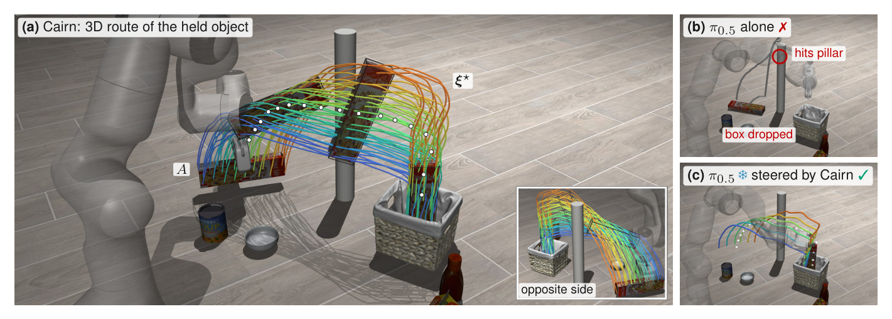
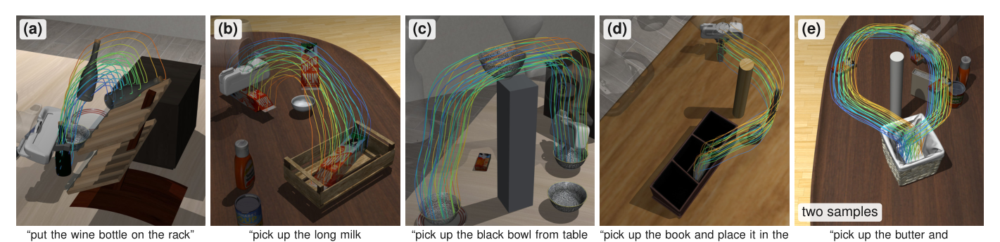

이번 주 리포트에서 이 논문의 점수는 0.33으로 그리 높지 않습니다. 화제성 面에서는 다른 논문들에 밀릴 수 있다는 뜻입니다. 그럼에도 이 논문을 골라 자세히 다루는 이유는, VLA(Vision-Language-Action model)라는 개념이 익숙하지 않은 분들께 "로봇 정책을 재학습하지 않고 다르게 움직이게 만든다"는 아이디어가 구체적으로 어떻게 구현되는지 보여주기에 좋은 사례이기 때문입니다. Imitation Learning과 RL의 고전 기법을 배운 분이라면, 그 다음 단계로 VLA가 왜 등장했고 왜 그걸로도 부족한지를 이 논문 하나로 따라가 볼 수 있습니다.

## VLA가 뭐고 왜 한계가 있나

VLA는 Vision-Language-Action model의 줄임말이다. 카메라로 본 장면과 "상자를 선반 위에 놓아라" 같은 언어 명령을 입력받아, 로봇 팔의 다음 액션(관절 움직임이나 엔드이펙터 자세 변화)을 직접 출력하는 모델이다. π0.5나 GR00T 같은 최근 모델들은 대규모 로봇 시연 데이터로 학습되어 파지(grasp), 배치(place) 같은 모터 스킬 자체는 꽤 잘 해낸다. 수업에서 배운 Behavior Cloning의 연장선에 있다고 보면 된다. 관측을 입력으로 액션을 지도학습으로 맞추는 것인데, 스케일이 훨씬 크고 입력에 언어가 추가됐을 뿐이다.

문제는 BC 계열이 항상 가지고 있던 약점이 VLA에서도 그대로 나타난다는 점이다. 학습 데이터에 없던 레이아웃을 만나면 무너진다. 논문의 Figure 1b가 이를 정확히 보여준다. π0.5가 혼자 실행하면 상자를 들고 가다가 기둥에 부딪혀 떨어뜨린다. 학습할 때 본 적 없는 위치에 장애물이 있으니, 모델은 "어디로 가야 하는지"를 새로 추론하지 못하고 예전에 외운 궤적을 그대로 재생한다.

이 문제를 푸는 가장 직관적인 방법은 새 레이아웃에서 시연 데이터를 더 모아 파인튜닝하는 것이다. 하지만 레이아웃이 바뀔 때마다 데이터를 다시 모으는 건 현실적이지 않고, 파인튜닝 과정에서 기존에 잘하던 스킬을 잊어버리는 망각(catastrophic forgetting) 문제도 생긴다. 그래서 최근 연구들은 "VLA 가중치는 건드리지 않고, 테스트 시점에 외부에서 방향만 틀어주자"는 steering 접근을 시도해왔다.

## 기존 steering이 왜 충분하지 않았나

OmniGuide 같은 선행 연구는 그리퍼 위치에 대한 3차원 에너지 함수를 정의해서, 장애물에서 멀어지고 목표에 가까워지도록 디노이징 과정에 그래디언트를 더해주는 방식을 썼다. VLA 재학습이 필요 없다는 점에서 방향은 맞았지만 두 가지가 비었다.

첫째, 목표 지점을 모르는 상태에서 충돌 회피 에너지만 쓰면 지역 최소점에 빠지기 쉽다. 장애물을 피하긴 하는데 엉뚱한 곳에서 멈추거나 빙빙 도는 식이다. 둘째, 더 근본적으로는 추적 대상이 "그리퍼"였다. 그런데 실제로 옮겨야 하는 건 그리퍼가 쥔 물체다. 긴 상자나 넓적한 판처럼 형상이 있는 물체는 틈을 통과하려면 위치뿐 아니라 회전까지 맞아야 하는데, 그리퍼 위치만 추적해서는 이걸 표현할 방법이 없다.

계층적 VLA 구조(상위 계획기 + 하위 정책)는 이 문제를 풀 수 있을 것 같지만, 하위 정책이 계획을 따르도록 별도로 학습해야 해서 애초에 "고정된 VLA를 그대로 쓴다"는 전제에 위배된다. 모션 플래너(RRT 등)는 반대로 목표 지점이 미리 좌표로 주어져야 작동하는데, 언어 명령에서 목표 좌표를 추론하는 건 플래너의 역할이 아니다.

정리하면, "고정된 VLA를 어떻게 steering할지"는 이미 답이 있었는데 "어디로 steering할지"가 빠져 있었다. Cairn은 바로 이 빈자리, 즉 object-centric한 3D 경로(route)를 생성하는 prior를 채워 넣는다.

## Cairn의 핵심: 물체 중심 SE(3) 궤적 prior

$$SE(3)$$는 3차원 공간에서 위치와 회전을 동시에 표현하는 변환의 집합이다. Cairn의 prior는 장면 점군, 들고 있는 물체의 점군, 파지 시점 자세, 언어 명령을 입력으로 받아, 물체가 지나갈 일련의 $$SE(3)$$ 웨이포인트를 생성한다. 그리퍼가 아니라 "물체"를 추적 대상으로 삼았기 때문에, 긴 물체가 좁은 틈을 지나기 위해 세로로 눕는 식의 회전까지 자연스럽게 계획에 포함된다.

Figure 1을 보면 (a)는 Cairn이 뽑은 최적 경로를 상자 위 여러 점의 궤적으로 그린 것인데, 상자가 기둥을 지나며 세로로 세워지는 모습이 뚜렷하다. (b)는 steering 없이 π0.5 혼자 실행했을 때 기둥에 부딪히는 장면, (c)는 동일한 π0.5가 Cairn의 경로에 유도되어 성공하는 장면이다. 모델 자체는 바뀌지 않았고, 경로만 주어졌는데 결과가 갈린다.

이 prior는 rectified flow라는 생성 모델 방식으로 학습됐다. Diffusion 모델과 같은 계열로, 노이즈에서 시작해 점진적으로 깨끗한 경로로 수렴해가는 과정을 학습한다. 특히 각 웨이포인트가 샘플링 스텝마다 주변 장면 점군에 로컬 어텐션으로 주목하도록 설계되어, 경로가 장면의 실제 기하 구조(장애물 위치 등)를 반영하게 만들었다.

학습 데이터도 직접 만들어야 했다. LIBERO의 실제 시연은 같은 레이아웃 안에서 궤적 차이가 2~4cm밖에 안 날 정도로 다양성이 부족했기 때문에, 논문은 MimicGen 방식처럼 파지와 운반, 배치 구간을 재조합해 새 레이아웃에 재배치하고 게이트, 기둥, 바 같은 장애물을 추가해 회전과 우회가 필요한 시나리오를 대량 생성했다. 시뮬레이션에서 충돌 검사를 통과하고 실제로 실행에 성공한 경로만 걸러서(통과율 71%) LIBERO-Shift라는 1,941개짜리 held-out 벤치마크를 만들었다.

## 양방향 steering: prior와 VLA가 서로를 당긴다

여기가 이 논문에서 가장 흥미로운 부분이다. 단순히 "prior가 계획하면 VLA가 따른다"는 일방향 구조가 아니라, 두 방향으로 정보가 오간다.

Figure 2(b)의 왼쪽 절반이 "prior의 턴"이다. prior는 여러 후보 경로를 동시에 생성하는데, 이때 VLA가 파지 직후 실행하지 않고 참고만 하는 의도(unguided intent) 샘플을 뽑아, 이 샘플이 후보 경로들을 끌어당기도록 한다. 그렇게 모인 후보 중 장면과 충돌하지 않는 것들의 중앙값(medoid)을 최종 경로로 고른다. 즉 prior가 완전히 독자적으로 경로를 정하는 게 아니라, VLA가 원래 하려던 방향도 어느 정도 반영한다.

오른쪽 절반은 "VLA의 턴"이다. 선택된 경로의 다음 웨이포인트가 VLA의 디노이징 과정 중 예측된 물체 자세를 끌어당긴다. 이때 핵심은 단순한 경사하강 업데이트가 아니라 댐핑된 가우스뉴턴(Gauss-Newton) 보정을 쓴다는 점이다. VLA가 예측한 물체 위치와 다음 웨이포인트 사이의 잔차를 야코비안으로 역산해서, 위치와 회전과 그리퍼 개폐까지 한 번의 선형계 풀이로 동시에 보정한다. 단순 그래디언트 스텝을 쓰면 방향마다 민감도가 달라 보정 크기를 잘못 잡기 쉬운데, 가우스뉴턴 보정은 잔차의 일정 비율만큼을 정확히 상쇄하도록 스텝을 조절해 이 문제를 피한다. VLA 네트워크를 다시 역전파하지 않고 디노이징 중간 추정치에 직접 보정을 더하는 방식이라 연산 비용도 크게 늘지 않는다.

## 결과와 한계

LIBERO-Shift 벤치마크에서 steering 없는 π0.5는 성공률 24.5%에 그쳤는데, Cairn으로 유도했을 때 95.1%까지 올라갔다. VLA 가중치는 하나도 바꾸지 않은 채 얻은 결과라는 점이 핵심이다.

다만 논문이 스스로 밝히는 한계도 있다. 이 방법은 결국 paired된 장면, 물체 점군과 정확한 파지 자세 추정이 전제되어야 작동한다는 점에서, 지각(perception) 파이프라인의 오차에 민감할 수 있다. 또한 prior 자체가 LIBERO류의 테이블탑 조작과 유사한 분포에서 학습됐기 때문에, 전혀 다른 형태의 조작(변형 가능한 물체, 양손 조작 등)으로 얼마나 일반화되는지는 이 논문만으로는 확인하기 어렵다. "경로만 잘 주면 고정된 정책도 다르게 행동한다"는 아이디어는 설득력 있지만, 그 경로 자체를 만드는 prior의 일반화는 결국 또 다른 학습 문제로 남는다.

## 용어 해설

- **SE(3)**: 3차원 공간에서 물체의 위치와 회전을 함께 나타내는 변환들의 집합. 로봇이 물체를 어디로, 어떤 방향으로 옮기는지를 하나의 수학적 대상으로 표현할 때 쓴다.
- **Rectified Flow (Flow Matching)**: 노이즈 샘플에서 출발해 점진적으로 목표 분포의 샘플로 변환해가는 생성 모델 학습 방식. Diffusion 모델과 비슷한 계열이지만, 노이즈에서 데이터로 가는 경로를 더 곧게(직선에 가깝게) 학습하는 것이 특징이다.
- **야코비안(Jacobian)**: 여러 변수를 입력받는 함수의 출력이 각 입력에 대해 얼마나 민감하게 변하는지를 나타내는 편미분 행렬.
- **가우스뉴턴(Gauss-Newton) 보정**: 비선형 최소제곱 문제를 풀 때 쓰는 반복적 최적화 기법으로, 단순 경사하강법보다 잔차를 줄이는 스텝 크기와 방향을 더 정확하게 계산한다.

## 🤖 AI의 생각

사실 요약과는 별개로 제 개인적인 인상을 말씀드리면, 이 논문은 화려한 새 아키텍처보다 "추적 대상을 그리퍼에서 물체로 바꾼다"는 단순한 관점 전환이 얼마나 큰 차이를 만드는지 보여준다는 점이 인상적이었습니다.

prior가 학습 분포 밖의 전혀 다른 조작 과제(변형 가능한 물체나 양손 조작)로 확장될 때도 object-centric 궤적이라는 표현이 여전히 유효할까?

강체(rigid body) 가정에 기반한 $$SE(3)$$ 웨이포인트라서 변형 가능한 물체에는 바로 적용하기 어렵고, 양손 조작은 두 물체 간 상대 자세까지 포함하는 확장이 필요해 보인다.

양방향 steering에서 VLA의 unguided intent가 prior의 경로 선택에 영향을 주는 구조는, VLA가 애초에 틀린 방향으로 편향돼 있을 때 오히려 나쁜 경로를 고르게 만들지 않을까?

논문은 충돌 검사를 통과한 후보 중에서만 medoid를 고르므로 명백히 나쁜 경로는 걸러지지만, 애매하게 가능한 여러 경로 중 VLA의 편향이 선택을 좌우할 여지는 남아있다.

taskcraft가 지향하는 "행동이 세계 상태를 어떻게 바꾸는가"를 표현하는 latent world model 관점에서 보면, Cairn의 object-centric route는 어떤 식으로 재사용할 수 있을까?

로봇 관절 공간보다 추상화된 물체 궤적 표현이라 embodiment에 덜 의존적이므로, 서로 다른 로봇 간 계획을 공유하는 중간 표현으로 가져다 쓸 여지가 있어 보인다.

참고문헌

원문<a href="https://arxiv.org/abs/2611.34914v1" target="_blank" rel="noopener">Cairn: Object-Centric 3D Trajectory Priors for Steering Frozen VLAs</a> · arxiv

