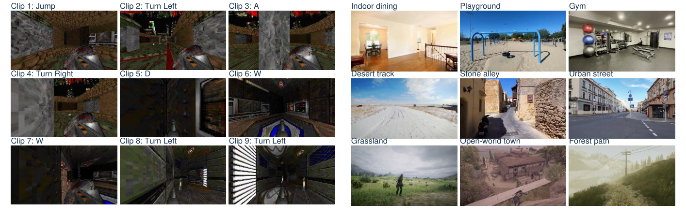
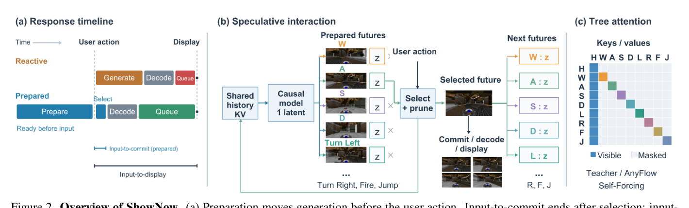

## 이번 주 왜 이 논문인가

안녕하세요. 이번 주는 인터랙티브 World Model 쪽에서 눈에 띄는 논문을 골랐습니다. HuggingFace Daily Papers에서 스코어 0.83으로 상위권에 든 ShowNow는, "실시간으로 영상을 생성하는 모델이 사용자 입력에 얼마나 빨리 반응할 수 있는가"라는 꽤 실용적인 질문을 던지고, 단일 H100 GPU라는 현실적인 제약 안에서 숫자로 답을 내놓습니다. 저도 로보틱스 쪽에서 실시간 제어 루프의 지연 문제를 다루다 보니, 이 논문이 지연을 줄이기 위해 "계산을 덜 하는" 대신 "유휴 시간에 미리 계산해둔다"는 방향을 택한 점이 흥미로웠습니다.

## 문제 제기: 월드 모델은 왜 느리게 반응하는가

게임 엔진을 비디오 생성 모델로 대체하려는 인터랙티브 World Model은 두 가지 일을 동시에 해야 한다. 화면을 끊김 없이 계속 그려내는 것, 그리고 사용자가 누르는 키(전진, 회전, 발사, 점프)에 즉각 반응하는 것이다. 문제는 이 둘이 서로 충돌한다는 점이다.

기존 방식은 보통 3개의 latent를 묶어 750ms짜리 블록 단위로 생성을 커밋한다. 블록이 통째로 끝나야 다음 입력을 반영할 수 있으니, 사용자가 방향을 바꿔도 화면은 한참 뒤에야 따라온다. 게다가 생성 자체도 입력이 들어온 "다음에" 시작되는 reactive 구조라서, 생성에 걸리는 시간 전체가 그대로 사용자가 체감하는 지연에 더해진다. 논문이 측정한 기존 방식(SolarWM-FT)의 지연은 P50 기준 620ms, P99는 1385ms에 달한다. 초당 수십 프레임을 뽑아내는 처리량(throughput)이 아무리 높아도, 이 입력-표시 지연(input-to-display latency) 문제는 따로 풀어야 한다는 게 저자들의 출발점이다.

## 왜 단순히 더 빨리 생성하는 걸로는 안 됐는가

처리량을 올리는 쪽으로 접근하면 결국 모델을 더 작게 만들거나 스텝 수를 줄이는 수밖에 없고, 이는 화질이나 일관성을 희생한다. 더 근본적인 문제는 구조에 있다. 블록 단위 커밋 자체가 "입력이 반영되는 최소 시간 단위"를 750ms로 못 박아버린다는 것, 그리고 생성이 입력 이후에 시작된다는 것. 이 둘을 그대로 둔 채로는 처리량을 아무리 늘려도 지연의 하한선이 바뀌지 않는다.

그래서 저자들은 질문을 바꾼다. 영상이 재생되는 동안 GPU는 계속 놀고 있는 시간이 있는데, 그 유휴 자원으로 "사용자가 다음에 누를 법한 행동들의 결과"를 미리 만들어둘 수는 없을까. 이게 이 논문의 핵심 아이디어인 투기적 스트리밍(speculative streaming)이다.

## 고친 방법: 미리 8개의 미래를 그려두기

구조는 이렇다. 커밋된 공통 히스토리 $$h_n$$에서 출발해, 가능한 8개 행동(전후좌우 이동, 좌우 회전, 발사, 점프) 각각에 대해 미래 latent를 미리 한 스텝씩 생성해둔다. 실제 입력이 도착하면 해당하는 분기만 골라 커밋하고 나머지는 버린다. 선택된 분기가 다음 라운드의 새로운 공통 히스토리가 되고, 거기서 다시 8개의 미래가 갈라져 나온다.

Figure 1을 보면 이 구조가 실제로 얼마나 효과가 있는지 바로 드러난다. 기존 3-latent 블록 방식의 P50 지연 620ms에 비해, 한 latent 단위로 세밀하게 커밋하는 Reactive 방식만으로도 211ms까지 줄고, 8개 미래를 미리 준비해두는 Eight Futures 방식은 208ms로 거의 동일하면서 연속 스트림에서의 재시작 공백 틱(restart empty tick)을 1.56%에서 0.09%로, 즉 94% 줄인다. 균일한 타이밍으로 전환이 요구되는 실험에서는 목표 달성률이 83.8%에서 96.8%로 올라간다. 지연 숫자만 보면 한 latent 단위 커밋이 이미 효과의 대부분을 설명하지만, 여러 미래를 미리 준비해두는 것은 "타이밍이 애매한 순간"의 안정성을 책임지는 역할을 한다.

문제는 8개의 미래를 매번 독립적으로 계산하면 연산량이 8배로 뛴다는 점이다. 여기서 두 번째 핵심 장치인 Branch-Tree Attention이 들어온다. 히스토리 토큰은 한 번만 계산해 모든 분기가 공유하고, 각 분기는 자신의 분기와 공유 히스토리만 바라보도록 attention mask를 설계해서, 8개를 독립적으로 계산한 것과 수학적으로 동일한 결과를 내면서 중복 계산을 없앤다. 논문의 설정값($$N_H=9$$, $$N_F=12$$, $$K=8$$)에서는 전체 어텐션 슬롯이 168개에서 105개로 줄어든다.

Figure 2의 (a)는 Reactive 방식과 Prepared 방식의 타임라인 차이를 보여주는데, 입력이 들어온 뒤 생성부터 시작하는 것과 이미 준비된 결과 중 하나를 고르기만 하면 되는 것의 응답 속도 차이가 한눈에 보인다. (c)의 어텐션 마스크 그림은 히스토리는 공유되지만 8개 분기가 서로 완전히 격리되어 있다는 점을 색으로 보여주는데, 이게 바로 식 4으로 정의된 Branch-Tree Attention의 시각화다.

하지만 여러 분기를 동시에 학습시키는 데도 함정이 있다. 같은 히스토리와 같은 노이즈에서 출발해 여러 행동의 미래를 동시에 예측하도록 학습시키면, 모델이 "행동마다 결과가 달라야 한다"는 걸 명시적으로 배우지 못하고 비슷한 미래만 뭉뚱그려 내놓을 위험이 있다. 저자들은 여기에 분기-차이 보조항($$\mathcal{L}_{diff}$$)을 추가해서, 두 행동의 예측 속도 차이가 실제 미래의 차이와 일치하도록 손실 함수에서 직접 강제한다. 공유 노이즈 덕분에 이 차이가 깔끔하게 정의되는 점을 이용한 설계다.

추론 단계에서도 결정 이후의 작업(post-decision path)을 FastTree 캐시, 분할 어텐션의 log-sum-exp 병합, CUDA 그래프, fused commitment로 다듬어서 약 17.5ms 걸리던 걸 3.5ms까지 줄였다고 밝힌다. 이런 세부 최적화가 없었다면 "미리 준비해둔다"는 아이디어 자체가 실시간 예산 안에 들어오지 못했을 것이다.

## 한계와 남는 질문

논문이 다루는 행동 공간은 8개로 고정되어 있고, 이는 ViZDoom처럼 이산적인 키 입력 환경에 특화된 설정이다. 연속적인 조작(예: 아날로그 스틱 각도, 로봇 팔의 연속 제어)으로 행동 공간이 커지면 분기 수가 폭발적으로 늘어나는데, 이 경우 Branch-Tree Attention의 공유 이점이 그대로 유지될지는 논문에서 다뤄지지 않는다. 또한 단일 H100이라는 조건이 전제이기 때문에, 더 작은 GPU나 멀티 유저 서빙 환경에서 "유휴 자원 활용"이라는 전제 자체가 성립하는지도 별개의 문제로 남는다.

## 용어 해설

- **Flow Matching**: 노이즈와 실제 데이터를 잇는 속도장(velocity field)을 직접 학습시켜 적은 스텝으로도 데이터를 생성할 수 있게 하는 생성 모델 학습 방식이다. Diffusion 모델의 대안 내지 발전형으로 자주 쓰인다.
- **KV 캐시**: Transformer의 attention 계산에서 이전 토큰들의 Key, Value 벡터를 매번 다시 계산하지 않고 저장해두었다가 재사용하는 기법으로, 자기회귀적 생성의 속도를 크게 높여준다.
- **증류(Distillation)**: 크고 느린 teacher 모델의 출력을 모방하도록 작고 빠른 student 모델을 학습시켜, 성능 손실을 최소화하면서 추론 속도를 높이는 기법이다.
- **CUDA 그래프**: GPU에서 반복되는 연산 커널들의 실행 순서를 미리 하나의 그래프로 기록해두고 재생(replay)함으로써, 매번 커널을 개별적으로 실행 지시할 때 생기는 오버헤드를 줄이는 최적화 기법이다.

## 🤖 AI의 생각

이 절은 사실 요약이 아니라 제 의견입니다. "유휴 GPU 자원으로 미래를 미리 그려둔다"는 아이디어 자체는 간단하지만, 그걸 중복 계산 없이 구현하기 위해 attention mask 설계부터 손실 함수, 캐시 구조까지 전부 다시 짜야 했다는 점에서 엔지니어링의 밀도가 높은 논문이라고 느꼈습니다.

행동 공간이 8개를 넘어 수십, 수백 개로 커지면 Branch-Tree Attention의 계산 절감 효과는 어디까지 유지될까

분기 수가 늘수록 공유되는 히스토리 대비 분기별 연산 비중이 커져서, 어느 지점부터는 공유의 이점보다 분기 자체의 비용이 지배적이 될 가능성이 있다.

taskcraft가 latent 공간에서 행동별 결과를 구별시키려 한다면 이 논문의 분기-차이 보조항 아이디어를 그대로 가져올 수 있을까

공유 노이즈라는 전제가 성립하는 생성 모델 구조라면 적용 가능성이 높아 보이지만, taskcraft의 latent가 flow matching 기반이 아니라면 손실 항의 형태부터 다시 설계해야 할 것 같다.

단일 GPU 전제가 아니라 여러 사용자를 동시에 서빙하는 상황에서도 유휴 자원을 활용한 투기적 준비가 비용 대비 이득이 있을까

유저 수가 늘수록 GPU 유휴 시간 자체가 줄어들기 때문에, 이 논문의 전제가 멀티테넌트 서빙 환경에서는 그대로 성립하지 않을 가능성이 커서 별도의 스케줄링 전략이 필요할 것 같다.

참고문헌

원문<a href="https://huggingface.co/papers/2611.34693" target="_blank" rel="noopener">ShowNow: Fine-Grained Speculative Streaming for Responsive World Models</a> · hf-daily

